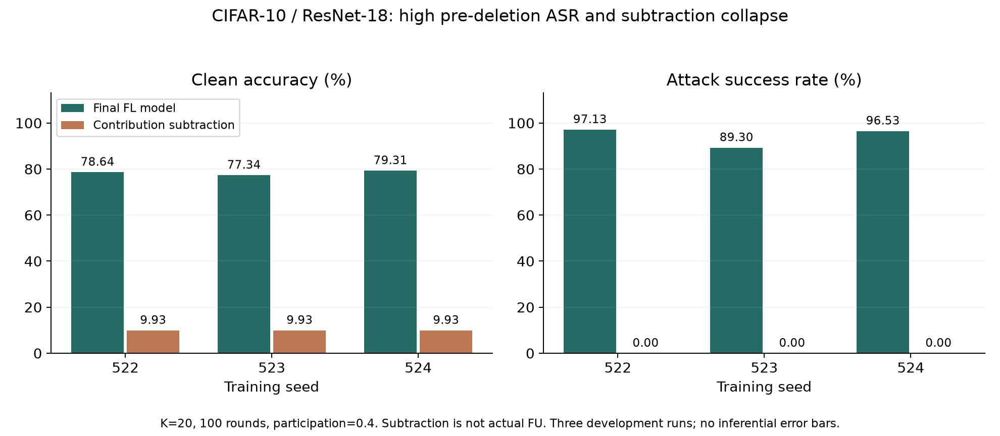

# BadFU_defend

FL에서 잠복하고 FU에서 활성화되는 백도어를 연구하는 실험 저장소입니다. **저장된 업데이트 이력과 삭제 요청을 함께 관측하면, 정상 non-IID 요청과 공격 활성화 위험을 단순 삭제 영향보다 더 잘 구분할 수 있는가**를 검증하고 있습니다.

현재는 탐지 검증 단계입니다. 모든 공격을 식별하는 알고리즘, 검증된 완전 방어 또는 학술 성과를 주장하지 않습니다.

## 현재 확인한 것

2026-10-15 기준, CIFAR-10/ResNet-18 공격 궤적 3개와 공격 없는 궤적 4개의 새 기록을 반영했습니다. CIFAR 공격 궤적은 최종 ASR이 89.30–97.13%로 이미 높고, 억제자 기여를 단순히 빼면 정확도가 9.93%로 무너집니다. 따라서 이 결과를 잠복 공격 검증 성공이나 ASR 0% 방어 성공으로 해석하지 않습니다. 새 독립 탐지 성능표는 아직 확인하지 못했습니다.

## 접근 방법

1. 클라이언트별 업데이트·참여 시점·집계 비중을 기록합니다.
2. 실제 삭제 요청이 과거 상쇄 관계의 어느 쪽을 얼마나 제거하는지 점수화합니다.
3. 독립 정상 궤적으로 보정한 뒤 단순 선형 삭제 영향과 탐지 성능을 비교합니다.
4. 탐지의 추가 가치가 확인되면 실제 FU 제어, 정상 효용, 망각 이행을 별도로 평가합니다.

장력이 크다는 사실만으로 악성을 판정하지 않습니다. 공개 입력에 신호가 없거나 한 클라이언트 내부의 기여가 합쳐져 있으면 현재 기록으로 구분하지 못할 수 있습니다. 시간 이력, 제약 최적화, FU 시뮬레이션 자체를 신규성으로 주장하지 않습니다.

## 문서와 근거

- [연구 요약: 문제·수식·결과·한계·다음 실험](docs/RESEARCH_SUMMARY.md)
- [수치 출처와 과거 주장 정정](docs/EVIDENCE_AUDIT.md)
- [논문별 다섯 항목 정리와 원문 링크](docs/paper_reviews/README.md)
- [현재 상태](docs/STATUS.md) · [실행 안내](RUN.md)
- [업로드된 원시 기록](FUBA/logs/trajectories/registry.json) · [자동 생성 장부](docs/EXPERIMENT_LOG.md)
- [그래프 재생성 코드](docs/plot_evidence.py) · [그래프 수치 CSV](docs/figures/trajectory_audit.csv)

## 과거 결과의 사용 범위

이전 README의 “완벽 재현”, “FPR/FNR 0%”, TEE 실증 및 논문 수준의 방어라는 표현은 현재 근거로 사용하지 않습니다. ASR 22.53→91.24%는 자체 MNIST 구현의 초기 로그이며, BadFU 공식 코드의 충실한 재현이나 별도 [badfu_2](https://github.com/sijoon-sung/badfu_2) 원본 재현 결과가 아닙니다. 기록은 출처 확인을 위해 보존합니다.

원 논문 결과와 우리 실험을 구분합니다. [BadFU](https://arxiv.org/abs/2508.15541)와 [FUBA](https://doi.org/10.1109/TAI.2025.3630110)는 선행 공격 연구이며 이 저장소의 출판 성과가 아닙니다.
