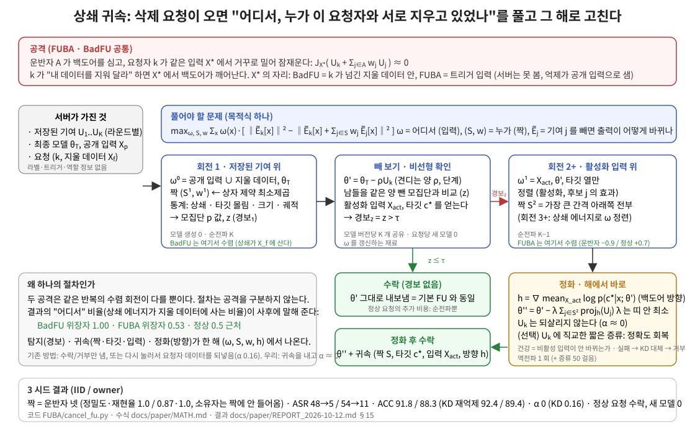

# BadFU_defend — 삭제 요청으로 깨어나는 백도어에 대한 연합 언러닝 방어

**2026-10-14 추가:** [장력→실제 FU 제어 알고리즘](docs/paper/TENSION_CONTROL.md), [주요 방어 논문의 문제·수식·수치·한계·신규성 논리](docs/paper_reviews/05_defenses_novelty.md), [단계 실험 실행](RUN.md). 제어/FedEraser 코어와11군 보정 단계 실행기를 구현했고 동작검사88개를 통과했다. 실제 트리거 관측에서는 장력 상위8좌표가 모두 실제 표적을 가리켰다. 전체 FU 성능·망각 및 단순 기준선 대비 이력의 추가 가치는 아직 미확정이다.

**현재 목표: FL에서 주입·억제를 함께 학습하고 FU에서 억제만 제거해 활성화하는 공통 공격 구조를 방어한다.** FUBA의 클라이언트 역할과 BadFU의 동일 클라이언트 내부 표본 역할은 같은 구조다. 핵심 후보는 학습 중 **기능적 장력을 기록하고 삭제 경계가 그 균형을 깨는지 계산하는 절차**다. [열린 원고 v7](docs/paper/draft_v7.tex) §§3–6이 현재 수학 명세다 (2026-10-14 구조 중심 수정).

**현재 구현과 근거:** `tension_audit.py`의 v3는 장력과 양·음 기여의 상대 삭제율을 결합한다. v2가 불완전 상쇄의 동일 비율 삭제에도 점수를 주는 반례를 수정했다. 기존 FUBA 캐시6개의 20/99시점 요청자·표적 동시1위는 v3 6/6, v2 5/6이며 정상 오탐률을 보정한 탐지율은 아니다. 동작검사69개 및 실제 저장 모델의 입력별 수집 스모크 통과. [RUN.md](RUN.md)의 예비18개/확인68개 실험을 준비했다. 원래 BadFU의 신뢰 가능한 묶음 기록과 실제 방어 검증은 남아 있다. 이전 soft 감사84조건은 비교군으로 보존한다.

## 무엇을 하려는가 (세 문장)
1. **공격.** 하나 이상의 운반 기여가 백도어를 심고, 억제 기여가 같은 입력에서 이를 잠재운다. 억제 기여를 지우면 백도어가 깨어날 수 있다. FUBA와 BadFU는 이 구조를 공유하지만 참여자 수·억제 방식·관측 가능한 입력은 다르다.
2. **방어.** FL 장부의 주입–억제 관계를 FU의 삭제·보존 경계와 연결한다. CCD의 학습 중 관측을 발전시키며, DOSE·soft 감사·공동삭제는 비교 또는 사후 효과 확인에 사용한다. 복구 후 보존·망각·잔여 공격 검증은 별도로 필요하다.
3. **실측 범위.** 기존 균형 장부는 FUBA 논문 설정 6 궤적에서 11–16 라운드에 6/6 경보, 위장자·운반자 넷 정확, 소유자 오제외 0, 제외 후 ASR 0.5 (R-013, R-010). 정상 학습에서 상쇄가 없거나 모든 잠복 공격이 공개 입력에 드러난다는 일반 보장은 아니다.

**잠복형 공격의 공통 과정 (실험용 확장):** [Structural Guard](docs/paper/STRUCTURAL_GUARD.md)는 관찰 → 누적 삭제 검사 → 잔존 기여 귀속 → 복구 → 독립 검증을 하나의 인터페이스로 연결한다. 단일/다중 주입자·억제자, 공개/삭제 입력, 클라이언트/데이터 묶음을 표현한다. 코어와 FUBA·BadFU 감산 감사 어댑터를 구현했으며, 실제 재학습과 망각 검증은 통합 callback이 필요하다. 기존 CCD 결과와 새 모듈의 검증 범위는 구분한다.

기본 실행은 **기존 CCD·DOSE·TRACE 계산을 재사용**한다. 새 코드의 주된 역할은 요청·관측 입력·연산자를 연결하고 완료 여부를 관리하는 것이다. 분포 전체 통계와 넓은 상쇄 후보는 선택적 실험 경로다.

**가칭 (앞으로 이 이름으로 부른다)**
| 가칭 | 하는 일 | 책임 |
|---|---|---|
| **균형 장부 (Balance Ledger)** | 학습 중 클래스별 누적 기여의 상쇄를 감시 | 기존 CCD, FUBA 설정의 후보 우선순위. 경보 없음은 안전 증명이 아님 |
| **DOSE** | 같은 삭제량 비교군을 이용한 누적 요청 검사 | 기존 위험 판정 유지. 망각 인증과는 별개 |
| **TRACE** | 기능 변화의 상대 기여 후보를 제한된 최소제곱으로 추정 | 후보 설명, 자동 공격자 확정/배제 아님 |
| **공동삭제 검증** (실험 옵션) | TRACE 선택 후 실제 네 모델을 별도 입력에서 비교 | `--paired_confirm`; 기존 경보를 취소하지 않고 추가 위험만 보류 |
| **장력·삭제 경계 점수** (현재 연구 후보) | 학습 중 가려진 부호 기여가 요청 경계를 가로지르는지 계산 | `tension_audit.py`; 언러닝 모델 생성 없음, 정상 보정·묶음 기록 통합 필요 |
| **삭제 반응 감사** (보조 비교군) | 동료 삭제 기준의 soft 흐름과 표적 선택·확인 | `--components response`; 시뮬레이션을 사용하며 본 연구의 핵심 신규성으로 제시하지 않음 |
| **DEFUSE** (폐기, R-011) | 짝의 기여에서 활성화 방향 성분만 빼서 띠 안으로 되돌림 | 삭제 이행 (요청자 기여 재주입 0, 잊힌 것 되가르치지 않음) |
현재 점수 명세: [draft_v7.tex](docs/paper/draft_v7.tex). 공통 처리기: [STRUCTURAL_GUARD.md](docs/paper/STRUCTURAL_GUARD.md). 보조 공동삭제: [PAIRED_AUDIT_MATH.md](docs/paper/PAIRED_AUDIT_MATH.md). ‘정상 상쇄 불가능’·오탐 확률 곱·되감기 망각 보장은 채택하지 않는다. 장력 가설을 유지하는 것과 이런 과도한 보장을 철회하는 것은 양립한다.

이전 균형 장부 설계 그림 (v7의 주 알고리즘 그림이 아님): [docs/paper/fig_architecture.svg](docs/paper/fig_architecture.svg)

## 기존 궤적 연구와 새 감사의 근거 범위

아래 CCD·복구의 기존 결과는 해당 프로토콜의 기록이다. v7 soft 후보의 다중 시드 또는 종단간 방어 성능으로 합산하지 않는다.
| 할 일 | 상태 |
|---|---|
| 공격 재현 (논문 설정 K=20, 100 라운드, 참여 0.4, 3 시드 × IID/owner) | **됨** (R-006): 잠복 ASR 5, 위장자 20 % 제거 ASR 72–74 |
| 학습 중 탐지 — 균형 장부 | **됨** (R-013): 6/6 경보 11–16 라운드, 위장자·운반자 넷 정밀도·재현율 1.0, 소유자 오제외 0, 오경보 0 |
| 기존 계열 비교 (9 계열 36 점수) | **됨** (R-009): 크기 기준은 소유자 오탐, 방향 기준은 운반자 못 봄 |
| 처방 — 연합 제외 | **됨** (R-010): ASR 0.5/0.6, 정확도 99. 되감기 이어 학습 노트북 1 시드 ASR 0.7 (R-014 예비) |
| 공격 없는 궤적의 오경보 | **비어 있음** (R-015): RUN.md 0-b `ONLY=clean_paper bash make_trajectories.sh` |
| 큰 모델 (CIFAR-10/resnet18) | **비어 있음**: RUN.md 0-b `ONLY=k20_paper_cifar bash make_trajectories.sh` |
| BadFU | **경계** (R-017): 노트북 15 라운드 궤적에서 장부가 상쇄를 못 봄 → 40 라운드 시드로 재확인, 안 보이면 요청 시점 빼 보기로 보완 |
| 공동삭제 검증 | 42개 실제 요청/비율 감사 + 699개 합성 에피소드. FUBA 추가 신호, BadFU pairing 실패, 정상 반대 기여 반례 포함. 실제 학습 시드는 자료당 1개 |
| 삭제 반응 감사 | 84조건, 기존/새 입력 분리. FUBA .10 추가신호, .05 미검출, BadFU 개선 없음. 동작검사47개 통과 |
| 초안 | [draft_v7.tex](docs/paper/draft_v7.tex), [재설계 보고서](docs/paper/DEFENSE_LOGIC_REDESIGN.md) |

## 어디부터 읽나
| 문서 | 내용 |
|---|---|
| [docs/STATUS.md](docs/STATUS.md) | **어디까지 됐나**: 끝난 것(번호), 돌아가는 것, 비어 있는 것(명령·시간), 초안에서 아직 정확하지 않은 곳 |
| [docs/paper/draft_v3.tex](docs/paper/draft_v3.tex) | **LaTeX 초안** (XeLaTeX + kotex; Overleaf 에서 컴파일) |
| [docs/paper/EXTENSIONS.md](docs/paper/EXTENSIONS.md) | **지금 알고리즘과 확장 방안** E1–E10 (안전 집계 대응, 상쇄 그래프, 입력 단위 상쇄, 순차 검정, 표적 가정 완화, 강건 집계 결합, 대응 세분화, 적응형 실측, 이론, 규모) 과 순서 |
| [docs/paper/brief_prof.tex](docs/paper/brief_prof.tex) | **교수님 브리프**: FL→FU 공격 부류의 정의(정의 1, 두 필요조건), 공격 논문 7 편의 위치, 두 층 방어(학습 중 CCD + 요청 시 상대 부분 제거), 실험 요약, 적응형·다중 공격 trade-off (그림), 발전 방안. PDF `brief_prof.pdf` |
| [docs/paper/draft_v7.tex](docs/paper/draft_v7.tex) | **현재 원고**: 공통 FL→FU 구조 → 장력 → 삭제 경계 → 조건부 분석 → 학습 캐시 실측. soft 감사는 부록 |
| [docs/paper/DEFENSE_LOGIC_REDESIGN.md](docs/paper/DEFENSE_LOGIC_REDESIGN.md) | 이전 soft 중심 개정 기록과84조건. 핵심 방향에서 벗어난 판단은 머리말에서 정정 |
| [docs/paper/draft_v6.tex](docs/paper/draft_v6.tex) | 이전 공동삭제 중심 원고. 해당 실측은 유지하며 주 서술은 v7로 변경 |
| [docs/paper/REVISION_REPORT.md](docs/paper/REVISION_REPORT.md) | **개정 안내**: 제거/추가 제안, 실제 결과, 남은 실험, 재실행 명령 |
| [docs/paper/draft_v5.tex](docs/paper/draft_v5.tex) | 과거 원고. 성립하지 않는 명제/과도한 주장은 v6에서 철회 |
| [docs/paper/DRAFT_v4.md](docs/paper/DRAFT_v4.md) | 과거 쉬운 말 원고. 현재 주장 범위는 v6 참조 |
| [docs/paper/DRAFT_v3.md](docs/paper/DRAFT_v3.md) | **논문 초안 v3**: 조사한 방어 논문들의 전개(문제 → 틈 → 기제 → 불변량 → 점수 → 판정 → 대응 → 분석 → 평가 → 한계)로 쓴 전체 초안, 그림 1·2, 결과 번호 대응 |
| [docs/paper/CONSOLIDATED.md](docs/paper/CONSOLIDATED.md) | **한 번에 정리**: 두 단계로 줄인 알고리즘(균형 장부 → 경보 시점 되감기+연합 제외), 실측 통계 표 1–5, 정화 결정 |
| [docs/paper/PLAIN_SUMMARY.md](docs/paper/PLAIN_SUMMARY.md) | **쉬운 말 요약**: 문제·확인한 사실·균형 장부·결과·논문 한 줄 |
| [docs/paper/HOW_OTHERS_EXPLAIN.md](docs/paper/HOW_OTHERS_EXPLAIN.md) | MASA·FLDetector·FLAME·DeepSight 본문에서 가져올 도출 과정과 가져오면 안 되는 보장 |
| [docs/paper/ALGORITHMIZATION.md](docs/paper/ALGORITHMIZATION.md) | 현재 방향 정정 및 이전 soft 비교군의 수학 기록. 장력 수학은 v7 참조 |
| [docs/paper/BRIEFING_2026-10-13.md](docs/paper/BRIEFING_2026-10-13.md) | **지금까지의 결과 브리핑** (공격 재현, 탐지 총정리, 처방, 학습 중 탐지, 발견 셋, 코드·문서, 확인 상태, 남은 약점) |
| [docs/paper/DRAFT_v2_SKELETON.md](docs/paper/DRAFT_v2_SKELETON.md) | **초안 v2 뼈대**: 주장 한 문장, 위협 모델 다섯 줄, 표 1–5 (논문 설정 K=20 값 채움), 한계, 해독제 실패 원인, 할 일 |
| [docs/paper/PLAN.md](docs/paper/PLAN.md) | **앞으로의 계획**: 실험 기록 체계(장부 2개), Phase 0–5 와 관문, 6주 일정, 위험, 사용자가 정할 것 3개 |
| [docs/paper/RELATED_METHODS.md](docs/paper/RELATED_METHODS.md) | **기존 방법 전체 목록** (공격 / 집계 방어 / 언러닝 연산자 / 요청 심사 / 사후 정화 / 복구): 가정, 잠복형 적용 여부, 우리 근거 상태, 공식 코드 |
| [docs/paper/WHY_EXISTING_FAIL.md](docs/paper/WHY_EXISTING_FAIL.md) | **기존 방법이 왜 안 되는가**: 집계 방어·언러닝 연산자·요청 심사·사후 정화·재억제, 계열별 기전·근거·상태 + 우리가 버린 시도들 |
| [docs/paper/ZERO_BASE_REVIEW.md](docs/paper/ZERO_BASE_REVIEW.md) | **원점 검토**: 문제·출발점·주장 10 개와 근거·실험 체계·판정·할 일 (쉬운 말) |
| [docs/paper/ALGORITHM.md](docs/paper/ALGORITHM.md) | **정본**: DOSE·TRACE·DEFUSE 의 알고리즘 정식화, 가정 S1–S6·T1–T5·O1–O6, 결정표, 파라미터, 비용 |
| [docs/paper/METHOD.md](docs/paper/METHOD.md) | 방법 v3 설명: 상쇄 짝 찾기 (저장 기여 위 짝 찾기 → 빼 보기 → 활성화 위 짝 찾기 → 짝의 상쇄 성분 제거). 코드 `FUBA/cancel_fu.py` |
| [docs/paper/THREAT_MODEL.md](docs/paper/THREAT_MODEL.md) | 공격의 틀 (상쇄형 백도어, 해로운 삭제 요청) |
| [docs/paper/REPORT_2026-10-12.md](docs/paper/REPORT_2026-10-12.md) | 지금까지의 실험 결과 보고 |
| [docs/paper/DRAFT_v1.md](docs/paper/DRAFT_v1.md) | **논문 초안 v1** (초록·기여·방법·결과·한계 + §8 노벨티 자가 평가와 보강 방향) |
| [docs/paper/DRAFT_OUTLINE.md](docs/paper/DRAFT_OUTLINE.md) | 논문 초안 기획 (이전) |
| [RUN.md](RUN.md) | 실험 돌리는 법 |
| [BRANCHES.md](BRANCHES.md) | 브랜치 (헤지 파일럿은 `exp/hedge-pilot` 브랜치) |

## 폴더
| 폴더 | 내용 |
|---|---|
| `FUBA/` | 실험 코드 (FUBA 공격 코드 + 우리 방어·비교군·러너). 스크립트 지도는 `FUBA/README.md` |
| `BadFU_src/` | BadFU 공격 코드 (로컬 궤적은 gitignore) |
| `docs/paper/` | 논문용 문서 (방법, 위협 모델, 자리매김, 실험 설계, 보고, 리뷰, 표) |
| `docs/paper_reviews/` | 선행 논문 정리 4 편 |
| `docs/archive/` | 지나간 설계 문서 (design/) 와 FUBA 쪽 옛 기록 (fuba/) |
| `legacy/` | 초기 탐색 코드·결과 (main 시절). 참고용 |

## 기존 궤적·균형 장부 실행 순서 (현재 감사 후보는 RUN.md 첫머리)
1. 궤적 만들기·검증: `cd FUBA && bash make_trajectories.sh` (RUN.md 0). 큰 모델·공격 없는 궤적: `ONLY=k20_paper_cifar`, `ONLY=clean_paper` (RUN.md 0-b)
2. **균형 장부 (본 방법)**: `bash run_ledger.sh` → `logs/ledger/summary_*.md` (RUN.md A-03). CIFAR 는 `DATASET=cifar10 TAG=_r100w5_k20paper_cifar`, 공격 없음은 `PREFIX=clean`
3. 대응 (되감기 + 연합 제외): RUN.md A-03 대응 블록 (R-014). 처음부터 제외 재학습: RUN.md A-01 (R-010)
4. 비교군: 탐지 총정리 `bash run_detect_bench.sh` (A-00), 동적 평형 지문 (A-02)
5. 부록 (요청 시점 절차 DOSE·TRACE·DEFUSE): RUN.md A-0
`run_paper.sh` 는 K=8 예비 파이프라인이다 (부록용).
