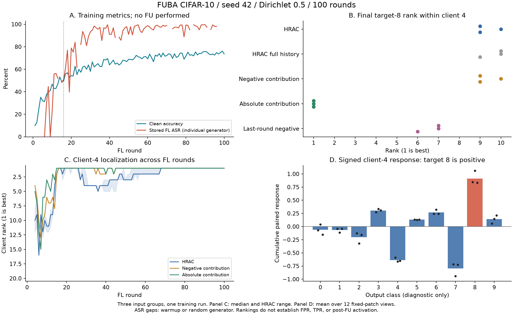
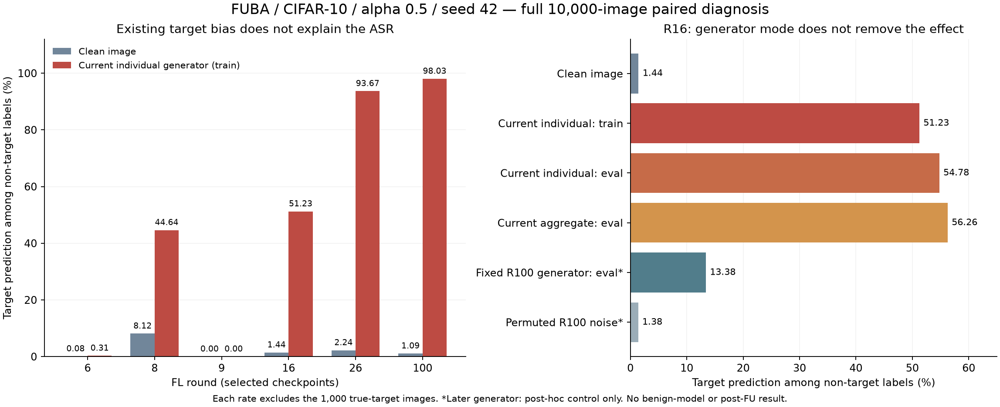

# 이력–요청 기여 일관성 (HRAC)

2026-10-16. 사용자의 방향을 구체화한 **구현 및 검증 단계의 알고리즘**이다. 대상은 FL→FU 백도어이며, 관측된 기여 상쇄와 요청의 설명 가능성을 함께 검사한다. 악성 의도의 완전 식별이나 두 공격에 대한 검증 완료를 주장하지 않는다. [수학적 점수](../FUBA/hrac.py) · [두 채널 공통 요청 검사](../reproduction/hrac_request_gate.py) · [실행](../RUN.md) · [궤적 상태](TRAJECTORIES.md).

**연구의 중심은 H–U의 일관성이다.** BadFU와 FUBA를 서로 다른 검사법으로 분기하지 않고, 같은 요청에 inter와 intra를 모두 연결한다. 이전 무라벨 BadFU 실험은 이 중 inter 관측을 검증한 것이며 HRAC 전체의 실증으로 확대하지 않는다. 현재 FUBA 실행기도 두 채널 상태를 별도로 출력한다. intra 자료가 없으면 미관측으로 남기며, 낮은 점수나 정상 통과로 대체하지 않는다.

**삭제 단위부터 구분한다.** FUBA는 억제 역할 클라이언트 전체, BadFU 원논문은 한 클라이언트 내부의 위장 샘플이 삭제 대상이다. 지금 분석한 BadFU `full6`는 위장 자료를 별도 client 5에 놓은 저자 코드 실행이다. 이 실행의 클라이언트 간 관계를 원논문의 샘플 선택 삭제 검증으로 확대하지 않는다. [삭제 경계와 이번 시계열 분석의 범위](#삭제-단위와-관계-시계열-재검토--2026-10-16).

## 논문을 설명하는 현재 문장 — 2026-10-16

본 연구는 연합학습에서 형성된 백도어가 이후 삭제 요청과 상호작용하는 FL→FU 공격을 대상으로 한다. 정상 Non-IID 클라이언트도 서로 다른 방향의 업데이트를 만들 수 있으므로, 업데이트의 크기나 집단 평균과의 거리만으로 악성 의도를 판정하기는 어렵다. 우리는 삭제 요청이 특정 학습 기여를 선택적으로 제거한다는 점에 주목하여, **기록된 클라이언트 기여와 요청 대상의 관계를 검사하는 HRAC**를 연구한다.

서버가 보관한 개별 업데이트를 공개 이미지에서 평가하되, 같은 이미지의 원본과 사전에 정한 패턴 적용본 사이의 반응 차이를 측정한다. 이 관측을 통해 일반적인 과제 학습과 함께 나타나는 변화에서 패턴에 따른 변화를 분리해 보고, 삭제 대상이 과거 기여 관계의 어느 부분을 제거하는지 검사한다. 공개 검사 이미지·개별 이력·삭제 대상 식별이라는 정보 가정을 명시하며, 탐지에 정답 트리거·공격 표적·FU 실행 결과를 사용하지 않는다.

현재 실험에서는 이 입력 쌍 관측이 BadFU와 FUBA의 삭제 대상 후보 순위를 개선했다. 그러나 단순 기준선도 같은 후보를 찾았고 FUBA에서는 HRAC의 표적 방향 순위가 낮았다. 따라서 현재 결과는 **요청을 평가하기 위한 관측 방식의 가능성**을 지지하며, HRAC 점수의 우월성·정상 Non-IID와의 완전 분리·잠복 상태의 조기 경보를 입증한 결과는 아니다. 검증해야 할 기여는 동일한 정보와 정상 오탐 수준에서 이력–요청 관계가 단순 기여량보다 추가적인 판별력을 제공하는가이다.

### 이미 추가한 조건과 아직 추가하지 않은 조건

| 정보·조건 | 현재 사용과 확인된 역할 | 범위와 비용 |
|---|---|---|
| 클라이언트 ID별 업데이트, 집계 비중, 참여 라운드, 모델 상태 | 이미 기록·사용. 요청자와 다른 참여자의 기여 관계를 계산 | 개별 업데이트 관측·저장 필요. secure aggregation만 있는 환경에는 그대로 적용 불가 |
| 삭제 대상 ID·시점·비율 | 이미 요청 게이트에 연결. 현재 본 실험은 선언한 클라이언트 전체 삭제 후보 | 독립적인 샘플 삭제 효과를 관측한 것과 다름 |
| 공개 이미지와 모델 전처리 | 이미 탐지에 사용. 클라이언트 원본 이미지는 탐지 입력으로 받지 않음 | 공개 이미지가 관련 기능을 충분히 드러낸다는 관측 가정 필요 |
| 같은 이미지의 패턴 유무 비교, 사전 고정된 패턴·위치 | 이미 사용. 깨끗한 입력만 볼 때보다 후보 순위 개선 | 이득이 확인된 관측 변경. 임의 트리거 전부를 관측한다는 보장 없음 |
| 공개 이미지의 정답 라벨·진짜 공격 생성기 | 최근 ASR 원인 진단에만 사용 | 현재 무라벨 탐지기의 가정으로 소급하지 않음 |
| 클라이언트별 클래스 수 | 업로드된 학습 분할의 사후 진단 정보 | 현재 점수는 사용하지 않음. 실환경에서는 검증 가능한 출처가 필요 |
| 데이터 묶음별 이력과 독립 요청 기여 | intra 계산 코드는 있으나 이번 실제 실험에는 없음 | 자료가 없으면 미관측. 클라이언트 합계로 복원한 척하지 않음 |
| 독립 정상 실행을 통한 경보 보정 | 보정 코드·조건부 수학적 근거는 있으나 이번 실험에 보정 자료 없음 | 순위 결과를 FPR·TPR이나 확정 경보로 표현하지 않음 |

**추가 정보의 사용은 이미 방법의 일부다.** ‘조건이 전혀 없는 탐지’로 설명하거나, 소량의 공개 자료를 허용한 것을 새로 처음 제안한 것으로 설명하지 않는다. 이전 개발 실험에도 라벨 proxy·정상 방향 보정이 있었다. 이번 최신 FUBA 본 실험에서 실제로 쓰인 정보와 앞으로 시험할 정보를 구분한다.

### 다른 방어 논문에서 가져오는 설명의 구조

| 선행 연구의 설계 논리 | 우리 논문에 적용할 설명 | 그대로 주장할 수 없는 부분 |
|---|---|---|
| [FLTrust](https://www.ndss-symposium.org/ndss-paper/fltrust-byzantine-robust-federated-learning-via-trust-bootstrapping/): 신뢰 기준 부재 → 작은 깨끗한 서버 자료 → 기준 업데이트와 비교 | 추가로 가진 정보가 무엇이며 어떤 모호함을 줄이는지 먼저 명시 | 공개 자료를 추가하는 것 자체의 신규성 |
| [FLShield §IV-C](https://arxiv.org/html/2308.05832v1#S4.SS3): 데이터 구성에 따른 검증 혼동 → 클래스별 손실 변화 → 검증 보고 비교 | 전체 평균에서 어떤 신호가 가려지는지 보이고 관측 단위를 정당화 | 클래스별 검사가 모든 feature skew·잠복 백도어를 해결한다는 주장 |
| [MASA §4](https://arxiv.org/html/2411.01040v1#S4): 정적 통계 중첩 → 개별 망각 동역학 → 모델 융합으로 정상 이질성 완화 | 새 관측의 판별력과 정상 이질성 완화의 효과를 각각 소거 | 개별 망각을 수행하는 MASA를 우리 FU 없는 관측과 동일시 |
| [BackdoorIndicator §3](https://arxiv.org/html/2405.20862v1#S3): 수동 관측 부족 → 서버 지표 과제 주입 → BN 교란 통제 | 패턴이 공격 기능을 볼 수 있는지 확인하고 관측 밖의 공격을 인정 | 우리 패턴 검사도 학습 과정에 지표 과제를 주입한 것으로 설명 |
| [FedREDefense](https://proceedings.mlr.press/v235/xie24c.html): 다수와의 유사성 한계 → 개별 업데이트의 학습 재구성 | HRAC가 비교하는 정상성 기준을 ‘요청 제약에 맞는 기여’로 구체화 | 정상 학습으로 재구성 가능하면 악의가 없다는 결론 |

논리 전개는 **FL→FU의 선택적 삭제 문제 → 필요한 관측 조건 → 요청에 연결한 기능 기여 → 관측과 점수의 소거 → 정상 조건에서의 한계**로 고정한다. 문헌의 가정을 수용하는 것과 성능 증거를 승계하는 것은 다르다. 상세 검토는 [방어 논문 통합본](paper_reviews/05_defenses_novelty.md)에 유지한다.

## 1. Problem Statement

삭제 영향의 크기만 보면 정상 Non-IID의 선택적 삭제와 공격 요청을 혼동할 수 있다. 반대로 정상 삭제가 전체 기여와 비례한다고 가정해도, 특정 클래스만 삭제하는 정상 요청을 잘못 판정한다. 필요한 질문은 다음과 같다.

1. 요청이 과거에 상쇄되던 기여 중 한쪽을 선택적으로 제거하는가?
2. 독립적으로 관측한 요청 기여를, 소유권·삭제량·삭제 단위에 맞는 과거 기여 조합으로 설명할 수 있는가?

FUBA의 역할 분리형 및 BadFU 공개 코드의 6클라이언트형은 클라이언트별 이력으로 첫 질문을 검사할 수 있다. BadFU 본문의 클라이언트 내부 샘플 삭제에는 내부 기여 기록이 필요하다. FedUBA의 민감한 샘플 선택·요청 특징 조작은 두 번째 질문의 후속 평가 대상이며, 이번에 FedUBA 실행을 재현하지 않았다. [BadFU 원문](https://arxiv.org/html/2508.15541v1) · [FUBA 저자 코드](https://github.com/stcebra/FUBA) · [FedUBA 원문 §IV–V](https://www.chenwang.net.cn/publications/FedUBA-TDSC26.pdf).

### 관측 조건

- 서버가 클라이언트별 업데이트, 실제 집계 가중치, 참여 라운드와 요청 대상 ID를 볼 수 있어야 한다. 개별 기여를 숨기는 secure aggregation은 별도 관측 장치 없이 지원하지 않는다.
- 이력은 합계 한 벡터가 아닌 $H=\{z_{a,t}\}$로 유지한다. $a$는 실제 기록된 클라이언트 또는 데이터 묶음이다. 모든 $z$는 같은 입력·출력 좌표를 사용한다.
- 현재 캐시는 **양의 실제 FL 업데이트를 적용했을 때의 유한 출력 차이**이다. Jacobian/Fisher의 정확한 추정이나 정확한 FU 인과 기여가 아니다. 이 근사를 숨기지 않는다.
- 대내 검사에는 과거 원자 기여 $A_i$와 **별도로 관측한** 요청 기여 $u$가 필요하다. $u=A_iq$를 같은 로그에서 만들어 넣으면 자기 자신을 확인할 뿐이므로 독립 검증으로 세지 않는다.
- 샘플/묶음 기록이 없는 클라이언트 합계를 임의로 쪼개 과거 샘플 기여로 사용하지 않는다. 현재 저장 자료의 이력 분석은 계속 가능하다.

## 2. Key Idea & Formulation

### A. 삭제 경계의 선택적 상쇄 제거 — 기존 v3 재사용

사전 고정한 이력 창 $W$와 기능 좌표 $c$에 대해 $h_{a,c}=\sum_{t\in W}z_{a,t,c}$를 계산한다. 요청의 삭제 비율을 $r_a\in[0,1]$라 두고,

$$P_c=\sum_a[h_{a,c}]_+,\quad N_c=\sum_a[-h_{a,c}]_+,$$
$$P_{D,c}=\sum_a r_a[h_{a,c}]_+,\quad N_{D,c}=\sum_a r_a[-h_{a,c}]_+,$$
$$s_{\rm inter,c}=\frac{2\min(P_c,N_c)}{P_c+N_c}\min(P_c,N_c)
\left[\frac{N_{D,c}}{N_c}-\frac{P_{D,c}}{P_c}\right]_+.$$

분모가 0이면 해당 항은 0이다. 양·음 기여의 같은 비율을 제거하면 점수는 0이다. 부호를 보존하므로 단순 에너지 스펙트럼과 다르다. 이 점수는 **기존 구현의 재사용**이며 새로운 수식으로 주장하지 않는다.

HRAC에서는 전체 이력·최근 10·최근 20라운드 창의 최대를 취한다. 초기 ledger 분석은 10/20/40/마지막 라운드, 기록 단위별 전체 삭제와 전체 단위 삭제를 검사했고 클래스 평균 관측을 사용했다. 이후 무라벨 검증기는 이미지 평균 logit의 입력 쌍 차이를 사용하며 모든 접두 라운드를 진단 표에 남긴다. 요청 게이트는 별도로 선언한 요청·시점만 평가하며, 기본값은 최종 라운드의 각 참여 클라이언트 전체 삭제다. **보정에는 실제로 검사한 클래스·창·변환·요청·시점을 모두 포함한 학습 실행별 최대값**을 써야 한다. 관측이나 검사군을 바꾸면 예전 보정을 재사용하지 않는다. 창 추가 자체는 신규성의 근거로 삼지 않는다.

### B. 요청의 기여 설명 가능성 — 제약 최적화

요청자의 과거 원자 기여를 열벡터로 둔 $A=[h_1,\ldots,h_m]$와 가능한 삭제 집합

$$\mathcal Q=\{q:\ell\le q\le v,\ Bq=b\},\qquad 0\le\ell\le v\le1$$

을 정의한다. 정확한 삭제 ID를 알면 해당 $q$를 0 또는 1로 고정한다. 데이터 묶음의 표본 수 또는 클래스별 삭제량을 아는 경우 $Bq=b$로 제한한다. 연속 $q$는 명시한 기여 근사하의 분할 삭제/볼록 완화이며, 묶음 내부의 임의 샘플이 정확히 그 비율로 기여한다는 주장이 아니다.

독립적으로 관측한 요청 $u$의 점수는

$$s_{\rm intra}=\min_{q\in\mathcal Q}(u-Aq)^\top C_\lambda^{-1}(u-Aq).$$

기본 척도는 $C=AA^\top/m$, $C_\lambda=C+\lambda\max(\operatorname{tr}(C)/d,\epsilon)I$, $\lambda=10^{-3}$이다. 이는 **이력의 이차 모멘트로 만든 거리 척도**이며 Fisher라고 부르지 않는다. 별도의 정상 자료에서 고정한 공분산도 코드 입력으로 허용하되, 테스트 결과로 선택하면 기존 보정은 승계되지 않는다.

수학적 근거:

- $H_0:u=Aq+\varepsilon,\ q\in\mathcal Q$와 자유 평균 대립가설을 가우시안 오차 모형에서 비교하면, 위 최소 잔차는 분산 상수 배를 제외한 일반화 우도비 통계량이다. 기본 $C$가 실제 오차 공분산이라는 사실은 보장하지 않는다. 경보 보정에는 가우시안 가정이 필요하지 않다.
- 정상 요청의 실제 $q_0\in\mathcal Q$이면 $s_{\rm intra}\le\varepsilon^\top C_\lambda^{-1}\varepsilon$이다. 따라서 정상 요청이 전체 이력과 평행할 필요가 없다.
- $vv^\top=(-v)(-v)^\top$이어도, 양의 삭제 계수와 소유권 제약 때문에 $v$와 $-v$의 설명 가능성은 달라질 수 있다.
- **정당한 위장 샘플 삭제는 이 집합 안에 있을 수 있다.** 이때 대내 점수가 낮은 것은 예상되는 동작이며 대외 검사와 함께 평가해야 한다. 두 채널 모두 정상과 관측이 같다면 식별할 수 없다.

볼록 이차 최적화를 풀고, 별도 선형 최적화로 $g=\nabla f(q)^\top q-\min_{v\in\mathcal Q}\nabla f(q)^\top v$를 계산한다. 볼록성에 의해 $f(q)-g\le f^*\le f(q)$이다. 구현은 수치 허용오차 내에서 이 간격을 검사하고, 경보 점수에는 하한을 사용한다. 미수렴은 오류로 반환한다. 빈 $\mathcal Q$는 요청 메타데이터 불일치이며 공격 판정으로 세지 않는다.

### C. 정상 실행으로 두 검사를 보정

같은 사전 정의 조건(데이터·모델·Non-IID·관측 방법·삭제 단위)의 독립 정상 실행 $n$개에서 채널별 실행 최대 $S_{1,c},\ldots,S_{n,c}$를 수집한다. 테스트 실행 $S_c$에 대해

$$p_c=\frac{1+\sum_{j=1}^n\mathbf1[S_{j,c}\ge S_c]}{n+1},\qquad
p_{\rm joint}=\min(1,2\min(p_{\rm inter},p_{\rm intra})).$$

$p_{\rm joint}\le\alpha$일 때 경보한다. 동일 조건의 정상 실행들이 교환 가능하고 점수·검사군을 미리 고정했다면, 순위 검정과 합집합 부등식으로 **주변적 실행 단위 오탐 확률**이 $\alpha$ 이하이다. 채널·클라이언트·라운드 간 독립성은 요구하지 않는다. 라운드를 독립 보정 표본처럼 세지 않는다. 이 보장은 특정 보정 집합을 고정했을 때 모든 미래 표본의 FPR 상한이나 분포 변화 하의 보장이 아니다.

두 채널, $\alpha=.05$에서 유한 경보 임계값에는 최소 정상 보정 실행 39개/조건이 필요하다. 부족하면 `insufficient_clean_episodes`다. 대내 관측이 없으면 `unobserved_channel`이고, 대외에서 유의한 양성 경보가 난 경우 외에는 전체 판단을 `null`로 둔다. 없는 검사를 정상 통과로 바꾸지 않는다.

### D. 입력 쌍의 기여 차이 — 이번 관측 개정

정상 클래스 학습 효과가 패턴 조건부 기여를 가릴 수 있으므로, 같은 이미지 $x$와 고정 변환 $P_gx$에서 **실제 양의 업데이트 효과의 차이**를 기록한다. 중심화한 logit을 $\ell$, 실제 집계 가중치를 $p_{i,t}$라 두면,

$$d_{i,t}(x)=\ell(w_t+p_{i,t}\Delta_{i,t},x)-\ell(w_t,x),$$
$$z^{(g)}_{i,t}=\frac1n\sum_{x\in X}\left[d_{i,t}(P_gx)-d_{i,t}(x)\right].$$

두 조건에 공통으로 나타나는 성분은 이 차이에서 상쇄된다. 이는 업데이트와 입력 변환의 상호작용을 측정하는 유한 차이이며, 정상 Non-IID의 모든 효과를 제거한다는 정리는 아니다. 정상 특성이 변환에 반응하면 그 효과도 남는다. 각 라운드의 기록된 BN 버퍼를 고정하며, 클라이언트 제거·FU·모델 재학습 없이 계산한다.

고정한 변환군 $g$, 출력 클래스, 이력 창 각각에서 A의 기존 점수를 계산하고 최대를 취한다. 삭제 요청은 실제 요청 대상의 $r_a$로 연결한다. 이번 비교에서는 여섯 클라이언트의 전체 삭제 요청을 각각 검사했다. **요청별 부호를 유지하는 것이 단순한 크기 비교와의 차이**지만, 복잡한 점수 자체의 우월성은 별도 기준선으로 검증해야 한다. 정상 실행으로 경보를 보정할 때도 변환군을 포함한 전체 최대값을 사용해야 한다.

비교 실험에는 JVP와 정상 클래스 그래디언트 부분공간도 포함했다. 별도 정상 이미지 80개로 만든 10개 방향의 응답을 $B$라 하고, 정상 입력 절반에서 $\hat q=\arg\min_q\|J\Delta-Bq\|^2$를 구한 뒤 다른 절반의 모든 입력 조건에 같은 계수를 적용한다. 두 절반을 교차하고 잔차를 관측한다. 정답 트리거 응답·공격 역할은 적합에 사용하지 않는다. 이 보정은 정상 한 단계 학습을 근사하며 현재 주 방법의 필수 구성으로 채택하지 않았다.

### E. BadFU와 FUBA의 동일 요청 검사 경로

`validate_hrac_requests.py`가 두 공격의 관측 묶음을 읽고 같은 `hrac_request_gate.evaluate`에 `(H, U)`를 전달한다. 공격 이름은 입력 형식을 읽는 데만 사용한다. inter와 intra의 수식·판정은 공격별로 바꾸지 않는다. FUBA의 실제 참여 ID와 집계 가중치, 모델과 전처리는 관측 단계에서 맞춘다.

요청마다 inter와 intra를 독립적으로 기록한다. `u`를 별도로 관측했고 요청자의 과거 원자가 있으면 B의 제약 최적화를 수행한다. 각 원자의 소유권·질량·삭제 범위를 확인하고, 소유자별 총 삭제 질량을 요청 비율과 일치시킨다. 원자와 요청은 같은 관측 식별자·좌표계·요청 시점을 참조해야 한다. 이 선언은 감사용 출처이며 실제 원자 수집의 정확성을 증명하는 암호학적 장치는 아니다.

현재 클라이언트 단위 궤적에는 내부 원자와 독립 요청 효과가 없으므로 **실제 intra 관측은 미완료**다. 공동 게이트는 이를 `null`로 남긴다. 정상 클래스 선택 삭제의 허용, 소유권 위반 거부, 전체 삭제 질량, 부호 반전은 합성 단위 검사로 확인하며 실제 FedUBA 탐지 결과와 구분한다. `u=Aq`를 같은 로그에서 만들어 잔차 0을 얻는 실험은 성능 근거가 될 수 없다.

## 3. Evaluation & Results

실제 저장 궤적을 읽었고 새 공격 학습·FU는 하지 않았다. 기존 모델의 ASR 재평가는 아래 사후 평가에 별도로 기록했다.

| 검증 | 결과 | 해석 |
|---|---|---|
| FUBA MNIST 개발 궤적 6개, 마지막 기록 라운드 | HRAC 대외·기존 v3 요청자+표적 1위 모두 6/6; 선형 기준선 4/6 | 기존 결과 유지. v3 대비 개선 증거 아님 |
| BadFU 공개 코드 6클라이언트형, 저장 15R, 깨끗한 입력 80개 | 주 분석 1위 정상 client 2 / class 0. 실제 요청자 client 5는 5위, 최고 좌표 class 7 | 현재 대외 점수가 이 실행의 공격자를 1위로 식별하지 못함. 궤적 생성 오류라는 뜻 아님 |
| BadFU 관측 방식 진단 12설정 × 2점수 | 입력별 점수 후 평균·logit 좌표를 포함해 요청자 5는 5~6위 | 사후 진단이며 좋은 설정만 골라 성공으로 보고하지 않음 |
| 실제 궤적의 대내 검사 | 독립 요청 기여·내부 원자 기록 미확보 | 실제 BadFU/FedUBA 탐지 성능 미측정 |
| 합성 원자, 정상 보정 99개 + 정상 시험 200개/조건 | 균형 조건 경보 12/200(6.0%, 95% CI 3.14–10.25%); 클래스 집중 조건 3/200(1.5%, CI .31–4.32%) | 정상 선택 삭제를 허용하는 모형의 검사. 유한 시험에서 5% 이하가 항상 나온다는 주장이 아님 |
| 같은 크기·이차 모멘트를 가진 부호 반전 요청 | 합성 두 조건 각각 200/200 경보; 요청 크기 기준선 각각 6/200·8/200 | 구성한 대립가설 검증. FUBA/BadFU 공격 성공률이나 탐지율로 인용 금지 |

원본: [FUBA replay](../FUBA/logs/hrac/fuba_replay_v1.json), [BadFU replay](../FUBA/logs/hrac/badfu_replay_v1.json), [BadFU 진단](../FUBA/logs/hrac/badfu_measurement_ablation_v1.json), [합성 검사](../FUBA/logs/hrac/synthetic_stress_v1.json). 모든 결과에는 코드 해시가 있고 실제 자료에는 입력 해시가 있다. 합성 검사에서 대외 채널은 0으로 고정했으므로 대내 분기만 검증한다. 실제 정상 궤적 부족으로 실제 공격의 보정된 FPR/TPR은 보고하지 않는다. 기존 76개와 새 19개를 포함한 테스트 95개가 통과했다. 테스트 수를 성능 표본 수로 세지 않는다.

### BadFU 미식별 요청의 사후 평가 — 2026-10-15

탐지 캐시와 기존 FU 실험의 manifest·데이터 해시를 연결하고, 저장 모델을 다시 평가했다. 새 학습이나 FU는 실행하지 않았다. [재평가 원본](../FUBA/logs/hrac/badfu_retrospective_v1.json), [재현 스크립트](../FUBA/diagnose_hrac_badfu.py).

| 저장 모델 | ASR (원래 비표적 클래스 512개) | 정상 정확도 |
|---|---:|---:|
| 최종 FL, glob_14 | 24.02% | 87.89% |
| FU 한 단계의 실제 시작 모델, round_14의 gm | 21.88% | 87.50% |
| 요청자 5 제거, 무방어 FU 한 단계 후 | 91.02% | 75.98% |
| 정상 client 1 제거, 같은 FU 한 단계 후 | 74.02% | 76.56% |

**확인된 범위:** 현재 HRAC 주 분석이 5위로 둔 요청자 5에 대해, 저장된 FU 한 단계 뒤 높은 ASR이 재현됐다. 같은 공격 포함 궤적에서 정상 요청 뒤에도 ASR이 상승했다. 이 FU는 기존 `request_pipeline`의 BN 재보정·1 epoch/2 batch·한 이벤트 변형이다. 저자 전체 FedEraser나 완전 삭제의 검증으로 인용하지 않는다. 삭제 없는 동일 FU 처리 대조군이 없어 상승분 전체를 삭제 자체에 인과적으로 귀속할 수 없다. 12라운드 `unlearn_activation.json`은 다른 실행이므로 섞지 않는다.

**관측된 미식별 원인:** 정상 client 2는 데이터의 69.94%가 클래스 4·5이며, 깨끗한 입력에서 표적 클래스 0의 로그확률을 15/15라운드 낮췄다(누적 -8.179). 요청자 5는 같은 좌표를 14/15라운드 높였다(누적 +7.430). 현재 제거 점수는 관측 좌표의 음의 기여 제거를 평가하므로 client 2의 class-0 점수는 6.563, 요청자 5는 0이다. 요청자 5의 다른 좌표 최대값도 1.406으로 5위다. 따라서 지속성만 추가해 정상 클래스 편향을 배제할 수 있다는 가정은 이 실행에서 반증된다. 숫자는 기록된 입력에서의 함수 변화이며, 파라미터 그래디언트 자체나 정확한 FU 영향이 아니다.

요청자 5의 입력 10,545개 중 9,695개는 client 0과 동일한 정상 입력이며, 나머지 850개가 cover다. 실제 저장 텐서의 정상 부분 일치를 확인했다. 정상 클래스 학습 효과에 트리거 조건부 억제 효과가 가려졌다는 설명은 이 사실과 일치하지만, 두 내부 성분을 따로 측정하지 않았으므로 인과적 분해가 확인된 것은 아니다. logit 좌표·입력별 점수·창 길이를 바꾼 기존 진단에서도 요청자 순위는 5~6위였다.

**저자 Non-IID 조건:** [BadFU §VI-B/E](https://arxiv.org/html/2508.15541v1#S6)는 기본 Non-IID: dominant 70%, Dirichlet α=0.3(MNIST)/0.5(CIFAR-10)다. 현재 공개 코드 분할도 dominant 70%이며, 두 우세 클래스가 정상 클라이언트 표본의 약 70%를 차지한다. [FUBA §IV-A, Table III/V](https://doi.org/10.1109/TAI.2025.3630110)는 주 실험 IID, 추가로 α=0.1~100을 시험했다. 로컬에 보존된 저자 PDF pp.2899/2901/2903을 직접 확인했다. CIFAR-10, α=0.1에서 ASR 6.9%→70.4%/56.2%(FedEraser/KD); 정상 1명 제거는 7.0%/6.5%다. 저자도 강한 label skew를 시험했으므로 현재 실패를 단순히 '우리가 너무 강한 Non-IID를 사용했다'고 설명하지 않는다. 이 결과는 공격 활성화 실험이며, 이력 점수의 탐지 분리성을 보장하지 않는다.

FU 결과 비교에서는 같은 시작 모델에서 요청자 5·정상 요청자 1/2·삭제 없는 처리를 동일한 전체 FU 프로토콜로 실행해야 한다. 악성 요청 식별과 실제 ASR 상승 위험 예측을 별도 평가한다. 탐지 입력의 수정은 FU를 추가 실행하지 않고 아래에서 먼저 시험했다.

### BadFU 입력 쌍 관측 실험 — 2026-10-15

**조건:** 위와 동일한 15라운드·6클라이언트·학습 seed 42, CIFAR-10/ResNet-18, dominant ratio 0.7. 최초 관측 입력은 클래스당 8개씩 80개다. 정답 트리거는 기존 공격 이미지 512개와 정확히 일치하도록 복원해 **진단 전용**으로 사용했다. 운용 후보는 정답 패턴 값을 사용하지 않는 4×4 무작위 이진 RGB 패턴을 네 모서리에 적용한다. 네 위치·모든 출력 클래스·기존 이력 창을 모두 검사하며, 잘 나온 한 위치만 따로 보고하지 않는다. 밝기 0.85와 좌우 반전도 대조 조건으로 남겼다.

프로토콜은 해당 수집 전에 저장했지만, 이미 검토했던 공격 궤적을 사용했다. 따라서 새 독립 시험이나 엄밀한 사전등록으로 부르지 않는다. 공격 역할은 순위의 사후 평가에만 사용했다. 초기 수집은 RTX 4060 Laptop GPU에서 118.3초, 후속 수집은 32.3초였다.

| 관측 / 점수 | 요청자 5 순위 | 1위 클라이언트 / 출력 클래스 |
|---|---:|---|
| 깨끗한 입력, 기존 log-probability, HRAC | 5 / 6 | 정상 2 / 0 |
| 깨끗한 입력, centered logit, HRAC | 6 / 6 | 정상 1 / 1 |
| 네 위치 무작위 패턴, centered logit 원시 효과, HRAC | 6 / 6 | 주입자 0 / 3 |
| 같은 패턴, **동일 이미지의 패턴 유무 차이**, HRAC | **1 / 6** | **요청자 5 / 0** |
| 정답 트리거, 입력 쌍 차이, HRAC — 진단 전용 | 1 / 6 | 요청자 5 / 0 |
| 정상 기준 방향 보정 후 무작위 패턴 입력 쌍 차이, HRAC | 1 / 6 | 요청자 5 / 0 |
| 밝기·반전 입력 쌍 차이, HRAC | 3 / 6 | 정상 1 / 2 |

무작위 패턴 입력 쌍의 HRAC 점수는 요청자 5가 **5.873**, 다음 클라이언트 0이 **2.662**, 정상 클라이언트 최대는 **1.838**이다. 서로 다른 관측 조건의 점수 크기를 그대로 비교하지 않는다. 정상 기준 보정 없이 이미 1위이므로 보정의 추가 이득을 주장하지 않는다.

**후속 입력 확인:** 초기 관측 및 정상 기준 이미지와 겹치지 않는 80개에서 새 패턴 세 개를 각각 네 위치에 적용했다. 학습 궤적은 그대로다.

| 패턴 seed | 요청자 5 순위 / 최고 출력 클래스 | 요청자 점수 | 다음 클라이언트 점수 |
|---|---|---:|---:|
| 20261016 | 1위 / 0 | 6.564 | 2.801 |
| 20261017 | 1위 / 0 | 6.501 | 2.849 |
| 20261018 | 1위 / 0 | 3.712 | 2.128 |

이는 입력·패턴 변경에 대한 확인이지 독립 학습 3회나 탐지율 100%가 아니다. 처음 실험의 신호는 네 위치 중 실제 트리거 영역을 덮는 우하단에서 강했다. 임의 위치·크기·분산형 트리거에 대한 보장은 없다.

**같은 관측에서 점수 기준선 비교:** 초기 결과와 후속 결과를 본 뒤 추가한 사후 분석이다. HRAC의 다중 창, 전체 이력 한 창, 단순 음의 기여 $[-\sum_t z_{i,t}]_+$, 마지막 한 라운드의 음의 기여 모두 초기 무작위 패턴 및 후속 세 패턴에서 요청자 5·출력 0을 1위로 뒀다. 반면 기여의 절댓값 크기는 주입자 0을 1위, 요청자 5를 2위로 뒀다. **이번 자료는 입력 쌍 관측과 부호의 유용성을 보여 주지만, 복잡한 HRAC 점수나 긴 이력이 꼭 필요하다는 증거는 아니다.** 이 구분을 유지한 채 정상 조건에서의 오탐과 약한 공격을 비교한다.

수치 점검: 유한 업데이트와 JVP의 전체 효과는 입력 조건별 상대 L2 차이가 약 20~23%여서 동일한 양으로 해석하지 않는다. 작은 epsilon의 float32 차분은 불안정했다. 첫 라운드·client 0·입력 8개의 별도 CPU float64 점검에서는 epsilon 1e-5에서 중앙 차분과 JVP의 상대오차가 0.014%였다. 이는 국소 미분 검사이며 전체 캐시의 정확성이나 전체 업데이트의 선형성을 증명하지 않는다. 기존 깨끗한 입력 캐시와 새 측정의 상대 차이는 0.76%이며 기존 순위는 유지됐다. 전체 테스트는 기존 95개와 새 3개를 합쳐 98개 통과했다.

원본: [초기 프로토콜](../FUBA/logs/hrac/views_badfu_v1/protocol.json) · [전체 관측 비교](../FUBA/logs/hrac/views_badfu_v1/analysis.json) · [후속 프로토콜](../FUBA/logs/hrac/views_holdout_v1/protocol.json) · [후속 결과](../FUBA/logs/hrac/views_holdout_v1/analysis.json) · [동일 관측의 점수 기준선](../FUBA/logs/hrac/views_score_ablation_v1.json) · [float32 점검](../FUBA/logs/hrac/views_badfu_v1/numerical_check.json) · [float64 점검](../FUBA/logs/hrac/views_badfu_v1/derivative_float64_check.json). 모델 응답 캐시도 같은 디렉터리에 저장했다.

### 정답 라벨 없는 공개 이미지 관측 — 2026-10-15

관측 가정을 완화한 별도 실행기 [experiment_hrac_unlabeled.py](../FUBA/experiment_hrac_unlabeled.py)를 추가했다. 클라이언트 데이터 archive, 정답 트리거 파일, 표적 클래스, 검사용 이미지 라벨을 입력받지 않는다. 입력 pool은 `images`와 `ids`만 허용한다. 일반 이미지 폴더도 지원하며, CIFAR exporter는 원본 파일의 라벨을 선택·기준선 계산에 사용하지 않고 픽셀만 저장한다. 모델 전처리와 공개 이미지 자체, 개별 클라이언트 업데이트·집계 비중은 여전히 필요하다.

이전 관측 및 정상 기준선에 사용한 240개 이미지를 ID로 제외했다. 남은 CIFAR-10 test 이미지 9,760개에서 클래스별 균형화나 모델 예측 필터 없이 80개씩 세 묶음을 무작위 추출했다. 세 묶음은 서로 겹치지 않는다. 이미지 seed와 패턴 seed는 각각 20261019/20/21이며, 패턴마다 네 모서리를 모두 검사한다. 첫 수집 전에 프로토콜을 저장했다. 이 실행기는 정상 클래스 그래디언트 보정을 하지 않으며, 알려진 요청자 5·표적 0은 아래 결과의 사후 해석에만 사용했다.

| 무작위 이미지 묶음 | 최종 HRAC 순위 / 출력 | 요청자 5 점수 | 다음 클라이언트 점수 |
|---|---|---:|---:|
| seed 20261019, 80개 | 1위 / 0 | 6.142 | 2.220 |
| seed 20261020, 80개 | 1위 / 0 | 6.329 | 2.654 |
| seed 20261021, 80개 | 1위 / 0 | 6.455 | 2.597 |

주 분석은 모든 패턴·위치·출력에 대한 최대값이다. 5/10라운드 주 분석에서도 세 묶음 모두 요청자 5·출력 0이 1위였다. 최종 시점의 각 패턴별 결과도 동일했다. **같은 관측의 단순 누적 음의 기여 및 마지막 한 라운드도 최종 순위 1위**여서 긴 이력·HRAC 점수의 추가 이득을 주장하지 않는다. 이전 실험과 수치 설정도 완전히 같지는 않다: 이번에는 TF32를 끄고 배치 64로 실행했으므로 점수 크기의 변화를 라벨 제거만의 효과로 해석하지 않는다.

동일한 BadFU 15라운드 학습 궤적을 재사용했고, RTX 4060 Laptop GPU에서 관측 수집 79.9초가 걸렸다. FL 학습·FU·그래디언트 계산은 모두 0회다. 두 라운드에서 중단한 뒤 `--resume`으로 이어서 완료했다. 전체 테스트 105개 통과: 라벨 필드 거부, CIFAR 라벨 미참조, 분류되지 않은 이미지 폴더, 중복 없는 표본 선택, BN 고정·집계 비중, archive 없는 측정, 재시작 및 캐시 손상을 검사했다.

라벨 없는 같은 벤치마크 이미지에서 결과가 유지되었다는 증거다. 공개 데이터의 도메인 차이, 신뢰성, 정상 Non-IID 오탐률은 아직 검증하지 않았다. 이미지 seed 3개 × 패턴 seed 3개는 독립 공격 학습 9회가 아니다. 현재 모델 어댑터는 BadFU CIFAR-10/ResNet-18이며, FUBA에 대한 라벨 없는 관측 전이는 별도 구현·실험이 필요하다.

[프로토콜](../FUBA/logs/hrac/unlabeled_badfu_v1/protocol.json) · [전체 결과](../FUBA/logs/hrac/unlabeled_badfu_v1/analysis.json) · [라운드별 시간·캐시 해시](../FUBA/logs/hrac/unlabeled_badfu_v1/progress.json) · [실행·긴 검사 안내](../RUN.md#라벨-없이-공개-이미지로-검사--현재-실행-경로).

### FUBA CIFAR-10 100R 업로드 검토 — 2026-10-16

`30bf063`에 업로드된 **`fuba_cifar10_s42` 본 실험과 별도 2R 점검 결과**를 확인했다. 본 실험은 CIFAR-10/ResNet, 20클라이언트·참여율 0.4·Dirichlet alpha 0.5·seed 42·warmup 5·100R이다. RTX 3080에서 학습 18,469.6초(약 5시간 8분), 관측 469.8초(약 7분 50초)가 기록됐다. 관측 시간에는 전체 가중치 무결성 검사와 점수 분석 시간이 포함되지 않는다.

ZIP 체크섬과 내부 파일 해시를 확인하고 **저장된 관측 평균으로 전체 점수·순위를 재계산해 업로드된 요약과 정확히 일치**했다. 기록 코드 중 두 파일은 Windows 줄바꿈(CRLF)만 달랐다. 원본 ZIP이나 현재 코드를 바꾸지 않고 별도 사본에서 기록된 코드 해시를 모두 맞춘 뒤 재계산했다. DISLAB 검사 기록은 초기 모델 포함 101개 파일, 49.88 GiB, 전 라운드 집계·연속성 검사 통과다. 전체 가중치는 업로드되지 않았으므로 이 PC에서 약 50 GiB 가중치를 다시 읽은 것은 아니다. **이번 자료에서 궤적 생성 오류의 근거는 발견하지 못했다.**

아래는 같은 100R 궤적, 같은 무라벨 이미지 80개×3묶음, 같은 패턴-원본 관측을 사용한 결과다. 클라이언트 4는 원본의 삭제 대상 역할이며, 표적 8은 사후 평가에만 사용한다. ‘표적 순위’는 클라이언트 4 내부의 출력 클래스 10개 중 순위다. 이미지 3묶음은 독립 학습 3회가 아니다.

| 점수 | 최종 client 4 순위, 3묶음 | 최종 target 8 순위, 3묶음 | 공격 시작 뒤 세 묶음 모두 client 4 단독 1위가 된 최초 라운드 |
|---|---|---|---:|
| HRAC, 고정 다중 창 | 1 / 1 / 1 | **9 / 10 / 9** | 16 |
| HRAC, 전체 이력만 | 1 / 1 / 1 | 10 / 10 / 9 | 23 |
| 단순 음의 기여 | 1 / 1 / 1 | 9 / 10 / 9 | 16 |
| 기여 절댓값 | 1 / 1 / 1 | **1 / 1 / 1** | 15 |
| 마지막 라운드 음의 기여 | 1 / 1 / 1 | 7 / 7 / 6 | 8 |

**확인된 이득은 관측 방식에 있다.** 깨끗한 입력만 사용한 최종 HRAC에서 client 4는 세 묶음 모두 8위였다. 입력 쌍 차이를 쓰면 1위가 된다. 하지만 동일 관측에서 단순 기준선들도 후보를 찾으며, 표적 식별은 절댓값 기준선이 더 좋다. 공격이 활성화된 6~100R 동안 HRAC가 client 4와 target 8을 동시에 단독 1위로 둔 라운드는 세 묶음 모두 0회다. client 4만 1위인 라운드는 각각 43/95, 61/95, 41/95로, 단순 음의 기여의 79/95, 85/95, 78/95보다 적다. 이는 이 궤적의 위치 추정 비교이며 탐지율이 아니다.

**부호 진단:** 최종 고정 창 3개×패턴 위치 12개 중 client 4의 target 8 기여가 양수인 조합은 32/36, 36/36, 30/36이다. 표적의 절댓값 최대 반응도 각각 **+2.205, +2.512, +2.127**이다. 현재 inter는 삭제되는 음의 기여가 다른 참여자의 양의 기여를 억제하는 경우를 강조한다. 따라서 현재 관측 좌표에서 강한 **양의** 표적 반응을 낮게 평가하고, 다른 출력의 음의 반응으로 client 4를 높게 평가한다. 실제 HRAC 최고 출력은 4/7/7이다. 이 진단은 고정 패턴의 centered-logit 유한 업데이트 반응에 관한 것이다. 진짜 공격 트리거 방향이나 실제 FU 효과가 양수/음수라고 단정하지 않는다. 단순 부호 반전·절댓값 치환을 성공 방법으로 채택하면 사후 적합이므로, 기준선과 구분해 새 정상 대조·새 학습 시드에서 검증해야 한다.

**시점과 ASR:** 최종 정상 정확도 **73.62%**, 원본 학습 평가의 ASR **98.18%**다. HRAC가 세 묶음에서 처음 client 4를 1위로 둔 16R의 ASR은 이미 **50.94%**였고, ASR 90% 초과는 26R이다. 따라서 이번 결과를 ‘낮은 ASR의 잠복 상태에서 경보를 낸 뒤 FU로 활성화됨’의 증거로 쓰지 않는다. 이 ASR은 FL 중 마지막 개별 생성기를 train 모드로 평가한 값이며, 라운드마다 생성기가 달라질 수 있다. 임의 초기 생성기를 사용한 9개 라운드는 그래프의 공격 ASR에서 제외했다. **실제 FU 후 ASR은 이 업로드에 없다.**

독립 요청 관측이 없어 intra는 미관측이며, 정상 보정 실행이 없어 종합 경보·FPR·TPR은 `null`이다. **현재 inter 구현의 표적 방향 가정과 단순 기준선 대비 이득은 이번 결과로 지지되지 않는다.** 다만 아래의 표적 편향·평가 방식 진단을 먼저 수행하며 점수 부호를 바로 수정하지 않는다. H–U 구조 자체를 폐기하거나 궤적을 다시 학습할 근거가 생긴 것은 아니다.

[수치·재계산 검토 기록](../reproduction/validation/fuba_cifar10_s42_review.json) · [업로드 원본 요약](../reproduction/validation/exports/fuba_cifar10_s42/cf7fb77d25525183/summary.json) · [재계산 가능한 ZIP](../reproduction/validation/exports/fuba_cifar10_s42/cf7fb77d25525183/fuba_hrac_evidence_b1deadcd4113.zip).

### ASR 해석 보완: Non-IID 표적 편향부터 분리

이 절은 실측 진단을 설계한 근거다. 아래의 정확도 기반 경계만으로 남았던 16R의 모호함은 **다음 절의 업로드된 개별 예측으로 해소**했다.

**16R ASR 50.94%만으로 백도어가 이미 활성화되어 탐지가 늦었다고 단정할 수 없다.** 원본 `attack()`은 비표적 정답 이미지 중 변형 후 표적으로 예측한 비율을 계산한다. 그 이미지가 변형 전부터 표적으로 오분류됐는지는 기록하지 않는다. Non-IID, 초기 저성능, 클래스별 예측 편향이 공격 방향과 겹쳤을 가능성을 별도로 확인해야 한다. Non-IID이면 ASR이 반드시 높아진다는 뜻도 아니다.

같은 비표적 이미지 집합에서 `C=P(f(x)=8 | y!=8)`, `A=P(f(T(x))=8 | y!=8)`로 두고, 새 표적 전환 `N=P(f(x)!=8, f(T(x))=8 | y!=8)`과 표적 이탈 `R=P(f(x)=8, f(T(x))!=8 | y!=8)`을 기록한다. **`A-C=N-R`**이다. `A-C`가 커도 일반적인 입력 변형 취약성과 악성 학습을 구분하려면 동일 변형을 넣은 정상 학습 모델이 추가로 필요하다. 원래 맞던 비표적 이미지에서의 표적 전환율과 원래 클래스별 결과도 함께 평가한다.

이번 CIFAR-10 전체 테스트는 정답 클래스당 1,000장으로 비표적 비율이 0.9다. 정상 정확도를 `a`라 하면 전체 오답 안에 깨끗한 입력의 표적 오분류가 포함되므로 **`C <= min(1,(1-a)/0.9)`**이며 **`N >= max(0,A-(1-a)/0.9)`**다. 이는 저장된 전체 테스트 수치로 계산한 경계이며 실제 `C`를 측정한 값은 아니다.

| 시점 | 정상 정확도 | 저장 ASR | 깨끗한 표적 오분류율의 가능한 최댓값 | 새 표적 전환율의 보장되는 최솟값 |
|---|---:|---:|---:|---:|
| 16R | 49.55% | 50.94% | 56.06% | 0.00% |
| 100R | 73.62% | 98.18% | 29.31% | 68.87% |

이 경계만으로는 16R이 기존 편향만으로 설명될 가능성을 배제하지 못한다. 반면 최종 98.18% 전부를 깨끗한 입력의 기존 클래스 편향으로 설명할 수는 없다. 후자의 경계도 **변형에 따른 추가 표적 전환**의 증거이며, 악성 학습의 인과 효과나 FU 이후 활성화를 증명하지는 않는다.

원본 코드에는 추가로 평가 생성기가 라운드마다 바뀌고, 평가 함수가 분류기만 `eval()`로 전환하며 새로 만든 생성기는 `train` 상태로 남는 조건이 있다. 생성기에는 BatchNorm이 있어 배치 구성에 따라 출력이 달라질 수 있다. 개별 생성기와 평균 생성기의 효과도 별도 조건이다. 원본을 그대로 실행했다는 사실만으로 이들 효과가 분리되는 것은 아니다. [고정 원본 평가 함수](../FUBA/utils/comm_utils.py) · [고정 원본 평가 호출](../FUBA/train_main.py) · [저자 저장소](https://github.com/stcebra/FUBA).

`diagnose_fuba_asr.py`는 저장 모델에서 이러한 대조를 수행한다. 동일 표본·표적·입력 범위로 생성기 고정, 개별 `train/eval`, 평균 `eval`, 값/노름을 보존한 노이즈 순열을 비교한다. 정상 학습이 있으면 같은 변형을 정상 모델에도 넣는다. 요청자 데이터 분포와 분할 일치도 같이 읽는다. 진단의 라벨·공격 생성기는 HRAC 점수에 전달하지 않는다. [실행 안내](../RUN.md#100r-학습-완료-후-지금-할-검사-asr의-원인-분리).

### ASR 실측 검토 — 2026-10-16

`6be45c6`에 1,000장·전체 10,000장 진단이 모두 업로드됐다. **개별 예측의 (정답, 변형 전 예측, 변형 후 예측) 교차표에서 78개 지표 묶음과 혼동행렬·클래스별 비율을 독립적으로 재계산해 모두 일치**했다. 원본 학습 프로토콜·manifest·선택 체크포인트 항목은 앞서 검토한 ZIP과 같고, 진단 코드 해시도 일치한다. 로컬 CIFAR-10 원본과 표본 ID·라벨·픽셀 해시·선택 순서를 대조했다. 전체 가중치를 이 PC에서 다시 추론한 것은 아니며, 원격 가중치 검사 기록과 업로드된 예측을 검토했다.

아래는 **전체 테스트 10,000장 중 정답이 표적 8이 아닌 9,000장**을 같은 분모로 비교한 값이다. 각 라운드의 마지막 개별 생성기를 `train` 모드, 고정된 배치 구성으로 적용했다. ‘증가’는 변형 후 ASR에서 깨끗한 표적 오분류율을 뺀 값이다.

| FL 라운드 | 깨끗한 표적 오분류율 | 변형 후 ASR | 증가 | 원래 맞던 비표적 이미지의 표적 전환율 |
|---|---:|---:|---:|---:|
| 6 | 0.08% | 0.31% | +0.23%p | 0.13% |
| 8 | 8.12% | 44.64% | +36.52%p | 37.33% |
| 9 | 0.00% | 0.00% | 0.00%p | 0.00% |
| 16 | **1.44%** | **51.23%** | **+49.79%p** | **49.49%** |
| 26 | 2.24% | 93.67% | +91.42%p | 91.97% |
| 100 | **1.09%** | **98.03%** | **+96.94%p** | **97.67%** |

16R에서는 9,000장 중 기존 표적 오분류가 **130장**, 새 표적 전환이 **4,481장**이다. 원래 맞던 비표적 4,441장 중 2,198장이 표적으로 바뀐다. 100R에서는 기존 98장에 새 표적 전환 8,725장이 추가된다. 따라서 **‘원래 Non-IID 표적 편향이 높아 ASR만 부풀었다’는 설명은 이번 결과를 설명하지 못한다.** Non-IID가 학습·민감도에 영향을 주지 않는다는 뜻은 아니다. 9R에서 다시 낮아지므로, 8R 이후 지속적으로 활성화됐거나 정확한 활성화 시작점을 찾았다고도 주장하지 않는다.

**평가 모드와 생성기 선택:** 같은 16R 모델에서 개별 생성기 `eval`은 **54.78%**, 평균 생성기 `eval`은 **56.26%**다. `train` 모드만의 착시로 높은 ASR을 설명할 수 없다. 원본 기록 50.94%와 이번 51.23%의 차이는 +0.29%p이며, 배치 순서 등 평가 조건이 달라 완전한 수치 재현을 주장하지 않는다. 100R도 개별 `train/eval`·평균 `eval`에서 각각 98.03/98.24/98.38%다.

**같은 고정 변형의 대조:** 100R 생성기를 고정해 16R 모델에 적용하면 ASR **13.38%**, 그 노이즈 값을 이미지 내부에서 순열한 대조는 **1.38%**다. 100R 모델에서는 각각 **98.24% / 1.80%**다. 따라서 두 조건에서 변형의 배열 구조가 결과에 영향을 준다. 순열은 이미지 클리핑 전 노이즈 값과 노름을 보존하며, 클리핑 후 입력 차이의 노름까지 같다는 뜻은 아니다. 미래 생성기는 사후 진단 전용으로, 온라인 조기 탐지 결과가 아니다. 공격 전 5R 모델도 이 미래 생성기에서 +4.18%p의 증가를 보여, 변형 효과를 모두 악성 학습 탓으로 돌릴 수는 없다.

1,000장 검사에서도 16R은 깨끗한 표적 오분류 1.44% → 변형 후 52.56%로 같은 결론이다. 두 표본의 공통 이미지에서 깨끗한 예측과 순열하지 않은 모든 `eval` 예측은 같았다. `train`은 배치 구성이, 노이즈 순열은 표본 위치별 난수 배정이 달라 공통 이미지의 일부 예측이 다르다. 두 검사는 같은 학습 궤적과 겹치는 테스트 이미지의 검사이며 독립 반복 실험이 아니다. 보고된 실제 데이터 분할도 네 MPI rank에서 일치한다. client 4의 표적 클래스는 86/1,306장(6.58%)으로, 표적 데이터가 대부분인 클라이언트는 아니다. 이 분포만으로 정상·공격 의도를 판단하지 않는다.

**당시 판정과 후속 보완:** 높은 ASR의 기존 표적 편향 가설은 분리했지만, 변형 효과 전체를 독성 학습의 효과로 확정한 것은 아니다. 따라서 원시 ASR이 높다는 이유만으로 이미 백도어가 활성화되어 탐지가 늦었다고 단정하지 않는다. 후보 1위도 정상과 구분하는 경보의 증거는 아니다. 당시 업로드에는 정상 모델·FU 전후 비교가 없었으며, 아래 정상 대조가 추가됐다. 실제 FU·정화 평가는 여전히 없고, 이 결과를 탐지 입력에 넣지는 않는다.

평가 루프는 1,000장 16.0초, 전체 10,000장 103.8초였다. 초기 데이터 로딩·고정 생성기 준비 시간은 제외된다. 이번 진단은 재학습·FU 호출 없이 끝났고 HRAC 코드를 바꾸지 않았다.

[독립 재계산 검토 기록](../reproduction/validation/fuba_cifar10_s42_asr_review.json) · [전체 테스트 원본 결과](../reproduction/validation/exports/fuba_cifar10_s42/asr_diagnostic_full/diagnosis.json) · [1,000장 원본 결과](../reproduction/validation/exports/fuba_cifar10_s42/asr_diagnostic_v1/diagnosis.json).

### 정상 대조와 복구 평가 기준 — 2026-10-16

**정상 기준으로 돌아오는 것은 유효한 복구 목표다.** 같은 입력 변형·학습 조건·삭제 요청을 적용한 공격 없는 기준 모델의 ASR이 50%라면, 공격으로 95%가 된 것을 정상 효용과 삭제 이행을 유지하며 50%로 낮추는 것은 초과 위험을 제거한 성과로 평가할 수 있다. ASR 0%가 모든 복구 방법의 필수 성공 조건은 아니다. 반면 기준의 50%가 이미 공격 학습을 거친 **FU 전 모델**의 수치라면, FU 후 95%를 50%로 낮춘 것은 우선 삭제에 따른 증폭의 완화이며 정화 완료의 증거와 구분한다. 정상 기준은 성능 비교 기준이지 더 낮출 수 없는 이론적 하한이 아니다.

새 업로드 `36aa15e`의 공격/정상 ZIP에서 같은 방식의 점수 3,000행씩과 1,000/10,000장 예측의 지표 78개씩을 독립 재계산했다. 같은 초기 체크포인트 해시, 100라운드 참여 명단, 분할 파일의 보고 해시, 관측 이미지·패턴을 확인했다. 정상 조건은 100라운드 전체를 warm-up으로 설정해 원본의 `r >= warm_up` 공격 분기를 비활성화했다. 정상 모델에 적용한 변형은 정상 실행에서 학습한 것이 아니라 **공격 실행의 생성기가 만든 동일 입력**이다. 생성기 `train`, 원래 정답이 표적 8이 아닌 9,000장 기준:

| 라운드 | 공격 모델 변형 후 ASR | 정상 모델 변형 후 표적 응답률 | 원시 차이 | 깨끗한 입력 편향을 뺀 반응 증가량의 차이 |
|---|---:|---:|---:|---:|
| 16 | 51.23% | 29.24% | +21.99pp | +24.72pp |
| 26 | 93.67% | 56.53% | +37.13pp | +38.50pp |
| 100 | 98.03% | 95.13% | +2.90pp | +3.06pp |

이 표는 **FL 종료 전후의 지정 시점 비교이며 FU·정화 결과가 아니다.** 정상 모델의 높은 변형 반응은 일반적 적대적 입력 취약성이 ASR에 포함될 수 있음을 보여 준다. 백도어의 부재나 방어의 무의미함을 증명하지 않는다. 한 학습 시드이고 공격 시작 전 5R의 예측도 두 실행에서 달라, 표의 차이를 모두 독성 학습의 인과 효과로 부르지 않는다. Non-IID의 인과 효과도 IID 대조 없이 확정하지 않는다.

**탐지 비교:** 100R client 4의 HRAC 순위는 공격 1/1/1, 정상 7/7/7이다. 그러나 단순 음의 기여도 공격 1/1/1, 정상 8/8/8이므로 HRAC의 추가 이득은 미입증이다. 16R에는 client 4의 점수가 공격 0.1207/0.1155/0.1128, 정상 0.1399/0.1388/0.1427이었다. 공격 실행 내 1위라는 사실과 정상 실행을 넘어서는 경보는 다르다. 정상 세 입력 묶음은 동일 학습 실행이며 독립 정상 학습 3회로 세지 않는다.

**평가할 세 모델:** 동일한 요청 U 뒤의 무방어 공격 모델 A, 방어·정화 모델 D, 공격 없는 정상 대조 B를 비교한다. 공개 입력, 고정한 평가 생성기/패턴, 전처리, 배치와 생성기 모드, 표적 제외 분모를 맞춘다. D에서 삭제 요청을 무시하거나 삭제한 억제 기여를 복원하여 ASR만 줄인 것은 성공으로 세지 않는다.

\[
E_A=\operatorname{ASR}(A)-\operatorname{ASR}(B),\qquad
E_D=\operatorname{ASR}(D)-\operatorname{ASR}(B).
\]

E_D가 사전 정한 허용 오차 안에 있고 정상 효용·망각 평가도 만족하는지를 확인한다. E_A가 충분히 양수일 때에만 보조 복구 비율 `(ASR(A)-ASR(D))/E_A`를 보고한다. 분모가 작거나 음수이면 이 비율을 성공률로 쓰지 않는다. 현재 100R은 원시 차이가 2.90pp여서 비율만 보고하면 작은 변동을 과장할 수 있다. 이 비율과 아래 분해는 이번 평가 설계이며 선행 논문의 명명된 지표나 새 알고리즘의 기여로 주장하지 않는다.

FU로 인한 증가를 별도로 평가하려면 같은 고정 변형으로 `(A_post-A_pre)-(B_post-B_pre)`도 보고한다. 방어 비교에는 `D_post-A_pre`를 사용한다. 이는 정상 삭제 자체의 변화를 분리하는 기술 통계이며 한 실행으로 인과 식별이 보장되지는 않는다. 실제 FU는 검증 단계에만 쓰고 탐지 점수 계산에는 쓰지 않는다.

**평균만 같으면 충분하지 않다.** 같은 비표적 이미지에서 `ASR(D)-ASR(B) = P(D만 표적)-P(B만 표적)`이다. 두 항이 상쇄되면 원시 ASR이 같아도 실패한 표본은 다를 수 있다. 새 검토 JSON에는 각 모델만 표적으로 예측한 비율, 양쪽 모두 깨끗한 입력에서 정답인 공통 표본의 ASR, 변형 입력의 원래 정답 정확도를 추가했다. 예를 들어 16R 공격/정상 비교에서 공격 모델만 표적으로 예측한 비율은 23.77%, 정상 모델만은 1.78%다. 이는 정화 성과가 아니라 관측된 두 FL 모델의 차이다. 후속 평가에서는 클래스별 정확도·독립 시드·후속 삭제/학습에서의 재발도 확인한다. 단순한 통계적 비유의성을 복구 동등성의 증거로 쓰지 않는다.

**참고할 논리:** [FedRecover](https://arxiv.org/pdf/2210.10936)와 [Crab §III-B](https://arxiv.org/html/2401.08216v2#S3.SS2)는 악성 클라이언트 제외 후 재학습 기준에 가까운 복구를 목표로 한다. 우리 정상 대조도 악성 역할과 정당한 삭제 대상을 구분해 정의해야 하며, 독성 자료를 그대로 보존한 일반 재학습을 무조건 안전 기준으로 취급하지 않는다. [MASA](https://arxiv.org/html/2411.01040v1)는 이상적인 악성 업데이트 제외 기준 FedAvg* 및 변형 입력의 원래 정답 정확도를 함께 평가한다. [UMA](https://ojs.aaai.org/index.php/AAAI/article/download/30183/32099)는 역추정 패턴의 정상 모델 전이로 일반적 적대적 변형과 백도어 신호의 혼동을 줄이며, 그 필터가 일부 진짜 공격을 놓칠 수 있다는 한계도 보고한다. 이들은 우리 50% 복구의 실험적 성공을 대신 증명하는 자료가 아니다.

**다음 검증:** 이미 학습한 공격·정상 모델을 재사용해 같은 요청의 FU 전후와 정화 후를 수집한다. IID 재학습은 Non-IID 자체의 효과를 주장할 때 필요한 추가 실험이며, 현재 Non-IID 안에서 정상 기준 대비 복구를 먼저 평가하는 데 필수 선행 조건은 아니다. 정상 기준 모델은 실험 평가용으로 사용하고, 실제 배포 탐지기가 접근할 수 있는 정보라고 가정하지 않는다.

[검산·표본별 비교 기록](../reproduction/validation/fuba_cifar10_s42_benign_review.json) · [전체 정상 대조 원본](../reproduction/validation/exports/fuba_cifar10_s42/asr_diagnostic_benign_full/diagnosis.json).

### 삭제 단위와 관계 시계열 재검토 — 2026-10-16

#### 1. 삭제 대상 U와 관측 단위

공통 문제는 **삭제 요청이 억제 성분을 없애고 독성 성분을 남기는가**이다. 그러나 두 성분의 위치와 요청 단위가 다르다.

| 대상 | 삭제 요청 U | 남는 부분 | 관측 경계 |
|---|---|---|---|
| FUBA의 Adv-defender | 억제 역할 클라이언트 전체 | Adv-attacker 및 다른 클라이언트 | 클라이언트 사이 |
| BadFU 원논문 | 악성 클라이언트 안의 위장 샘플 | 같은 클라이언트의 독성·정상 샘플, 다른 클라이언트 | 클라이언트 내부 |
| 현재 BadFU full6 실행 | 별도로 추가된 client 5 전체 | 독성 샘플을 가진 client 0 및 client 1~4 | 공개 코드가 외부에 배치한 경계 |

[BadFU Algorithm 1](https://arxiv.org/html/2508.15541v1#S5)은 독성·위장 자료를 같은 클라이언트에 넣은 뒤 위장 자료를 삭제한다. [FUBA 저자 설명](https://github.com/stcebra/FUBA#abstract)은 Adv-defender의 기여 삭제를 정의한다. 고정 원본 `badfu.py`는 `cv_client_datasets[0]`에 정상+독성+위장을, `ul_client_datasets[0]`에 정상+독성을 넣고 별도 client 5에 정상 client-0 자료+위장을 넣는다. `full6 → fu_remove5`는 후자의 client 5가 빠지는 경로다. **원본을 잘못 가져온 것이 아니라, 분석한 공개 코드 실행과 원논문의 삭제 단위를 구분해야 한다.** 저장된 `cover5` 관측도 client 0의 합계이지 위장/독성 각각의 이력이 아니다. `cover5 → fu_remove1`은 정상 client 1 삭제 대조다.

#### 2. 기존 inter/intra 수식과의 연결

기록 단위 a와 실제 요청의 삭제 계수 r(U)를 먼저 정하고 위 A의 선택적 상쇄 식과 B의 요청 설명 가능성 식을 유지한다. FUBA에서는 a가 클라이언트이고 `r_4=1`이다. BadFU 원논문에서는 a가 요청자 내부의 실제 기록된 샘플/묶음이어야 한다. 공격자·위장 여부를 탐지기에 알려주는 대신, **실제 요청 ID가 어느 기록 단위를 지우는지** 연결한다.

$$s_{\mathrm{inter}}(t;U)=\max_c s_{\mathrm{inter},c}(H_{1:t},r(U)),$$
$$s_{\mathrm{intra}}(t;U)=\min_{q\in\mathcal Q(U)}(u_t-A_tq)^\top C_{\lambda,t}^{-1}(u_t-A_tq).$$

inter는 다른 기여와의 관계, intra는 요청자의 내부 기록으로 독립 요청 기여를 설명할 수 있는지를 본다. **내부 상쇄와 intra 잔차는 동일하지 않다.** 실제 학습한 위장 샘플을 정확히 삭제하는 요청은 악성 의도가 있어도 잔차가 작을 수 있다. 내부 상쇄의 해방을 직접 검사하려면 A의 삭제 경계 식을 내부 기록 단위에도 적용해야 한다. `inter_profile`의 수학적 입력은 일반 기록 단위를 허용하지만 현재 실제 요청 게이트의 inter 입력은 클라이언트 단위다.

시계열에서도 같은 U와 기능 좌표를 고정한다. 시점별 u_t가 없으면 최종 u 하나를 매 라운드 재사용해 독립 관측처럼 만들지 않는다. **FedEraser용 클라이언트별 이력과 샘플/묶음별 이력은 다른 정보다.** BadFU 내부 채널은 현재 실측 미완료이며, FUBA 외부 관측의 한계로 내부 채널의 성공/실패를 판정하지 않는다.

#### 3. 이번에 수행한 외부 관계 분석

새 학습·FU 없이 FUBA 공격 42와 정상 42·43·44, BadFU full6/clean5를 분석했다. 각 클라이언트의 기존 HRAC가 전반부에서 고른 좌표 하나를 고정해 후반부를 확인했다. FUBA는 50R 선택→51~100R 확인, BadFU는 20R 선택→21~40R 확인이다. 모든 클라이언트에 같은 규칙을 적용하며 공격 역할·표적은 별도 사후 설명에만 사용한다.

$$x_{i,t,d}=h_{i,t,d},\qquad y_{i,t,d}=\sum_{j\ne i}h_{j,t,d}.$$

x, y의 라운드별 값과 누적 이력을 그렸다. x<0, y>0인 공동 관측 라운드 수, 지속 길이, 양쪽 크기의 겹치는 비율을 각각 보고하며 새 탐지 점수로 합치지 않는다. 미참여는 반대 기여가 아니고 물리 라운드의 연속성을 끊는다. 참여 기회별 연속성도 별도로 기록한다. 고정 입력/출력 좌표라도 모델 상태는 매 라운드 달라지므로, 이 합은 정확한 FU 효과가 아닌 관측 이력의 합이다.

| 실행·후보 | 전반부 선택 출력 | 후반부 반대 기여 / 공동 관측 | 해석 |
|---|---:|---:|---|
| BadFU full6 client 5 | 0 | 20/20 | 현재 외부 배치 실행의 지속 관계 |
| BadFU clean5 client 0, 자신의 전반부 선택 | 5 | 16/20 | 정상에서도 지속 관계 발생. 5명/6명 조건도 다름 |
| FUBA 공격 client 4 | 7 | 9/17 | 실제 표적 8을 보는 관계가 아님 |
| FUBA 정상 42/43/44의 client 4, 각자 전반부 선택 | 0/8/4 | 8/17, 9/19, 12/21 | 공격의 비율과 중첩 |

정상 전체 클라이언트에도 같은 규칙을 적용했다. FUBA 정상 44 client 14는 12/17로 공격 client 4보다 높았다. BadFU 공격 실행의 정상 client 2도 다른 출력에서 후반부 20/20이었다. 따라서 지속성만으로 악성 소유자를 식별할 수 없다. 정상에서 가장 큰 값을 사후 임계값으로 정해 FPR이라고 보고하지 않는다.

**FUBA의 현재 inter가 보는 관계:** client 4 선택 좌표의 최종 누적 기여는 요청자 -1.7861, 남은 공격자 0~3 합계 -0.1085, 정상 5~19 합계 +1.1358이었다. 이 좌표의 외부 반대 관계는 주로 정상 클라이언트 쪽에서 온다. 표적 8의 36개 좌표 전체에서는 요청자와 공격자 0~3이 둘 다 양수인 좌표가 24개이고, 요청자 음수/공격자 양수는 2개다. **현재 임의 패턴·평균 출력 관측과 부호 점수가 FUBA의 억제 기능을 그대로 읽는다고 보기 어렵다.** 실제 생성기 방향의 상쇄 부재나 공통 FL→FU 메커니즘 부재를 증명한 것은 아니다.

**BadFU full6:** 선택 좌표에서 요청자와 client 0은 전체 40R 중 39R에 반대 부호였고 후반부 20R 모두 유지됐다. 원논문의 샘플 삭제는 평가하지 않았으며 기존 단순 값 점수도 이미 요청자를 찾았다. 이 그림만으로 시계열의 추가 탐지 이득을 주장하지 않는다.

#### 4. 완료 범위와 다음 검증

- 완료: 저장 관측 6개, 전체 91개 후보의 고정 좌표 관계, 정상 대조와 그래프. 미래 정보·참여 누락·부호·좌표 고정 등을 검사한 새 테스트 11개 통과.
- 미완료: BadFU 원논문의 내부 삭제/유지 기여 실측. FUBA ZIP의 20개 요청은 `prospective_full_client_requests`이며 intra payload는 0개다. BadFU ZIP에도 내부 원자/독립 요청 자료가 없다. `intra=null`을 정상 판정으로 바꾸지 않았다.
- 다음은 **요청 단위에 맞는 관측을 확보**하는 일이다. FUBA는 클라이언트 이력의 기능 관측을 개선할 문제, BadFU 샘플 삭제는 내부 기여를 확보할 문제다. 내부 로그가 없으면 기존 체크포인트·데이터로 새 관측을 만들 수 있는지 먼저 확인한다. 새 gradient proxy를 실제 과거 내부 업데이트로 부르지 않으며 현재 결과만으로 전체 재학습을 요구하지 않는다.

[분석 코드](../reproduction/analyze_history_relations.py) · [수치·삭제 단위](../reproduction/validation/exports/history_relations/81e1e1f1fe570e71/summary.json) · [91개 후보](../reproduction/validation/exports/history_relations/81e1e1f1fe570e71/fixed_coordinate_clients.csv) · [BadFU 그래프](../reproduction/validation/exports/history_relations/81e1e1f1fe570e71/badfu_fixed_relation.png) · [FUBA 그래프](../reproduction/validation/exports/history_relations/81e1e1f1fe570e71/fuba_fixed_relation.png) · [표적 좌표 전체](../reproduction/validation/exports/history_relations/81e1e1f1fe570e71/target_relation_signs.png).

### 시계열 파일럿 업로드 검토 — 2026-10-16

업로드 `461b293`에서 FUBA 정상 seed 43·44와 BadFU 40R 시계열 결과를 확인했다. **FUBA의 정상/공격 4개 실행에서 5개 방법의 전체 경로 20개를 원본 관측으로 재계산했고 최대 절대 오차는 7.96e-13이었다.** 원본 ZIP 내부 해시, 모형 계수, 구간 시작점과 좌표도 일치했다. 두 새 정상 실행은 100R 전체 warm-up으로 공격이 꺼져 있으며 초기 체크포인트 해시가 서로 다르다. 정상 학습 시간은 seed 43 약 15.5분, seed 44 약 15.6분이었다. 최종 정상 정확도는 각각 78.38%, 74.65%다. 원격 가중치를 다시 추론한 것은 아니며 저장 관측의 검산이다.

| 방법 | 새 정상 43 최대 | 새 정상 44 최대 | 공격 42 최대 | 공격이 두 정상의 전체 최대값을 처음 초과한 시점 |
|---|---:|---:|---:|---:|
| 누적 HRAC 값 | 1.0079 | 1.0439 | 1.5773 | 81R |
| 창별 HRAC | 1.0079 | 1.0439 | 1.5773 | 81R |
| 양의 변화량 | 0.1012 | 0.1004 | 0.1832 | 68R |
| 정상 예측 잔차 | 27.3017 | 30.9685 | 53.4663 | 76R |
| 구간 GLR | 372.6916 | 479.5247 | 1429.3244 | 76R |

마지막 열은 결과를 모두 본 뒤의 **관측 범위 초과 시점**이다. 실시간 임계값·탐지 지연·보정된 FPR로 보고하지 않는다. 각 방법의 단위도 다르다. 새 정상 GLR 최대값은 적합 정상의 127.36보다 크므로 적합 실행의 범위만을 정상 한계로 사용할 수 없다. 이번 4개 FUBA 실행 모두 `max(GLR) = max(양의 표준화 잔차)^2 / 2`였다. 즉 최대점의 분리 비율이 커진 것은 한 번의 큰 잔차를 제곱한 효과이며, 구간 누적의 추가 정보가 최대점에 기여한 증거는 아니다. 단순 변화량도 68R에 같은 사후 범위를 넘었으므로 현재 v1이 더 이르게 구분한다는 주장은 지지되지 않는다.

**BadFU 40R 원본 검산 완료:** 후속 업로드 `cb381e7`에서 `badfu_detection_evidence.zip`을 받아 해시·관측 좌표·정상 적합 모형을 확인하고, clean5/full6의 5개 방법씩 전체 10개 점수 경로를 원본 관측에서 재계산했다. 최대 절대 오차는 4.55e-13이며 구간 시작점·좌표도 일치했다. 두 단계 모두 40R이고 smoke 실행이 아니다. 앞서 원본이 없어 남겼던 검산 제한은 해소됐다. 이는 저장 관측의 재계산이며, 원격 가중치에서 새 추론이나 FU를 실행한 것은 아니다. 추가 학습·관측·업로드는 필요 없다.

| BadFU 최종 라운드 | client 0 | client 5 | 순위 해석 |
|---|---:|---:|---|
| 누적 HRAC | 12.1154 | 37.7704 | 삭제 요청자 5가 1위 |
| 양의 변화량 | 0.7646 | 1.2793 | 삭제 요청자 5가 1위 |
| 구간 GLR | 15394.3712 | 10200.4021 | 공모 공격자 0이 1위, 요청자 5가 2위 |

원본 구성에서 client 0은 poison, client 5는 clean-0 복제와 cover를 가진 역할이다. 따라서 GLR의 client 0 1위를 정상 클라이언트 오탐으로 부르면 잘못이다. 그러나 사전에 정한 **삭제 요청자 5의 특정**에서는 값/변화량보다 좋아졌다고 할 수도 없다. GLR은 2–40R의 39개 점검 중 요청자를 12회 1위, 27회 2위로 뒀고 값/변화량은 39회 모두 1위였다. 최종 GLR의 최대 구간은 client 0의 16–40R, 출력 좌표 1이며 요청자 5는 6–40R, 출력 0이었다. 이 사후 관측을 새 공모 탐지 성능으로 바꿔 보고하지 않는다. `clean5`와 `full6`는 클라이언트 수가 다르고 같은 실행에 속하므로 독립 정상 보정도 아니다.

**판정:** 기록 오류 때문에 결과가 무효인 상황이 아니다. 이력에는 구분 가능한 변화가 있으나, 현재 정규화·구간 누적이 단순 변화량보다 낫다는 증거는 없다. 알고리즘을 이번 결과에 맞춰 바꾸지 않고 v1을 그대로 보존한다. 양쪽 원본 검산을 마쳤으며 다음 설계 검토에서는 같은 정규화 아래의 단일 시점/구간 누적 비교와 요청자 특정/공모자 특정 목표를 분리해야 한다. 이후 바뀐 방법의 성능 평가는 새 실행으로 해야 한다. 이번 추가 원본의 검산으로 FU·정화 방법의 복구 성과까지 검증한 것은 아니다.

[양쪽 원본 검산 완료 기록](../reproduction/validation/temporal_pilot_complete_review_20261016.json) · [원본 추가 전 검토 기록](../reproduction/validation/temporal_pilot_review_20261016.json) · [FUBA 원본 요약](../reproduction/validation/exports/temporal_history/c939c4f11272c550/summary.json) · [BadFU 원본 요약](../reproduction/validation/exports/temporal_history/aeb01d3b125f892e/summary.json) · [FUBA 그래프](../reproduction/validation/exports/temporal_history/c939c4f11272c550/temporal_history.png).

### 이력의 시계열 분석 v1 — 2026-10-16

**목적:** 삭제 후보의 누적 기여 관계가 크다는 사실과, 그 관계가 정상적인 학습 변화로 설명되기 어려운 방식으로 변한다는 사실을 구분한다. 기존 HRAC inter를 버리지 않고 **값 → 변화량 → 정상 예측 잔차 → 변화 구간 검사**로 확장한다. 구현은 [temporal_history.py](../reproduction/temporal_history.py), 재분석은 [validate_temporal_history.py](../reproduction/validate_temporal_history.py), 원격 추가 실험은 [run_temporal_validation.py](../reproduction/run_temporal_validation.py)다.

#### 1. 관측과 가정

입력 `h[t,i,d]`는 실제 집계 가중치를 적용한 클라이언트 업데이트가 고정 무라벨 입력의 출력에 미친 **패턴-원본 응답 차이**다. d는 3개 입력 묶음 × 12개 패턴 × 10개 출력, 총 360좌표다. 이는 이미 저장한 업데이트의 기능적 관측이며 원시 gradient 자체나 정확한 인과적 FU 기여가 아니다. 미참여자의 기여는 0이고 실제 참여 마스크도 보존한다. 새 모형은 클래스 라벨, 실제 공격 생성기, ASR, 공격자 ID, 실제 FU 결과를 입력으로 받지 않는다. 출력 좌표는 모두 검사한다.

추가한 조건은 **공격 없는 정상 참조 이력으로 정상 변화 예측기를 맞출 수 있음**이다. 정상 참조 이력의 신뢰성과 배포 환경과의 일치는 가정이다. 클라이언트 데이터의 IID, 정상 부분 삭제가 전체 기여와 비례함, 공격 시작 전 몇 라운드가 안전함은 가정하지 않는다. v1은 기록 단위가 맞는 **전체 클라이언트 삭제 후보**를 평가한다. 샘플 단위 intra 자료가 생겼다고 주장하지 않는다. 고정 공개 입력 풀을 사용하는 기존 관측 조건은 유지한다.

#### 2. 값과 변화량

`A[t,i,d] = sum_{s<=t} h[s,i,d]`, `P[t,d] = sum_i [A[t,i,d]]_+`, `N[t,d] = sum_i [-A[t,i,d]]_+`로 두면, 클라이언트 i 전체 삭제에 대한 기존 HRAC inter는 다음과 같다. 분모가 0이면 0이다.

$$
R_{t,i,d}=\frac{2\min(P_{t,d},N_{t,d})^2}{(P_{t,d}+N_{t,d})N_{t,d}}[-A_{t,i,d}]_+,
\qquad y_{t,i,d}=R_{t,i,d}-R_{t-1,i,d}.
$$

현재 라운드까지의 기여만 사용한다. 원래 창 길이 0/10/20의 HRAC도 별도 기준선으로 유지하고, 기존 ZIP의 8/16/26/100R 값과 일치하는지 검사했다. 미참여자라도 다른 참여자의 기여가 변하면 관계 R이 달라질 수 있으므로, y를 해당 클라이언트의 최신 gradient와 동일시하지 않는다.

#### 3. 정상 변화 예측과 구간 검정

각 좌표에서 정상 이력의 y를 ridge 회귀로 예측한다. 설명 변수는 절편, 직전 변화량, 자신의 과거 평균 변화량, 다른 클라이언트의 직전 평균 변화량, 현재 본인 참여 여부, 현재 다른 클라이언트 참여율, `1/sqrt(t)`다. 현재의 응답 y 자체나 이후 라운드는 설명 변수에 넣지 않는다. 클라이언트 ID별 계수를 외우지 않고 정상 클라이언트들을 함께 적합한다. 예측 가능한 클라이언트별 차이와 공통 변화를 일부 설명하려는 설계이며 Non-IID의 모든 차이를 제거한다는 보장은 없다.

좌표별 변화량 스케일과 설명 변수의 평균·표준편차도 정상 적합 실행에서만 정한다. 평균 제곱 오차에 ridge `0.001`을 더하며 절편은 벌점에서 제외한다. 잔차 분산은 좌표별 추정값 90%와 전체 좌표 평균 10%를 섞어 작은 분산으로 인한 폭주를 줄인다. 이 선택값은 v1 설정이며 공격 결과에 맞춰 탐색하지 않았다. 다른 설정을 비교하면 별도 버전과 독립 검증이 필요하다.

표준화한 잔차를 e라 하면 변화 시작점 k와 양의 평균 변화 크기를 모르는 구간에 대해 다음 점수를 계산한다.

$$
G_{t,i,d}=\max_{2\le k\le t}\frac{[\sum_{s=k}^{t}e_{s,i,d}]_+^2}{2(t-k+1)}.
$$

이는 독립 표준 정규 잔차에 양의 평균 이동이 생기는 **작업 모형**의 일반화 우도비를 최적화한 형태다. 실제 잔차가 독립 정규라고 선언하거나 이 식에 정규분포 임계값을 붙이지 않는다. 1R은 지연 변수 초기화에만 쓰고 모든 비교 방법의 점검은 2R부터 시작한다. 한 라운드 구간도 허용하므로 G가 크다는 것만으로 지속적 변화의 증거라고 부르지 않는다. 역방향 변화나 이미 자신의 과거로 잘 예측되는 공격은 놓칠 수 있다. [Quickest Change Detection](https://arxiv.org/abs/1210.5552)의 변화 탐지 문제 설정을 참고했으며 기존 GLR 자체를 알고리즘 노벨티라고 주장하지 않는다.

#### 4. 오탐 보정의 단위

주 방법은 temporal_glr로 고정한다. 정상 보정 실행 b에서 `S_b = max_{t<=T,i,d} G[b,t,i,d]` 하나를 만든다. 평가 실행의 현재까지 최대값 S(t)에 대해 `p(t) = (1 + count(S_b >= S(t)))/(m+1)`를 계산한다. 최종 시점까지의 최대값으로 보정하므로, 같은 실행 안의 시간·클라이언트·패턴·출력 좌표를 반복해서 본 효과가 보정 단위에 포함된다. 정상 보정과 새 정상 실행이 독립 적합 모형에 조건부로 교환 가능하고 같은 T·클라이언트 수·학습/관측 조건을 따른다면, 해당 고정 기간 중 한 번이라도 오경보가 나는 확률을 alpha 이하로 제어하는 순위 논리가 성립한다. 무한 기간 보장이나 각 클라이언트 조건부 FPR 보장은 아니다. [Exchangeability, Conformal Prediction, and Rank Tests](https://arxiv.org/abs/2005.06095).

alpha=0.05에서 유한 표본 순위의 최소 p가 0.05 이하가 되려면 **적합 실행과 별도로 최소 19개 정상 보정 실행**이 필요하다. 100라운드·20클라이언트·3입력 묶음을 6,000개의 독립 정상 실험으로 세지 않는다. 시드 중복, 적합/보정/평가 중복, 보정/평가의 모집단·기간 불일치를 검사한다. 기존 seed 42 공격/정상 쌍은 이미 살펴본 자료이며 같은 시드를 공유하므로 탐색 분석만 허용한다. 코드의 `null`은 자료 부족이지 정상 판정이 아니다. 값·변화량·잔차 등 기준선은 각자 보정하며, 같은 alpha의 여러 방법을 OR로 합쳐 놓고 같은 보장을 주장하지 않는다.

#### 5. 현재 검증 결과와 다음 판단

FUBA CIFAR-10 seed 42의 공격·정상 ZIP 해시를 검사하고 GPU·모델 가중치 없이 분석했다. 새로운 정상 모형은 정상 seed 42에서만 적합했다. 전체 명령 실행은 이 컴퓨터에서 약 4초였다. 구간 GLR의 계산량은 T라운드·K클라이언트·D좌표에서 O(T²KD)이며 100R·20명·360좌표에서는 기존 관측 이후 분석 비용이 작다. 매 라운드별 클라이언트 점수·구간 위치와 모형만 내보내고, 전체 좌표는 원본 ZIP과 모형으로 재계산해 중복 저장을 줄였다. 다음은 **동일 학습 실행의 탐색 결과**이며 탐지 확률이 아니다.

| 방법 | 정상 적합 실행의 전체 최대값 | 공격 실행의 전체 최대값 | 공격 최대값의 라운드/클라이언트 |
|---|---:|---:|---|
| 누적 HRAC 값 | 0.8322 | 1.5773 | 98R / 4 |
| 양의 변화량 | 0.0811 | 0.1832 | 95R / 4 |
| 표준화 예측 잔차 | 15.9599 | 53.4663 | 95R / 4 |
| 구간 GLR | 127.3590 | 1429.3244 | 95R / 4 |

각 행의 단위가 다르므로 행 사이 숫자 크기를 성능으로 비교하지 않는다. 정상 열은 **모형 적합에 쓴 자료의 값**이어서 분리 정도를 낙관할 수 있다. GLR의 client 4 순위는 16R 1위, 26R 6위, 100R 1위였다. 최대 GLR의 구간은 95R 하나여서 현재 최대값은 한 번의 큰 잔차가 설명한다. 이를 지속성의 추가 이득이나 조기 탐지 개선으로 보고하지 않는다. 시간 순서를 뒤집고 참여 마스크도 함께 뒤집으면 최종 누적 HRAC는 같고 최대 GLR은 601.8740으로 달라졌다. 이는 순서에 민감함을 확인하는 제거 실험이며, 뒤집힌 이력이 정상 귀무분포라는 뜻은 아니다.

21개 검사에서 GLR의 직접 구간 열거 일치, 지속적 평균 이동의 누적, 미래 접미부 변경 시 이전 점수 불변, 클라이언트 순열 일관성, 0/미참여 처리, 원래 HRAC 값 보존, 입력 해시 변조 거부, 정상 순위의 정확한 유한 경우 열거, 실행 중복·조건 불일치 거부, 기존 ZIP 재실행을 확인했다. 로컬 BadFU 2R 자료는 로딩·좌표 호환을 확인하고 너무 짧은 적합을 거부했다. BadFU 긴 이력의 성능 검증은 원격 결과가 필요하다.

현재 결과: [summary.json](../reproduction/validation/exports/temporal_history/9d2eac2c21bd39b7/summary.json) · [그래프](../reproduction/validation/exports/temporal_history/9d2eac2c21bd39b7/temporal_history.png) · [검사 코드](../reproduction/test_temporal_history.py). 새 검사 21개와 기존 실행기 검사 7개, 총 28개가 통과했다.

**다음 실험은 정상 seed 43·44를 새로 학습하고 v1을 변경 없이 적용하는 것**이다. 여기서 정상 점수도 크게 튀면 현재 적합 모형의 일반화 문제부터 수정한다. 분리가 유지되어도 2회로 FPR을 주장하지 않고, 그때 별도 보정·새 공격 반복을 설계한다. 긴 검증은 시간과 수백 GiB 이상의 저장 공간을 추가로 요구하므로 파일럿 결과 확인 뒤 진행한다. 현재 방법의 논문 기여 후보는 삭제 경계의 과거 관계에 조건부로 정상 변화와 다른 변화를 식별하는 데 있다. GLR·회귀·순위 보정의 단순 결합만으로 노벨티가 확정되었다고 주장하지 않는다.

이 단계는 **이력 기반 탐지의 검증**이다. 정화 성공은 위의 동일 요청 이후 정상 기준 대비 초과 ASR·정상 효용·망각 기준으로 별도 평가하며, 실제 FU/정화 결과를 탐지 입력에 섞지 않는다.

### Non-IID가 탐지를 방해하는 경로와 다음 원인 분리

**깨끗한 입력의 표적 오분류가 낮다는 사실은 정상 업데이트의 변동도 작다는 뜻이 아니다.** 전자는 최종 모델의 예측이고, 후자는 클라이언트가 가진 데이터에 따른 기여의 차이다. 정상 클라이언트도 클래스 비율·클래스 내부 특징·학습량이 다르면 서로 다른 출력 방향과 패턴 반응을 만든다. 정상 반응과 공격 반응이 겹칠 수 있다는 점은 MASA의 모델 융합과 FLShield의 클래스별 검증이 다루는 문제다. 다만 현재 한 FUBA 궤적으로 HRAC의 실패 원인이 Non-IID라고 확정할 수는 없다.

현재 확인한 것과 검증할 가설을 구분한다.

| 원인 후보 | 현재 증거 | 구분할 검사 |
|---|---|---|
| 부호를 사용하는 점수가 관측된 표적 신호를 낮게 평가 | 확인됨. client 4의 표적 기여가 주로 양수이며 절댓값 기준선은 표적 1위, HRAC는 9/10/9위 | 같은 좌표에서 양·음 기여와 점수 단계를 각각 보고. 부호 반전을 새 성공 방법으로 바로 채택하지 않음 |
| 고정 모서리 패턴이 실제 생성기 변형의 기능을 충분히 관측하지 못함 | 가능성. 두 변형은 다른 입력이며 동등성 근거 없음 | 사후 진단에서 같은 H–U 점수에 실제 생성기 관측을 넣어 비교. 이 결과를 비밀 트리거를 모르는 탐지 성능으로 세지 않음 |
| 전체 이미지 평균이 클래스별 반응을 상쇄·희석 | 코드상 평균은 확인됨. 실제 희석 여부는 미측정 | 동일 이미지의 정답 클래스로 나눠 기여와 정답 대비 출력 차이를 계산 |
| BN 상태와 평가 좌표 차이 | 관측기는 라운드 전 BN 버퍼를 고정하고 파라미터 변화만 측정 | 저장된 실제 BN·고정 BN·공개 자료로 보정한 BN을 분리 비교. 생성기 train/eval ASR 검사와는 다른 문제 |
| Non-IID 자체가 정상·공격 점수 중첩을 확대 | 아직 인과 비교 없음 | 정상/공격 × IID/Non-IID 비교. 공격 강도·정확도 변화도 함께 보고 |

현재 관측은 `rounds/*.npz`에 `[3묶음, client, 13변형, 80이미지, 10출력]`을 저장한 뒤 `mean(-2)`로 이미지 축을 평균낸다. GitHub ZIP에는 이 평균만 있다. **DISLAB에 기존 이미지별 캐시가 남아 있으면 클래스별 재집계에는 재학습·새 추론이 필요 없다.** 캐시가 없으면 저장된 모델로 관측만 다시 수집한다. 실제 파일 존속 여부는 이 PC에서 확인하지 못했다.

업로드의 공개 이미지 ID를 로컬 CIFAR-10 정답과 사후 대조한 클래스별 수는 다음과 같다. 이 라벨을 기존 탐지 점수가 사용한 것은 아니다.

| 묶음 seed | 원래 정답 0~9의 이미지 수 |
|---|---|
| 20261019 | 8, 7, 9, 6, 6, 11, 5, 11, 9, 8 |
| 20261020 | 4, 6, 13, 5, 10, 6, 11, 8, 9, 8 |
| 20261021 | 11, 10, 8, 9, 7, 6, 7, 8, 9, 5 |

우선 완화할 가정은 **공개 검사 이미지의 정답 라벨을 검사에 사용할 수 있음**이다. 클라이언트 원본 이미지나 공격 표적 라벨을 요구하는 가정은 아니다. 지금의 출력 클래스 좌표와 이미지의 실제 정답 클래스를 혼동하지 않는다. 클래스 수는 클래스별 손실을 계산하기에 충분하지 않으며, 검사 이미지와 그 정답의 대응이 있어야 한다.

가능한 다음 관측을 다음처럼 정의한다. 정답이 $c$인 공개 이미지 집합을 $D_c$, 출력 로짓을 $f_k$, 실제 가중 업데이트를 적용한 두 모델을 $w_t$와 $w_{i,t}^{+}$라 하자. $k\ne c$에 대해

$$m_{k,c}(w,x)=f_k(w,x)-f_c(w,x),\qquad
\delta_{i,t}m(x)=m_{k,c}(w_{i,t}^{+},x)-m_{k,c}(w_t,x),$$
$$z_{i,t,c,k}^{(g)}=\frac{1}{|D_c|}\sum_{x\in D_c}
\left[\delta_{i,t}m(P_gx)-\delta_{i,t}m(x)\right].$$

이는 어느 원래 클래스에서 어느 출력으로 상대 점수가 움직이는지 보존한다. 공격 표적을 미리 고르지 않고 모든 $c,k$를 검사한다. 현재처럼 원래 클래스를 섞은 평균과 비교하고, 다중 검사의 증가는 보정에 반영해야 한다. 소수 클래스의 표본이 4~13장인 현재 묶음은 불확실성이 크므로, 클래스별 평균 하나를 안정적인 정상 기준으로 간주하지 않는다. **이 관측은 아직 구현·실측하지 않은 후보이며**, 클래스별 검증 자체를 신규성으로 주장하지 않는다.

클라이언트별 클래스 비율 $\pi_{i,c}$도 알면, 정상 한 단계 기대 그래디언트의 $\mathbb E[g_i]=\sum_c\pi_{i,c}\mathbb E[g_i\mid y=c]$에서 비율 차이와 클래스 내부 차이를 나눠 볼 수 있다. 그러나 실제 여러 로컬 단계의 업데이트는 단순한 공통 클래스 그래디언트 혼합과 같지 않다. 클래스 비율만으로 feature skew를 제거할 수 없고, 공격자의 자체 보고를 검증된 분포로 취급하지 않는다. 현재의 실제 클래스 수는 우선 원인 분석에만 사용한다.

진단 순서는 **기존 캐시의 클래스별 재집계 → 진짜 생성기와 고정 패턴의 사후 관측 비교 → BN 좌표 확인 → 필요할 때 정상/공격과 IID/Non-IID 학습 대조**다. 최초 두 비교는 점수를 고정해 관측 변경의 영향을 측정한다. 현재 테스트 이미지의 라벨을 이용한 분석은 사후 진단으로 표시하고, 확증 실험의 공개 검사 자료는 최종 평가 자료와 분리한다. 클래스별 분리가 좋아져도 그 개선이 이력이나 요청 없이도 생기는지 같은 관측의 기준선과 비교해야 한다.

## 4. Limitations & Critical Discussion

- **관측 한계:** 깨끗한 입력에서 보이지 않는 백도어 기능은 이 표현으로 놓칠 수 있다. 깨끗한 입력/정상 변형의 관측 범위를 넓히는 실험은 가능하지만, 정답 트리거를 탐지 입력으로 쓰면 다른 가정이다.
- **이력 단위:** 클라이언트 내 $b_t+c_t$만 관측했다면 두 항을 일반적으로 복원할 수 없다. 데이터 묶음별 이력 수집을 별도로 추가해야 한다. 기존 궤적을 잘못됐다고 재분류하지 않는다.
- **요청 관측:** 서버가 독립적으로 검증할 수 없는 요청 벡터·소유권·삭제량을 공격자 진술만으로 확정해서는 안 된다. JSON의 출처 선언은 암호학적 보장이 아니다.
- **근사·적응 공격:** 비선형 학습에서 원자 합의 정확성은 보장되지 않는다. 합법적 집합 안에 머무는 공격과 지속적인 정상 상쇄는 남는 반례다. 실제 관측이 동일하면 악성 의도를 분리할 수 없다.
- **비용:** 현재 구현은 이력 $O(TKd)$를 저장하고, 대내 분기는 $O(md+d^2)$ 메모리·$d$차원 고유분해 및 제약 최적화를 사용한다. 전체 신경망 파라미터 차원이 아니라 작은 기능 공간을 대상으로 한다. 대규모 실행 비용은 아직 측정하지 않았다.
- **이번 개선의 범위:** 하나의 공격 실행에서 순위가 개선됐다. 그 실행의 정상 클라이언트 4명은 독립 정상 실행 4개가 아니다. 같은 관측의 단순 기준선도 1위이므로, HRAC의 우월성·긴 이력의 필요성·시계열 순서의 신규성을 입증하지 않는다. 클래스 손실 기준 방향도 정상 Non-IID의 전체 부분공간이 아니다.

## 5. Takeaway & Next Actions

기여 후보는 **삭제 제약을 반영한 부호 있는 기여 설명 가능성과 삭제 경계의 상쇄를 결합해 정상 선택 삭제와 비교하는 것**이다. 이력 사용·스펙트럼·conformal 보정 각각의 신규성은 주장하지 않는다. [FLDetector](https://github.com/zaixizhang/FLDetector)와 [UnlearnGuard §4](https://arxiv.org/html/2501.17396v1#S4)는 이력에 기반한 업데이트 일관성을 이미 사용한다.

1. 입력 쌍 관측·네 위치 검사군과 단순 음의 기여 기준선을 고정한다. 현재 DISLAB 실험이 만든 동일 데이터/모델의 정상 체크포인트에서 새 관측을 수집해 정상 요청과 비교한다. 과거 깨끗한 입력 점수 캐시만으로는 새 패턴 반응을 복원할 수 없다. 새 전체 학습보다 기존 완료 자료의 수집·분석이 우선이다.
2. 다음 제한된 수집 실험에서 요청자의 데이터 묶음 ID·질량·기능 기여와 독립 요청 관측을 기록한다. 기록 시점·모델·입력 좌표를 맞추고, 재구성 오차를 정상 요청에서도 측정한다.
3. 정상 클래스 선택·민감한 정상 샘플 선택·도메인 선택 삭제를 별도 조건에 넣는다. 순진한 비례성 검사, 요청 크기, 기존 v3, 대내 단독, 결합을 비교한다. 공격을 본 뒤 조건/임계값을 정하지 않는다.
4. 새 학습 시드·트리거 위치/크기·약한 공격과 FUBA에서 같은 관측을 시험한다. 현재 모델만의 패턴 반응, 마지막 한 라운드, 단순 누적 음의 기여, HRAC를 동일 정상 오탐 수준에서 비교해야 이력–요청 구조의 추가 가치를 판단할 수 있다. 마지막으로 동결한 탐지기를 실제 FU 활성화 결과와 대조한다. 탐지 과정에는 FU 실행을 넣지 않는다.

[기존 논문 정리](paper_reviews/README.md) · [이전 연구 설명 보관](archive/cleanup_2026-10-15/RESEARCH_SUMMARY.md).
