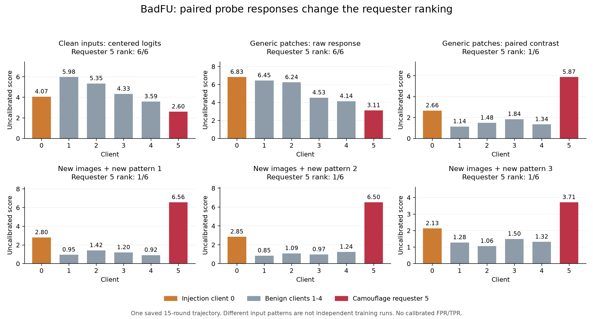

# 이력–요청 기여 일관성 (HRAC)

2026-10-15. 사용자의 방향을 구체화한 **구현 및 검증 단계의 알고리즘**이다. 대상은 FL→FU 백도어이며, 관측된 기여 상쇄와 요청의 설명 가능성을 함께 검사한다. 악성 의도의 완전 식별이나 두 공격에 대한 검증 완료를 주장하지 않는다. [코드](../FUBA/hrac.py) · [실행](../RUN.md) · [궤적 상태](TRAJECTORIES.md).

## 1. Problem Statement

삭제 영향의 크기만 보면 정상 Non-IID의 선택적 삭제와 공격 요청을 혼동할 수 있다. 반대로 정상 삭제가 전체 기여와 비례한다고 가정해도, 특정 클래스만 삭제하는 정상 요청을 잘못 판정한다. 필요한 질문은 다음과 같다.

1. 요청이 과거에 상쇄되던 기여 중 한쪽을 선택적으로 제거하는가?
2. 독립적으로 관측한 요청 기여를, 소유권·삭제량·삭제 단위에 맞는 과거 기여 조합으로 설명할 수 있는가?

FUBA의 역할 분리형 및 BadFU 공개 코드의 6클라이언트형은 클라이언트별 이력으로 첫 질문을 검사할 수 있다. BadFU 본문의 클라이언트 내부 샘플 삭제에는 내부 기여 기록이 필요하다. FedUBA의 민감한 샘플 선택·요청 특징 조작은 두 번째 질문의 후속 평가 대상이며, 이번에 FedUBA 실행을 재현하지 않았다. [BadFU 원문](https://arxiv.org/html/2508.15541v1) · [FUBA 저자 코드](https://github.com/stcebra/FUBA) · [FedUBA 원문 §IV–V](https://www.chenwang.net.cn/publications/FedUBA-TDSC26.pdf).

### 관측 조건

- 서버가 클라이언트별 업데이트, 실제 집계 가중치, 참여 라운드와 요청 대상 ID를 볼 수 있어야 한다. 개별 기여를 숨기는 secure aggregation은 별도 관측 장치 없이 지원하지 않는다.
- 이력은 합계 한 벡터가 아닌 $H=\{z_{a,t}\}$로 유지한다. $a$는 실제 기록된 클라이언트 또는 데이터 묶음이다. 모든 $z$는 같은 입력·출력 좌표를 사용한다.
- 현재 캐시는 **양의 실제 FL 업데이트를 적용했을 때의 유한 출력 차이**이다. Jacobian/Fisher의 정확한 추정이나 정확한 FU 인과 기여가 아니다. 이 근사를 숨기지 않는다.
- 대내 검사에는 과거 원자 기여 $A_i$와 **별도로 관측한** 요청 기여 $u$가 필요하다. $u=A_iq$를 같은 로그에서 만들어 넣으면 자기 자신을 확인할 뿐이므로 독립 검증으로 세지 않는다.
- 샘플/묶음 기록이 없는 클라이언트 합계를 임의로 쪼개 과거 샘플 기여로 사용하지 않는다. 현재 저장 자료의 이력 분석은 계속 가능하다.

## 2. Key Idea & Formulation

### A. 삭제 경계의 선택적 상쇄 제거 — 기존 v3 재사용

사전 고정한 이력 창 $W$와 기능 좌표 $c$에 대해 $h_{a,c}=\sum_{t\in W}z_{a,t,c}$를 계산한다. 요청의 삭제 비율을 $r_a\in[0,1]$라 두고,

$$P_c=\sum_a[h_{a,c}]_+,\quad N_c=\sum_a[-h_{a,c}]_+,$$
$$P_{D,c}=\sum_a r_a[h_{a,c}]_+,\quad N_{D,c}=\sum_a r_a[-h_{a,c}]_+,$$
$$s_{\rm inter,c}=\frac{2\min(P_c,N_c)}{P_c+N_c}\min(P_c,N_c)
\left[\frac{N_{D,c}}{N_c}-\frac{P_{D,c}}{P_c}\right]_+.$$

분모가 0이면 해당 항은 0이다. 양·음 기여의 같은 비율을 제거하면 점수는 0이다. 부호를 보존하므로 단순 에너지 스펙트럼과 다르다. 이 점수는 **기존 구현의 재사용**이며 새로운 수식으로 주장하지 않는다.

HRAC에서는 전체 이력·최근 10·최근 20라운드 창의 최대를 취한다. 검사 시점은 10/20/40/마지막 라운드, 요청군은 기록 단위별 전체 삭제와 전체 단위 삭제로 고정했다. 클래스·창·요청·시점을 모두 포함한 **학습 실행별 최대값**이 보정 입력이다. 클래스 평균을 먼저 계산하는 프로토콜을 주 분석으로 고정한다. 창 추가는 짧은 구간의 상쇄를 관측하기 위한 설계이며 자체 신규성의 근거로 삼지 않는다.

### B. 요청의 기여 설명 가능성 — 제약 최적화

요청자의 과거 원자 기여를 열벡터로 둔 $A=[h_1,\ldots,h_m]$와 가능한 삭제 집합

$$\mathcal Q=\{q:\ell\le q\le v,\ Bq=b\},\qquad 0\le\ell\le v\le1$$

을 정의한다. 정확한 삭제 ID를 알면 해당 $q$를 0 또는 1로 고정한다. 데이터 묶음의 표본 수 또는 클래스별 삭제량을 아는 경우 $Bq=b$로 제한한다. 연속 $q$는 명시한 기여 근사하의 분할 삭제/볼록 완화이며, 묶음 내부의 임의 샘플이 정확히 그 비율로 기여한다는 주장이 아니다.

독립적으로 관측한 요청 $u$의 점수는

$$s_{\rm intra}=\min_{q\in\mathcal Q}(u-Aq)^\top C_\lambda^{-1}(u-Aq).$$

기본 척도는 $C=AA^\top/m$, $C_\lambda=C+\lambda\max(\operatorname{tr}(C)/d,\epsilon)I$, $\lambda=10^{-3}$이다. 이는 **이력의 이차 모멘트로 만든 거리 척도**이며 Fisher라고 부르지 않는다. 별도의 정상 자료에서 고정한 공분산도 코드 입력으로 허용하되, 테스트 결과로 선택하면 기존 보정은 승계되지 않는다.

수학적 근거:

- $H_0:u=Aq+\varepsilon,\ q\in\mathcal Q$와 자유 평균 대립가설을 가우시안 오차 모형에서 비교하면, 위 최소 잔차는 분산 상수 배를 제외한 일반화 우도비 통계량이다. 기본 $C$가 실제 오차 공분산이라는 사실은 보장하지 않는다. 경보 보정에는 가우시안 가정이 필요하지 않다.
- 정상 요청의 실제 $q_0\in\mathcal Q$이면 $s_{\rm intra}\le\varepsilon^\top C_\lambda^{-1}\varepsilon$이다. 따라서 정상 요청이 전체 이력과 평행할 필요가 없다.
- $vv^\top=(-v)(-v)^\top$이어도, 양의 삭제 계수와 소유권 제약 때문에 $v$와 $-v$의 설명 가능성은 달라질 수 있다.
- **정당한 위장 샘플 삭제는 이 집합 안에 있을 수 있다.** 이때 대내 점수가 낮은 것은 예상되는 동작이며 대외 검사와 함께 평가해야 한다. 두 채널 모두 정상과 관측이 같다면 식별할 수 없다.

볼록 이차 최적화를 풀고, 별도 선형 최적화로 $g=\nabla f(q)^\top q-\min_{v\in\mathcal Q}\nabla f(q)^\top v$를 계산한다. 볼록성에 의해 $f(q)-g\le f^*\le f(q)$이다. 구현은 수치 허용오차 내에서 이 간격을 검사하고, 경보 점수에는 하한을 사용한다. 미수렴은 오류로 반환한다. 빈 $\mathcal Q$는 요청 메타데이터 불일치이며 공격 판정으로 세지 않는다.

### C. 정상 실행으로 두 검사를 보정

같은 사전 정의 조건(데이터·모델·Non-IID·관측 방법·삭제 단위)의 독립 정상 실행 $n$개에서 채널별 실행 최대 $S_{1,c},\ldots,S_{n,c}$를 수집한다. 테스트 실행 $S_c$에 대해

$$p_c=\frac{1+\sum_{j=1}^n\mathbf1[S_{j,c}\ge S_c]}{n+1},\qquad
p_{\rm joint}=\min(1,2\min(p_{\rm inter},p_{\rm intra})).$$

$p_{\rm joint}\le\alpha$일 때 경보한다. 동일 조건의 정상 실행들이 교환 가능하고 점수·검사군을 미리 고정했다면, 순위 검정과 합집합 부등식으로 **주변적 실행 단위 오탐 확률**이 $\alpha$ 이하이다. 채널·클라이언트·라운드 간 독립성은 요구하지 않는다. 라운드를 독립 보정 표본처럼 세지 않는다. 이 보장은 특정 보정 집합을 고정했을 때 모든 미래 표본의 FPR 상한이나 분포 변화 하의 보장이 아니다.

두 채널, $\alpha=.05$에서 유한 경보 임계값에는 최소 정상 보정 실행 39개/조건이 필요하다. 부족하면 `insufficient_clean_episodes`다. 대내 관측이 없으면 `unobserved_channel`이고, 대외에서 유의한 양성 경보가 난 경우 외에는 전체 판단을 `null`로 둔다. 없는 검사를 정상 통과로 바꾸지 않는다.

### D. 입력 쌍의 기여 차이 — 이번 관측 개정

정상 클래스 학습 효과가 패턴 조건부 기여를 가릴 수 있으므로, 같은 이미지 $x$와 고정 변환 $P_gx$에서 **실제 양의 업데이트 효과의 차이**를 기록한다. 중심화한 logit을 $\ell$, 실제 집계 가중치를 $p_{i,t}$라 두면,

$$d_{i,t}(x)=\ell(w_t+p_{i,t}\Delta_{i,t},x)-\ell(w_t,x),$$
$$z^{(g)}_{i,t}=\frac1n\sum_{x\in X}\left[d_{i,t}(P_gx)-d_{i,t}(x)\right].$$

두 조건에 공통으로 나타나는 성분은 이 차이에서 상쇄된다. 이는 업데이트와 입력 변환의 상호작용을 측정하는 유한 차이이며, 정상 Non-IID의 모든 효과를 제거한다는 정리는 아니다. 정상 특성이 변환에 반응하면 그 효과도 남는다. 각 라운드의 기록된 BN 버퍼를 고정하며, 클라이언트 제거·FU·모델 재학습 없이 계산한다.

고정한 변환군 $g$, 출력 클래스, 이력 창 각각에서 A의 기존 점수를 계산하고 최대를 취한다. 삭제 요청은 실제 요청 대상의 $r_a$로 연결한다. 이번 비교에서는 여섯 클라이언트의 전체 삭제 요청을 각각 검사했다. **요청별 부호를 유지하는 것이 단순한 크기 비교와의 차이**지만, 복잡한 점수 자체의 우월성은 별도 기준선으로 검증해야 한다. 정상 실행으로 경보를 보정할 때도 변환군을 포함한 전체 최대값을 사용해야 한다.

비교 실험에는 JVP와 정상 클래스 그래디언트 부분공간도 포함했다. 별도 정상 이미지 80개로 만든 10개 방향의 응답을 $B$라 하고, 정상 입력 절반에서 $\hat q=\arg\min_q\|J\Delta-Bq\|^2$를 구한 뒤 다른 절반의 모든 입력 조건에 같은 계수를 적용한다. 두 절반을 교차하고 잔차를 관측한다. 정답 트리거 응답·공격 역할은 적합에 사용하지 않는다. 이 보정은 정상 한 단계 학습을 근사하며 현재 주 방법의 필수 구성으로 채택하지 않았다.

## 3. Evaluation & Results

실제 저장 궤적을 읽었고 새 공격 학습·FU는 하지 않았다. 기존 모델의 ASR 재평가는 아래 사후 평가에 별도로 기록했다.

| 검증 | 결과 | 해석 |
|---|---|---|
| FUBA MNIST 개발 궤적 6개, 마지막 기록 라운드 | HRAC 대외·기존 v3 요청자+표적 1위 모두 6/6; 선형 기준선 4/6 | 기존 결과 유지. v3 대비 개선 증거 아님 |
| BadFU 공개 코드 6클라이언트형, 저장 15R, 깨끗한 입력 80개 | 주 분석 1위 정상 client 2 / class 0. 실제 요청자 client 5는 5위, 최고 좌표 class 7 | 현재 대외 점수가 이 실행의 공격자를 1위로 식별하지 못함. 궤적 생성 오류라는 뜻 아님 |
| BadFU 관측 방식 진단 12설정 × 2점수 | 입력별 점수 후 평균·logit 좌표를 포함해 요청자 5는 5~6위 | 사후 진단이며 좋은 설정만 골라 성공으로 보고하지 않음 |
| 실제 궤적의 대내 검사 | 독립 요청 기여·내부 원자 기록 미확보 | 실제 BadFU/FedUBA 탐지 성능 미측정 |
| 합성 원자, 정상 보정 99개 + 정상 시험 200개/조건 | 균형 조건 경보 12/200(6.0%, 95% CI 3.14–10.25%); 클래스 집중 조건 3/200(1.5%, CI .31–4.32%) | 정상 선택 삭제를 허용하는 모형의 검사. 유한 시험에서 5% 이하가 항상 나온다는 주장이 아님 |
| 같은 크기·이차 모멘트를 가진 부호 반전 요청 | 합성 두 조건 각각 200/200 경보; 요청 크기 기준선 각각 6/200·8/200 | 구성한 대립가설 검증. FUBA/BadFU 공격 성공률이나 탐지율로 인용 금지 |

원본: [FUBA replay](../FUBA/logs/hrac/fuba_replay_v1.json), [BadFU replay](../FUBA/logs/hrac/badfu_replay_v1.json), [BadFU 진단](../FUBA/logs/hrac/badfu_measurement_ablation_v1.json), [합성 검사](../FUBA/logs/hrac/synthetic_stress_v1.json). 모든 결과에는 코드 해시가 있고 실제 자료에는 입력 해시가 있다. 합성 검사에서 대외 채널은 0으로 고정했으므로 대내 분기만 검증한다. 실제 정상 궤적 부족으로 실제 공격의 보정된 FPR/TPR은 보고하지 않는다. 기존 76개와 새 19개를 포함한 테스트 95개가 통과했다. 테스트 수를 성능 표본 수로 세지 않는다.

### BadFU 미식별 요청의 사후 평가 — 2026-10-15

탐지 캐시와 기존 FU 실험의 manifest·데이터 해시를 연결하고, 저장 모델을 다시 평가했다. 새 학습이나 FU는 실행하지 않았다. [재평가 원본](../FUBA/logs/hrac/badfu_retrospective_v1.json), [재현 스크립트](../FUBA/diagnose_hrac_badfu.py).

| 저장 모델 | ASR (원래 비표적 클래스 512개) | 정상 정확도 |
|---|---:|---:|
| 최종 FL, glob_14 | 24.02% | 87.89% |
| FU 한 단계의 실제 시작 모델, round_14의 gm | 21.88% | 87.50% |
| 요청자 5 제거, 무방어 FU 한 단계 후 | 91.02% | 75.98% |
| 정상 client 1 제거, 같은 FU 한 단계 후 | 74.02% | 76.56% |

**확인된 범위:** 현재 HRAC 주 분석이 5위로 둔 요청자 5에 대해, 저장된 FU 한 단계 뒤 높은 ASR이 재현됐다. 같은 공격 포함 궤적에서 정상 요청 뒤에도 ASR이 상승했다. 이 FU는 기존 `request_pipeline`의 BN 재보정·1 epoch/2 batch·한 이벤트 변형이다. 저자 전체 FedEraser나 완전 삭제의 검증으로 인용하지 않는다. 삭제 없는 동일 FU 처리 대조군이 없어 상승분 전체를 삭제 자체에 인과적으로 귀속할 수 없다. 12라운드 `unlearn_activation.json`은 다른 실행이므로 섞지 않는다.

**관측된 미식별 원인:** 정상 client 2는 데이터의 69.94%가 클래스 4·5이며, 깨끗한 입력에서 표적 클래스 0의 로그확률을 15/15라운드 낮췄다(누적 -8.179). 요청자 5는 같은 좌표를 14/15라운드 높였다(누적 +7.430). 현재 제거 점수는 관측 좌표의 음의 기여 제거를 평가하므로 client 2의 class-0 점수는 6.563, 요청자 5는 0이다. 요청자 5의 다른 좌표 최대값도 1.406으로 5위다. 따라서 지속성만 추가해 정상 클래스 편향을 배제할 수 있다는 가정은 이 실행에서 반증된다. 숫자는 기록된 입력에서의 함수 변화이며, 파라미터 그래디언트 자체나 정확한 FU 영향이 아니다.

요청자 5의 입력 10,545개 중 9,695개는 client 0과 동일한 정상 입력이며, 나머지 850개가 cover다. 실제 저장 텐서의 정상 부분 일치를 확인했다. 정상 클래스 학습 효과에 트리거 조건부 억제 효과가 가려졌다는 설명은 이 사실과 일치하지만, 두 내부 성분을 따로 측정하지 않았으므로 인과적 분해가 확인된 것은 아니다. logit 좌표·입력별 점수·창 길이를 바꾼 기존 진단에서도 요청자 순위는 5~6위였다.

**저자 Non-IID 조건:** [BadFU §VI-B/E](https://arxiv.org/html/2508.15541v1#S6)는 기본 Non-IID: dominant 70%, Dirichlet α=0.3(MNIST)/0.5(CIFAR-10)다. 현재 공개 코드 분할도 dominant 70%이며, 두 우세 클래스가 정상 클라이언트 표본의 약 70%를 차지한다. [FUBA §IV-A, Table III/V](https://doi.org/10.1109/TAI.2025.3630110)는 주 실험 IID, 추가로 α=0.1~100을 시험했다. 로컬에 보존된 저자 PDF pp.2899/2901/2903을 직접 확인했다. CIFAR-10, α=0.1에서 ASR 6.9%→70.4%/56.2%(FedEraser/KD); 정상 1명 제거는 7.0%/6.5%다. 저자도 강한 label skew를 시험했으므로 현재 실패를 단순히 '우리가 너무 강한 Non-IID를 사용했다'고 설명하지 않는다. 이 결과는 공격 활성화 실험이며, 이력 점수의 탐지 분리성을 보장하지 않는다.

FU 결과 비교에서는 같은 시작 모델에서 요청자 5·정상 요청자 1/2·삭제 없는 처리를 동일한 전체 FU 프로토콜로 실행해야 한다. 악성 요청 식별과 실제 ASR 상승 위험 예측을 별도 평가한다. 탐지 입력의 수정은 FU를 추가 실행하지 않고 아래에서 먼저 시험했다.

### BadFU 입력 쌍 관측 실험 — 2026-10-15

**조건:** 위와 동일한 15라운드·6클라이언트·학습 seed 42, CIFAR-10/ResNet-18, dominant ratio 0.7. 최초 관측 입력은 클래스당 8개씩 80개다. 정답 트리거는 기존 공격 이미지 512개와 정확히 일치하도록 복원해 **진단 전용**으로 사용했다. 운용 후보는 정답 패턴 값을 사용하지 않는 4×4 무작위 이진 RGB 패턴을 네 모서리에 적용한다. 네 위치·모든 출력 클래스·기존 이력 창을 모두 검사하며, 잘 나온 한 위치만 따로 보고하지 않는다. 밝기 0.85와 좌우 반전도 대조 조건으로 남겼다.

프로토콜은 해당 수집 전에 저장했지만, 이미 검토했던 공격 궤적을 사용했다. 따라서 새 독립 시험이나 엄밀한 사전등록으로 부르지 않는다. 공격 역할은 순위의 사후 평가에만 사용했다. 초기 수집은 RTX 4060 Laptop GPU에서 118.3초, 후속 수집은 32.3초였다.

| 관측 / 점수 | 요청자 5 순위 | 1위 클라이언트 / 출력 클래스 |
|---|---:|---|
| 깨끗한 입력, 기존 log-probability, HRAC | 5 / 6 | 정상 2 / 0 |
| 깨끗한 입력, centered logit, HRAC | 6 / 6 | 정상 1 / 1 |
| 네 위치 무작위 패턴, centered logit 원시 효과, HRAC | 6 / 6 | 주입자 0 / 3 |
| 같은 패턴, **동일 이미지의 패턴 유무 차이**, HRAC | **1 / 6** | **요청자 5 / 0** |
| 정답 트리거, 입력 쌍 차이, HRAC — 진단 전용 | 1 / 6 | 요청자 5 / 0 |
| 정상 기준 방향 보정 후 무작위 패턴 입력 쌍 차이, HRAC | 1 / 6 | 요청자 5 / 0 |
| 밝기·반전 입력 쌍 차이, HRAC | 3 / 6 | 정상 1 / 2 |

무작위 패턴 입력 쌍의 HRAC 점수는 요청자 5가 **5.873**, 다음 클라이언트 0이 **2.662**, 정상 클라이언트 최대는 **1.838**이다. 서로 다른 관측 조건의 점수 크기를 그대로 비교하지 않는다. 정상 기준 보정 없이 이미 1위이므로 보정의 추가 이득을 주장하지 않는다.

**후속 입력 확인:** 초기 관측 및 정상 기준 이미지와 겹치지 않는 80개에서 새 패턴 세 개를 각각 네 위치에 적용했다. 학습 궤적은 그대로다.

| 패턴 seed | 요청자 5 순위 / 최고 출력 클래스 | 요청자 점수 | 다음 클라이언트 점수 |
|---|---|---:|---:|
| 20261016 | 1위 / 0 | 6.564 | 2.801 |
| 20261017 | 1위 / 0 | 6.501 | 2.849 |
| 20261018 | 1위 / 0 | 3.712 | 2.128 |

이는 입력·패턴 변경에 대한 확인이지 독립 학습 3회나 탐지율 100%가 아니다. 처음 실험의 신호는 네 위치 중 실제 트리거 영역을 덮는 우하단에서 강했다. 임의 위치·크기·분산형 트리거에 대한 보장은 없다.

**같은 관측에서 점수 기준선 비교:** 초기 결과와 후속 결과를 본 뒤 추가한 사후 분석이다. HRAC의 다중 창, 전체 이력 한 창, 단순 음의 기여 $[-\sum_t z_{i,t}]_+$, 마지막 한 라운드의 음의 기여 모두 초기 무작위 패턴 및 후속 세 패턴에서 요청자 5·출력 0을 1위로 뒀다. 반면 기여의 절댓값 크기는 주입자 0을 1위, 요청자 5를 2위로 뒀다. **이번 자료는 입력 쌍 관측과 부호의 유용성을 보여 주지만, 복잡한 HRAC 점수나 긴 이력이 꼭 필요하다는 증거는 아니다.** 이 구분을 유지한 채 정상 조건에서의 오탐과 약한 공격을 비교한다.

수치 점검: 유한 업데이트와 JVP의 전체 효과는 입력 조건별 상대 L2 차이가 약 20~23%여서 동일한 양으로 해석하지 않는다. 작은 epsilon의 float32 차분은 불안정했다. 첫 라운드·client 0·입력 8개의 별도 CPU float64 점검에서는 epsilon 1e-5에서 중앙 차분과 JVP의 상대오차가 0.014%였다. 이는 국소 미분 검사이며 전체 캐시의 정확성이나 전체 업데이트의 선형성을 증명하지 않는다. 기존 깨끗한 입력 캐시와 새 측정의 상대 차이는 0.76%이며 기존 순위는 유지됐다. 전체 테스트는 기존 95개와 새 3개를 합쳐 98개 통과했다.

원본: [초기 프로토콜](../FUBA/logs/hrac/views_badfu_v1/protocol.json) · [전체 관측 비교](../FUBA/logs/hrac/views_badfu_v1/analysis.json) · [후속 프로토콜](../FUBA/logs/hrac/views_holdout_v1/protocol.json) · [후속 결과](../FUBA/logs/hrac/views_holdout_v1/analysis.json) · [동일 관측의 점수 기준선](../FUBA/logs/hrac/views_score_ablation_v1.json) · [float32 점검](../FUBA/logs/hrac/views_badfu_v1/numerical_check.json) · [float64 점검](../FUBA/logs/hrac/views_badfu_v1/derivative_float64_check.json). 모델 응답 캐시도 같은 디렉터리에 저장했다.

### 정답 라벨 없는 공개 이미지 관측 — 2026-10-15

관측 가정을 완화한 별도 실행기 [experiment_hrac_unlabeled.py](../FUBA/experiment_hrac_unlabeled.py)를 추가했다. 클라이언트 데이터 archive, 정답 트리거 파일, 표적 클래스, 검사용 이미지 라벨을 입력받지 않는다. 입력 pool은 `images`와 `ids`만 허용한다. 일반 이미지 폴더도 지원하며, CIFAR exporter는 원본 파일의 라벨을 선택·기준선 계산에 사용하지 않고 픽셀만 저장한다. 모델 전처리와 공개 이미지 자체, 개별 클라이언트 업데이트·집계 비중은 여전히 필요하다.

이전 관측 및 정상 기준선에 사용한 240개 이미지를 ID로 제외했다. 남은 CIFAR-10 test 이미지 9,760개에서 클래스별 균형화나 모델 예측 필터 없이 80개씩 세 묶음을 무작위 추출했다. 세 묶음은 서로 겹치지 않는다. 이미지 seed와 패턴 seed는 각각 20261019/20/21이며, 패턴마다 네 모서리를 모두 검사한다. 첫 수집 전에 프로토콜을 저장했다. 이 실행기는 정상 클래스 그래디언트 보정을 하지 않으며, 알려진 요청자 5·표적 0은 아래 결과의 사후 해석에만 사용했다.

| 무작위 이미지 묶음 | 최종 HRAC 순위 / 출력 | 요청자 5 점수 | 다음 클라이언트 점수 |
|---|---|---:|---:|
| seed 20261019, 80개 | 1위 / 0 | 6.142 | 2.220 |
| seed 20261020, 80개 | 1위 / 0 | 6.329 | 2.654 |
| seed 20261021, 80개 | 1위 / 0 | 6.455 | 2.597 |

주 분석은 모든 패턴·위치·출력에 대한 최대값이다. 5/10라운드 주 분석에서도 세 묶음 모두 요청자 5·출력 0이 1위였다. 최종 시점의 각 패턴별 결과도 동일했다. **같은 관측의 단순 누적 음의 기여 및 마지막 한 라운드도 최종 순위 1위**여서 긴 이력·HRAC 점수의 추가 이득을 주장하지 않는다. 이전 실험과 수치 설정도 완전히 같지는 않다: 이번에는 TF32를 끄고 배치 64로 실행했으므로 점수 크기의 변화를 라벨 제거만의 효과로 해석하지 않는다.

동일한 BadFU 15라운드 학습 궤적을 재사용했고, RTX 4060 Laptop GPU에서 관측 수집 79.9초가 걸렸다. FL 학습·FU·그래디언트 계산은 모두 0회다. 두 라운드에서 중단한 뒤 `--resume`으로 이어서 완료했다. 전체 테스트 105개 통과: 라벨 필드 거부, CIFAR 라벨 미참조, 분류되지 않은 이미지 폴더, 중복 없는 표본 선택, BN 고정·집계 비중, archive 없는 측정, 재시작 및 캐시 손상을 검사했다.

라벨 없는 같은 벤치마크 이미지에서 결과가 유지되었다는 증거다. 공개 데이터의 도메인 차이, 신뢰성, 정상 Non-IID 오탐률은 아직 검증하지 않았다. 이미지 seed 3개 × 패턴 seed 3개는 독립 공격 학습 9회가 아니다. 현재 모델 어댑터는 BadFU CIFAR-10/ResNet-18이며, FUBA에 대한 라벨 없는 관측 전이는 별도 구현·실험이 필요하다.

[프로토콜](../FUBA/logs/hrac/unlabeled_badfu_v1/protocol.json) · [전체 결과](../FUBA/logs/hrac/unlabeled_badfu_v1/analysis.json) · [라운드별 시간·캐시 해시](../FUBA/logs/hrac/unlabeled_badfu_v1/progress.json) · [실행·긴 검사 안내](../RUN.md#라벨-없이-공개-이미지로-검사--현재-실행-경로).

## 4. Limitations & Critical Discussion

- **관측 한계:** 깨끗한 입력에서 보이지 않는 백도어 기능은 이 표현으로 놓칠 수 있다. 깨끗한 입력/정상 변형의 관측 범위를 넓히는 실험은 가능하지만, 정답 트리거를 탐지 입력으로 쓰면 다른 가정이다.
- **이력 단위:** 클라이언트 내 $b_t+c_t$만 관측했다면 두 항을 일반적으로 복원할 수 없다. 데이터 묶음별 이력 수집을 별도로 추가해야 한다. 기존 궤적을 잘못됐다고 재분류하지 않는다.
- **요청 관측:** 서버가 독립적으로 검증할 수 없는 요청 벡터·소유권·삭제량을 공격자 진술만으로 확정해서는 안 된다. JSON의 출처 선언은 암호학적 보장이 아니다.
- **근사·적응 공격:** 비선형 학습에서 원자 합의 정확성은 보장되지 않는다. 합법적 집합 안에 머무는 공격과 지속적인 정상 상쇄는 남는 반례다. 실제 관측이 동일하면 악성 의도를 분리할 수 없다.
- **비용:** 현재 구현은 이력 $O(TKd)$를 저장하고, 대내 분기는 $O(md+d^2)$ 메모리·$d$차원 고유분해 및 제약 최적화를 사용한다. 전체 신경망 파라미터 차원이 아니라 작은 기능 공간을 대상으로 한다. 대규모 실행 비용은 아직 측정하지 않았다.
- **이번 개선의 범위:** 하나의 공격 실행에서 순위가 개선됐다. 그 실행의 정상 클라이언트 4명은 독립 정상 실행 4개가 아니다. 같은 관측의 단순 기준선도 1위이므로, HRAC의 우월성·긴 이력의 필요성·시계열 순서의 신규성을 입증하지 않는다. 클래스 손실 기준 방향도 정상 Non-IID의 전체 부분공간이 아니다.

## 5. Takeaway & Next Actions

기여 후보는 **삭제 제약을 반영한 부호 있는 기여 설명 가능성과 삭제 경계의 상쇄를 결합해 정상 선택 삭제와 비교하는 것**이다. 이력 사용·스펙트럼·conformal 보정 각각의 신규성은 주장하지 않는다. [FLDetector](https://github.com/zaixizhang/FLDetector)와 [UnlearnGuard §4](https://arxiv.org/html/2501.17396v1#S4)는 이력에 기반한 업데이트 일관성을 이미 사용한다.

1. 입력 쌍 관측·네 위치 검사군과 단순 음의 기여 기준선을 고정한다. 현재 DISLAB 실험이 만든 동일 데이터/모델의 정상 체크포인트에서 새 관측을 수집해 정상 요청과 비교한다. 과거 깨끗한 입력 점수 캐시만으로는 새 패턴 반응을 복원할 수 없다. 새 전체 학습보다 기존 완료 자료의 수집·분석이 우선이다.
2. 다음 제한된 수집 실험에서 요청자의 데이터 묶음 ID·질량·기능 기여와 독립 요청 관측을 기록한다. 기록 시점·모델·입력 좌표를 맞추고, 재구성 오차를 정상 요청에서도 측정한다.
3. 정상 클래스 선택·민감한 정상 샘플 선택·도메인 선택 삭제를 별도 조건에 넣는다. 순진한 비례성 검사, 요청 크기, 기존 v3, 대내 단독, 결합을 비교한다. 공격을 본 뒤 조건/임계값을 정하지 않는다.
4. 새 학습 시드·트리거 위치/크기·약한 공격과 FUBA에서 같은 관측을 시험한다. 현재 모델만의 패턴 반응, 마지막 한 라운드, 단순 누적 음의 기여, HRAC를 동일 정상 오탐 수준에서 비교해야 이력–요청 구조의 추가 가치를 판단할 수 있다. 마지막으로 동결한 탐지기를 실제 FU 활성화 결과와 대조한다. 탐지 과정에는 FU 실행을 넣지 않는다.

[기존 논문 정리](paper_reviews/README.md) · [이전 연구 설명 보관](archive/cleanup_2026-10-15/RESEARCH_SUMMARY.md).
