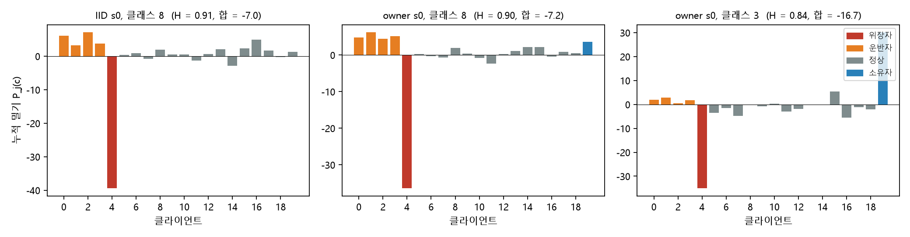
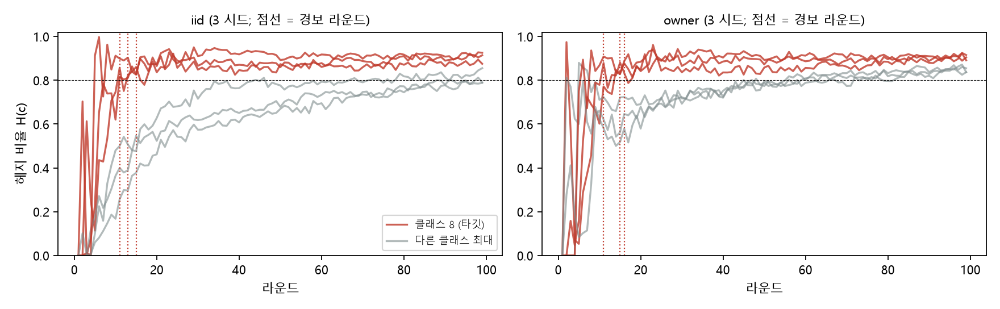

# 균형 장부: 연합 언러닝에서 삭제로 깨어나는 백도어를 학습 중 상쇄 연합으로 찾아 걷어내기

초안 v3 (2026-10-13). 전개는 조사한 방어 논문들(FLDetector, FoolsGold, FLAME, DeepSight; `HOW_OTHERS_EXPLAIN.md`)의 순서를 그대로 따른다: 문제 → 기존 방어의 틈 → 핵심 관찰(기제) → 불변량 → 점수 → 영분포·판정 → 대응 → 분석 → 평가 → 한계. 숫자는 `docs/RESULTS_LOG.md` 번호가 있는 것만 쓴다. 아직 없는 숫자는 [R-xxx 예정] 으로 비워 둔다.

---

## 초록
연합 언러닝(federated unlearning, FU)은 클라이언트가 자기 기여의 삭제를 요청하면 서버가 저장된 기여로 모델에서 그 몫을 걷어내는 절차다. 최근 공격(FUBA, BadFU)은 이 절차를 역이용한다. 공격자 일부(운반자)는 백도어를 심고, 다른 한 명(위장자)은 같은 입력에서 반대 방향으로 밀어 학습 중 모델을 깨끗하게 보이게 한 뒤, 위장자가 삭제를 요청하면 백도어가 깨어난다. 우리는 이 공격이 "같은 입력 영역에 모순된 지도를 공급해 평균을 0 으로 만드는 것"이며, 그 결과 **정상 학습에는 없는 구조 — 한 클래스를 여럿이 밀고 한 명이 그만큼 되미는 상쇄 연합 —** 를 반드시 남긴다는 것을 보인다. 이를 재는 **균형 장부(Balance Ledger)** 를 제안한다. 서버는 라운드마다 참여자의 갱신이 공개 입력 위에서 각 클래스를 미는 양을 누적하고, 클래스마다 헤지 비율·음의 다리·양의 다리 집합을 계산해, 양의 다리가 여럿이고 한 명이 독식하지 않는 균형 클래스가 지속되면 경보를 울린다. 경보는 타깃 클래스, 위장자, 운반자 집합, 그리고 되감을 라운드를 함께 준다. 대응은 그 라운드로 되감고 연합을 제외한 채 이어 학습하는 것이다. FUBA 논문 설정(클라이언트 20, 악성 5, 100 라운드, 참여 0.4, IID·non-IID 각 3 시드)에서 장부는 6/6 궤적에서 11–16 라운드에 경보를 내고 위장자와 운반자 넷을 오탐 없이 특정했으며, 클래스 소유자(한 클래스의 90 % 를 가진 정상 클라이언트)를 한 번도 제외하지 않았다. 연합을 제외한 재학습은 ASR 0.5–0.6 %, 정확도 99 % 에 닿는다. 갱신 하나의 크기·방향을 보는 기존 방어는 소유자를 같이 잡거나 운반자를 가장 정상으로 보며, 요청 시점에 빼 보는 심사는 모델 생성이 필요하고 더 늦다.

---

## 1. 서론

**문제.** 연합학습(FL)에서 클라이언트는 데이터 대신 갱신을 보내고, 서버는 평균을 낸다. 삭제권(GDPR 17 조)을 지키려면 서버는 특정 클라이언트의 몫을 모델에서 걷어내야 하고, 이를 위해 FedEraser 류의 서버는 라운드별 기여 U_j^t 를 저장한다. 이 저장과 삭제가 새 공격면이 된다. Zhang 등(2023), Liu 등(AAAI 2024), UBA-Inf, BadFU, FUBA 는 모두 같은 구조다. 운반자 집합 A 는 트리거 입력을 타깃 클래스로 보내는 성분을 심고, 위장자 S 는 같은 입력에서 그 성분을 되미는 성분을 심는다. 학습이 끝난 모델 θ_T 는 깨끗하다(ASR 3–8 %, 표 1). 위장자가 삭제를 요청해 서버가 U_S 를 걷어내면 되밀던 힘이 사라져 백도어가 깨어난다(ASR 46–93 %). 서버가 요청을 정확히 이행할수록 공격은 더 잘 된다: 운반자가 남은 채 처음부터 재학습해도 백도어 모델이 나온다(K=8 예비, ASR 30–44 %).

**기존 방어의 틈.** FL 방어는 갱신 **하나**의 성질(노름, Krum 거리, 서버 기준과의 코사인, 출력층 에너지)이나 갱신들의 **닮음**(FoolsGold)을 본다. 이 공격에서 위장자는 크기가 커서 크기 기준에 걸리지만, 한 클래스를 많이 가진 정상 클라이언트(소유자)도 같이 걸린다(소유자 z 3.8–65, 표 3). 운반자는 방향이 가장 중심에 있어(20 명 중 평균 순위 18.5) 어떤 단일 갱신 기준으로도 보이지 않는다. FU 전용 방어(MASA 의 언러닝 손실, SubID 의 부분공간 잔차)는 요청자 한 명의 갱신만 보므로 두 몫의 **관계**인 상쇄를 보지 못한다. 요청 시점에 조금 빼 보는 심사는 위장자만 잡지만(flow z, 소유자 z 0.0) 요청이 올 때까지 기다려야 하고 라운드마다 모델을 만들어야 한다.

**핵심 관찰.** 공격 논문들은 잠복을 "손실항 A 가 손실항 B 를 상쇄한다"는 한 문장으로만 설명한다. 우리는 이것을 **모순 지도의 평균화** 로 본다. 선형화(경험적 NTK) 아래 같은 입력 영역에 반대 라벨이 들어오면 잔차 부호가 반대라 커널 회귀가 라벨 평균을 배우고, 한쪽 공급자를 빼면 평균이 뒤집힌다. 이 평균화는 공급자별로 분해되고, 그 분해가 라운드별 갱신이 공개 입력 위에서 각 클래스를 미는 양 P_j(c) 다. 백도어가 잠복하려면 Σ_j P_j(c*) ≈ 0 이면서 |P_S(c*)| ≈ |Σ_A P_j(c*)| 가 커야 한다. 이것은 **정상 학습에는 없는 관계 구조** — 여럿이 밀고 한 명이 되미는 **상쇄 연합** — 이며, 공격이 이것을 피하려면 백도어를 약하게 하거나(실패) 되밀기를 여럿에 나누어야 한다(§7).

**기여.**
1. 삭제로 깨어나는 백도어의 기제를 "모순 지도의 평균화"로 정식화하고, 그 필요조건이 학습 중 장부에서 관찰 가능한 관계 불변량(상쇄 연합)임을 보인다 (§4, §7).
2. 균형 장부: 역할·라벨·트리거 정보 없이, 라운드당 참여자 수만큼의 순전파로 상쇄 연합을 찾고 타깃 클래스·위장자·운반자·되감기 라운드를 함께 내는 학습 중 방어 (§5).
3. 탐지가 준 정보를 그대로 쓰는 대응: 되감기 + 연합 제외 이어 학습. 요청 시점에는 같은 장부를 저장 갱신에 사후 적용한다 (§5.5).
4. FUBA 논문 설정 6 궤적에서 6/6 경보(11–16 라운드), 위장자·운반자 정밀도·재현율 1.0, 소유자 오제외 0, 제외 후 ASR 0.5–0.6 %. 갱신 크기·방향·요청 심사·null-space·학습 중 감사·참여 회귀 등 9 계열 36 점수와 같은 궤적에서 비교 (§8).

---

## 2. 배경과 관련 연구

**2.1 연합 언러닝.** 서버는 θ_t = θ_{t−1} + (1/|P_t|) Σ_{j∈P_t} u_j^t 로 갱신하고(P_t 참여자), U_j^t = u_j^t/|P_t| 를 저장한다. 요청 (k) 에 FedEraser 는 저장 기여로 보정 재구성, 빼기 연산자는 θ_T − ρΣ_t U_k^t, 재학습은 k 를 뺀 채 처음부터 학습한다. 정상 요청에서 이 셋은 요청자 지식만 걷어내야 한다.

**2.2 삭제로 깨어나는 백도어.** Zhang 등(2023)은 오염 표본과 완화 표본(같은 트리거, 원래 라벨)을 함께 학습시키고 완화 표본의 삭제를 요청한다. Liu 등(2024)은 "잠복 트리거"를 언러닝으로 "증폭"한다. UBA-Inf 는 위장 표본을 "오염 표본에 대한 영향이 반대"가 되도록 영향 함수로 최적화하며, 위장이 세면 백도어가 사라지고(vanishing) 약하면 미리 드러난다(exposure)고 보고한다 — 상쇄 크기를 정확히 맞춰야 한다는 뜻이다. BadFU 는 전역 갱신에 p₁(∇L_bd + ∇L_c) 가 들어가고 언러닝이 ∇L_c 를 빼면 백도어 기울기가 온전히 작용한다고 쓴다(어휘: counterbalance, suppressive effect, dormant). FUBA 는 위장자를 "Adv-defender" 라 부르고 model-consistency 손실로 전역 모델이 깨끗해 보이도록 민다. 어느 논문도 잠복을 이론 대상으로 올리지 않았고, 방어는 요청 심사·사후 감시·DP 를 제안하는 데 그친다.

**2.3 FL 방어와 그 불변량.** Krum·Multi-Krum(정상 기울기는 참 기울기 주위에 모인다), FLTrust(서버 뿌리 갱신과 방향이 맞는다), FLAME(백도어 갱신은 각도·크기가 정상 밀집 무리에서 벗어난다), DeepSight(오염 데이터는 덜 이질적이라 출력층 에너지가 한 뉴런에 몰린다), FoolsGold(시빌은 서로 닮는다), FLDetector(정상 갱신은 헤세 예측과 일관된다), BaFFLe(정상 전역 모델은 클래스별 오류가 점진적으로 변한다). 전부 갱신 하나의 성질 또는 갱신들의 닮음이다. "갱신들이 서로 지운다"는 관계를 불변량으로 둔 방어는 없다. FU 전용: MASA(정상 요청의 언러닝 손실 상승), SubID(정상 언러닝 갱신은 학습 부분공간 안), FedRecover(저장 갱신으로 복구), 모두 요청자 한 명의 갱신을 본다.

**2.4 상쇄를 설명하는 다른 틀.** 영향 함수(Koh & Liang), 섀플리 상호작용(Grabisch–Roubens), 과제 산술(Ilharco; 과제 벡터의 부정 = 잊기), 기울기 충돌(PCGrad). 우리는 협력 게임의 "연합은 더미(dummy)인데 구성원은 더미가 아니다"를 불변량의 이름으로 쓰고, 선형화(NTK)를 기제 설명과 측정의 정당화에 쓴다. 매개변수 공간의 쌍별 코사인·부호 충돌은 우리 설정에서 위장자–운반자(+0.56)와 위장자–정상(+0.60)을 가르지 못해 통계로 쓰지 않는다 (R-005).

---

## 3. 위협 모델

**시스템.** K 클라이언트, T 라운드, 라운드당 참여율 p. 서버는 θ_{t−1}, 참여자 집합 P_t, 갱신 u_j^t 를 저장한다(FU 서버의 전제). 서버는 라벨 없는 공개 입력 X_p(|X_p| = 500, 시험 분포)를 가진다. 서버는 트리거, 타깃 클래스, 역할, 악성 수를 모른다.

**공격자.** 악성 집합 M ⊂ [K], |M| < K/2 (논문 설정 5/20). M 은 운반자 A 와 위장자 S 로 나뉜다. 목표: 학습 중 전역 모델은 트리거 입력에서 깨끗하고(잠복), S 의 삭제 요청이 이행되면 트리거 입력이 타깃 c* 로 분류된다(활성화). 능력: 자기 데이터·손실·갱신을 임의로 정한다(FUBA 의 적대적 방어자 학습 포함). 백도어는 한 타깃 클래스로 몰린다(다중 타깃은 §9).

**정상 클라이언트.** 자기 데이터로 정직하게 학습한다. 데이터 분포는 IID 또는 한 클라이언트가 한 클래스의 90 % 를 갖는 non-IID(소유자). 정상 클라이언트도 삭제를 요청할 수 있고, 서버는 요청자의 의도를 심판하지 않는다.

**방어 목표.** (G1) 요청 전에 상쇄 연합을 찾아 타깃·위장자·운반자를 특정한다. (G2) 정상 클라이언트(소유자 포함)를 제외하지 않는다. (G3) 삭제를 이행하면서 백도어를 없앤다. (G4) 라벨·트리거·역할 정보와 모델 생성 없이, 라운드당 순전파만으로 한다.

---

## 4. 핵심 관찰: 모순 지도의 평균화와 상쇄 연합

**4.1 선형화.** f_c(x; θ) 를 클래스 c 의 로그확률이라 하자. 라운드 t 에 참여자 j 의 가중 갱신 U_j^t 가 공개 입력 x 의 클래스 c 에 주는 1 차 변화는 ⟨U_j^t, ∇_θ f_c(x; θ_{t−1})⟩ 이고, 전역 갱신의 변화는 참여자 합이다. 이것이 경험적 NTK 선형화의 클라이언트별 분해다. 유한차분 f_c(x; θ_{t−1} + U_j^t) − f_c(x; θ_{t−1}) 는 순전파 한 번으로 이 양의 비선형 판을 준다.

**4.2 밀기와 장부.** 클라이언트 j 의 클래스 c 에 대한 누적 밀기
  P_j(c) = Σ_{t: j∈P_t} mean_{x∈X_p} [ f_c(x; θ_{t−1} + U_j^t) − f_c(x; θ_{t−1}) ].
정상 학습에서 P_j(c) 는 j 의 데이터가 c 를 얼마나 가르쳤는지다. IID 면 모두 비슷하고, 소유자는 자기 클래스에서 크게 양수다.

**4.3 잠복의 필요조건.** 운반자는 트리거 입력에서 c* 로 밀고, 위장자는 같은 입력에서 되민다. 트리거 입력에서 성립하는 상쇄식 J_{X*}(U_S + Σ_A U_j) ≈ 0 이 공개 입력 X_p 에도 새면(FUBA 의 consistency 손실은 전역 모델 전체를 깨끗한 모델 쪽으로 밀므로 새는 것이 관찰된다, R-012) 장부에는
  P_S(c*) ≈ −Σ_{j∈A} P_j(c*),   |P_S(c*)| ≫ 정상의 |P_j(c*)|
가 남는다. 즉 클래스 c* 에서 (i) 합은 0 에 가깝고 (ii) 개별은 크며 (iii) 음의 다리는 한 명이고 (iv) 양의 다리는 여럿이다. 이 넷을 함께 갖는 클래스를 **상쇄 연합이 있는 클래스**라 부른다.

**4.4 정상에서는 왜 없는가.** 정상 클라이언트들의 P_j(c) 는 같은 부호로 더해지거나(IID) 소유자 한 명이 크게 양수이고 나머지는 작다(non-IID). "한 명이 크게 음수이고 그 크기가 여럿의 양수 합과 같다"는 데이터 분포의 차이로는 생기지 않는다 — 그것은 다른 사람들의 가르침을 **되돌리는** 것이고, 정직한 학습은 자기 데이터를 가르칠 뿐 남의 가르침을 되돌릴 이유가 없다. 실측(R-012, 표 2): 위장자 P(c*) −29.7…−39.4 (6/6 최솟값), 운반자 +3.3…+16.3, 정상 −3.9…+4.9, 소유자 +0.2…+3.8.


그림 1. 학습 끝의 누적 밀기 P_j(c). 왼쪽·가운데: 타깃 클래스 8 — 운반자 넷(주황)이 밀고 위장자(빨강)가 되민다 (H 0.91 / 0.90). 오른쪽: owner 조건의 소유 클래스 3 — 소유자(파랑) 한 명이 밀고 위장자가 되민다 (H 0.84): 음의 다리는 같지만 양의 다리가 한 명이다.

**4.5 소유자와의 구분.** non-IID 조건에서 위장자는 소유자가 가르친 클래스 3 도 되민다(소유자 +30, 위장자 −35; FUBA 의 consistency 손실이 전역 모델의 흐름 전체를 되돌리기 때문). 따라서 클래스 3 도 "합은 0, 음의 다리 한 명"이다. 차이는 양의 다리다: 클래스 8 은 운반자 넷이 비슷하게(최대 몫 0.31–0.54), 클래스 3 은 소유자 한 명이 거의 전부(몫 > 0.6) 민다. 공모는 **여럿이 나눠 미는 것**이고 정상 큰손은 **한 명이 미는 것**이다. 이 구분이 판정 규칙의 넷째 조건이 된다.

---

## 5. 균형 장부

조사한 방어 논문들이 공통으로 밟는 다섯 단계로 쓴다.

**5.1 불변량.** 정상 학습에서는 어떤 클래스에도 상쇄 연합(4.3 의 (i)–(iv))이 없다. 삭제로 깨어나는 백도어는 타깃 클래스에 반드시 하나 만든다.

**5.2 점수 (라운드 t, 참여자 j, 순전파 1 회).**
```
P_j(c) ← P_j(c) + mean_{x∈X_p} [ f_c(x; θ_{t−1} + U_j^t) − f_c(x; θ_{t−1}) ]        모든 c
H(c)     = 1 − |Σ_j P_j(c)| / Σ_j |P_j(c)|                                      헤지 비율 (1 = 합은 0, 개별은 큼)
neg(c)   = argmin_j P_j(c),      z_neg(c) = (P_neg(c) − med_j P_j(c)) / MAD_j P_j(c)
Pos(c)   = { j ≠ neg(c) : z_j(c) > κ }                                          양의 다리
share(c) = max_{j∈Pos(c)} P_j(c) / Σ_{j∈Pos(c)} P_j(c)                           한 명의 몫
```
장부에 n_min 라운드 이상 참여한 클라이언트만 다리 후보다(참여율 0.4 에서 초반 결석 처리).

**5.3 영분포와 판정.** 영분포는 같은 클래스의 나머지 클라이언트(MAD; MASA·FLAME 과 같은 꼴). 클래스 c 는
  **공모** ⇔ H(c) ≥ h₀ ∧ z_neg(c) ≤ −τ ∧ |Pos(c)| ≥ m ∧ share(c) ≤ s₀,
  **정상 큰손** ⇔ 앞 둘을 만족하고 |Pos(c)| = 1 또는 share(c) > s₀ (손대지 않음),
  **외톨이 음** ⇔ 앞 둘만 만족하고 Pos(c) = ∅ (보고만; 위장자는 전역 흐름을 통째로 되밀므로 타깃 아닌 클래스에도 생긴다).
같은 클래스가 r 라운드 연속 공모이면 **경보**. 판정은 t ≥ t₀ 부터. 모든 클래스를 본다(추정 하나에 걸지 않는다). 고정값: h₀ 0.8, τ 3, κ 2, m 2, s₀ 0.6, r 3, t₀ 5, n_min 2 (민감도 §8.6).

**5.4 경보가 주는 것.** 타깃 c*, 위장자 후보 neg(c*), 운반자 후보 Pos(c*)(연속 판정 동안의 합집합), 되감기 라운드 t_back = 경보 전 H(c*) < h₀ 였던 마지막 라운드.

**5.5 대응.** 연합 C = {neg(c*)} ∪ Pos(c*). θ_{t_back} 로 되감고 C 를 제외한 채 남은 T − t_back 라운드를 이어 학습한다(저자 학습 코드 그대로, 시작 모델과 제외 목록만 다르다). 되감기는 연합이 심기 시작한 구간을 버리는 것이고, 제외는 다시 심지 못하게 하는 것이다. 위장자의 삭제 요청은 이미 이행된 셈이고, 운반자의 몫은 정당하지 않으므로 걷어낸다.
요청이 학습 후에 오는 경우(장부를 돌리지 않은 서버): 저장된 {U_j^t} 위에 같은 장부를 사후 계산해 같은 판정을 내리고, 연합을 제외한 재학습으로 요청을 이행한다. 새 절차가 아니다.

**5.6 비용.** 라운드당 |P_t| + 1 순전파(500 장; 논문 설정 8 + 1). 모델 생성·역전파·라벨·트리거 없음. 대응은 T − t_back 라운드 학습(논문 설정 87–93 라운드, 15 클라이언트); 처음부터 재학습 대비 t_back 라운드 절약.

---

## 6. 알고리즘

```
입력: 라운드 t 마다 (θ_{t−1}, P_t, {U_j^t}), 공개 입력 X_p; 문턱 h₀, τ, κ, m, s₀, r, t₀
P ← 0_{K×C}; streak ← 0_C
for t = 1..T:
    L₀ ← mean_x f(x; θ_{t−1})                                   # 1 순전파
    for j ∈ P_t:  P_j ← P_j + mean_x f(x; θ_{t−1} + U_j^t) − L₀   # |P_t| 순전파
    if t < t₀: continue
    for c = 1..C:  (H, neg, z_neg, Pos, share) ← 5.2;  coalition(c) ← 5.3
                   streak[c] ← coalition(c) ? streak[c]+1 : 0
    if ∃c: streak[c] ≥ r:
        c* ← argmax_{streak≥r} H(c);  S ← neg(c*);  A ← ∪(연속 판정 동안 Pos(c*))
        t_back ← max{ t' < t : H_{t'}(c*) < h₀ }
        return 경보(t, c*, S, A, t_back)       → 대응: θ_{t_back} 에서 {S}∪A 제외 이어 학습
```
구현: `FUBA/ledger_defense.py` (밀기 캐시, 문턱 재판정은 순전파 없음), 대응 `FUBA/benign_departure.py --exclude A --init_round t_back`.

---

## 7. 분석

**명제 1 (공격의 필요조건 ⇒ 장부의 양성).** 1 차 선형화 아래, 학습 끝 모델이 트리거 입력 X* 에서 깨끗하고(잠복) S 의 몫을 걷어내면 X* 가 c* 로 분류되며(활성화), 상쇄가 공개 입력 X_p 에 비율 η > 0 으로 새면(즉 X_p 위의 밀기가 X* 위의 밀기에 η 배 비례), 장부에서
  Σ_j P_j(c*) = O(정상 합),   P_S(c*) ≤ −η·γ,   Σ_{j∈A} P_j(c*) ≥ η·γ − O(정상 합)
가 성립한다. 여기서 γ 는 활성화에 필요한 로그확률 상승량이다. 따라서 H(c*) → 1, neg(c*) = S, Pos(c*) ⊇ A 이고 |Pos(c*)| = |A|. (증명 스케치: 잠복은 X* 위 합이 0, 활성화는 S 의 몫이 −γ 이하, 누출은 X_p 로 η 배 전달. 정상 합은 정상 클라이언트의 밀기 분산으로 유계.)

**명제 2 (정상의 하한).** 정상 클라이언트들의 P_j(c) 가 독립이고 분산 σ² 이면, 어떤 클라이언트가 z_neg ≤ −τ 를 만족할 확률은 MAD 기반 z 의 꼬리로 유계이고, 동시에 |Pos| ≥ 2 이면서 share ≤ s₀ 이고 H ≥ h₀ 일 확률은 그 곱보다 작다. 소유자는 자기 클래스에서 양수이므로 neg 가 되지 못하고, 소유자 클래스에서 양의 다리는 소유자 한 명(share > s₀)이다. [공격 없는 궤적의 실측 R-015 예정]

**적응 공격.** (a) 되밀기를 여러 위장자에 나누면 음의 다리가 집합이 된다 — neg 를 집합 Neg(c) = {z ≤ −τ} 로 두면 같은 규칙이 적용되며 위장자 2 명 궤적에서 시험한다 [R-016 예정]. (b) 되밀기를 약하게 하면 학습 중 ASR 이 올라 잠복이 깨진다(UBA-Inf 의 exposure). (c) 상쇄를 공개 입력에 새지 않게 트리거 영역에만 가두면(η → 0) 장부는 보지 못한다 — 이것이 이 방어의 경계이며, 그 경우 요청 시점에 지울 입력을 포함한 집합에서 빼 보는 심사(R-009 의 flow z)가 보완한다. (d) 운반자를 많이 두어 각자의 몫을 κ 아래로 낮추면 Pos 가 비지만 합은 여전히 위장자를 상쇄해야 하므로 H 와 z_neg 는 남는다(외톨이 음으로 보고됨; 운반자 특정은 못 한다).

---

## 8. 평가

**8.1 설정.** FUBA 저자 코드 그대로. MNIST, LeNet, 클라이언트 20, 운반자 0–3, 위장자 4, 100 라운드(웜업 5), 참여율 0.4, 지역 에폭 50. 조건: IID, owner(클라 19 가 클래스 3 의 90 %). 시드 3 (522–524). 공개 입력: 시험 집합 500 장. 서버는 역할·타깃·트리거를 모르며 역할은 채점에만 쓴다. 궤적 생성·검증: `make_trajectories.sh`, `verify_trajectories.py` (R-006).
연구 질문: RQ1 장부가 연합을 찾는가, 언제. RQ2 소유자·정상을 제외하지 않는가. RQ3 기존 계열과의 비교. RQ4 대응이 백도어를 없애는가. RQ5 문턱 민감도. RQ6 비용.

**8.2 공격 재현 (표 1, R-006).** 정확도/ASR (%).
| | 잠복 | 위장자 20 % 제거 | 정상 1 명 제거 | 운반자 1 명 제거 |
|---|---|---|---|---|
| IID s0·s1·s2 | 98.8/7.4 · 98.7/3.1 · 98.6/4.8 | 68.7/92.6 · 97.6/46.2 · 86.6/82.3 | 97.8/3.9 · 96.5/2.4 · 94.8/4.9 | 98.3/0.6 · 98.1/0.6 · 97.3/0.6 |
| owner s0·s1·s2 | 98.2/7.8 · 98.3/3.6 · 98.1/5.7 | 73.1/85.7 · 96.7/50.0 · 82.5/78.9 | 96.1/9.8 · 95.8/5.8 · 96.0/4.4 | 98.0/1.4 · 96.5/0.2 · 94.5/0.2 |
| ASR 평균 | 5.1±1.8 / 5.7±1.7 | 73.7±19.9 / 71.5±15.5 | 3.7±1.0 / 6.7±2.3 | 0.6±0.0 / 0.6±0.6 |
위장자를 전량 빼면 모델이 무너진다(정확도 9.7 %, R-007); 공격자는 20 % 만 빼도 된다.

**8.3 RQ1·RQ2: 장부 (표 2, R-013; R-012).**
| | IID (3) | owner (3) |
|---|---|---|
| 경보 라운드 / 99 | 13.0 ± 1.6 (13, 15, 11) | 14.0 ± 2.2 (16, 15, 11) |
| 경보 클래스 = c* (8) | 3/3 | 3/3 |
| neg(c*) = 위장자 4 | 3/3 | 3/3 |
| Pos(c*) = 운반자 {0,1,2,3}: 정밀도 / 재현율 | 1.0 / 1.0 | 1.0 / 1.0 |
| 소유자 19 ∈ 제외 목록 | — | 0/3 |
| 학습 끝 장부의 오경보 클래스 | 0/3 | 0/3 |
| H(c*): 경보 시 → 끝 | 0.86±0.04 → 0.91±0.02 | 0.89±0.01 → 0.90±0.01 |
| z_neg(c*): 경보 시 → 끝 | −8.2±1.8 → −18.4±1.7 | −6.5±2.4 → −17.7±1.1 |
| c* 아닌 클래스의 최대 H (끝) | 0.81±0.03 | 0.84±0.01 |
| share(c*) (운반자 최대 몫) | 0.41±0.09 | 0.39±0.11 |
| t_back | 10, 12, 7 | 13, 12, 7 |
| P(c*) 끝: 위장자 / 운반자 / 정상 / 소유자 | −39.4…−29.7 / +3.3…+16.3 / −3.1…+4.9 / — | −36.4…−32.7 / +4.4…+12.9 / −3.9…+2.2 / +0.2…+3.8 |
| 순/총 밀기 |Σ|/Σ|·| (c*) | 0.07–0.12 | 0.15–0.16 |


그림 2. 라운드별 헤지 비율 H(c). 타깃 클래스(빨강)는 10 라운드 안에 0.8 을 넘고 끝까지 유지된다; 다른 클래스의 최대(회색)는 그 아래에 머문다. 점선은 경보 라운드(11–16).
읽기. 경보는 학습의 11–16 % 지점에 난다. 위장자는 모든 클래스의 음의 다리(z −4…−19)이지만 양의 다리가 둘 이상이고 한 명이 독식하지 않는 클래스는 c* 뿐이다. owner 조건의 클래스 3 은 정상 큰손(소유자 한 명)으로 분류된다. 한 시드(owner s0)는 학습 끝에 정상 한 명이 클래스 3 의 양의 다리에 더해져 share 조건이 없으면 공모로 걸린다(share 0.6 조건의 근거; 0.5 는 IID s0 의 c* 까지 깎는다). 다른 시드(owner s1)는 학습 끝에 소유자가 c* 의 Pos 에 들어오므로 제외 목록은 경보 시점의 것을 쓴다.

**8.4 RQ3: 기존 계열과의 비교 (표 3, R-009; 같은 6 궤적, 36 점수 중 대표).** 잡힘 = 위장자 순위 1 인 시드 수; 소유자 z 는 owner 조건.
| 계열 (점수) | 잡힘 IID · owner | 소유자 z | 운반자 평균 순위/20 | 모델 생성 | 시점 |
|---|---|---|---|---|---|
| 갱신 크기: 노름 · Krum · 총노출 | 3/3 · 3/3 | 3.8 · 6.8 · 2.8 | 18.5 | 없음 | 학습 중 |
| 갱신 방향: 중앙값 코사인 · 반상관 · 누적 코사인 | 0/3 · 0/3 | 1.9 · 2.0 · 1.0 | 2.6–4.9 | 없음 | 학습 중 |
| 요청 심사 절대 변화(20 % 빼기): 바뀐 답 · KL | 3/3 · 3/3 | 9.7 · 65.1 | 11–15 | 요청당 단계 수 | 요청 시 |
| null-space 에너지 | 1/3 · 1/3 | −9.9 | 3–7 | 없음 | 요청 시 |
| 기능 효과: 타깃 몰림 · Fisher | 3/3 · 3/3 | −1.8 · 1.7 | 8–18 | 없음 | 요청 시 |
| 빼 보기 상대 기준 (flow z, 20 %) | 3/3 · 3/3 | 0.0 | 3.0–3.7 | 요청당 K 개 | 요청 시 |
| 학습 중 부분합 감사 (라운드 74) | 3/3 · 3/3 | 0.0 | 2.9–3.0 | 라운드당 K 개 | 학습 중 |
| 참여 자연 실험 (참여 회귀) | 3/3 · 3/3 | −1.5 | 15.0–15.2 | 없음 | 학습 중 |
| **균형 장부** | **3/3 · 3/3** | **제외 0/3** | **운반자 = Pos 4/4** | **없음** | **13–14 라운드** |
읽기. 크기 기준은 소유자를 같이 잡고 운반자를 가장 정상으로 본다. 방향 기준은 운반자가 가장 중심이라 못 본다. 절대 변화 심사는 소유자 오탐. 위장자만 잡는 것은 상대 기준 빼 보기·기능 효과·부분합 감사·참여 회귀·장부이며, 이 중 운반자까지 특정하고 모델 생성 없이 가장 이른 것은 장부다.

**8.5 RQ4: 대응 (표 4; ASR / 정확도 %, 요청자 = 위장자).**
| 처방 | IID | owner | 출처 |
|---|---|---|---|
| 정확한 언러닝 = 재학습, 운반자 남김 | 44.3±23.3 / 98.8 | 29.6±19.2 / 98.4 | K=8 예비 (R-001 설정) |
| 증류 FU | 18–25 / — | — | R-007 |
| 빼기 + 재억제 증류 | 5.6±2.2 / 96.0±0.4 (α 0.09) | — | R-008 |
| 해독제(짝 몫 투영 제거) | 실패 | 실패 | R-011 |
| **연합 제외 재학습 (처음부터)** | **0.5±0.1 / 99.0±0.0** | **0.6±0.2 / 98.9±0.0** | R-010 |
| 연합 제외, t_back 되감기 이어 학습 | [R-014 예정] | [R-014 예정] | 노트북 1 시드 진행 중 |
읽기. 요청자를 완벽히 지우는 것(재학습)은 공격을 완성한다. 연합을 제외해야 ASR 0.5 와 정확도 99 가 동시에 나온다.

**8.6 RQ5: 문턱 민감도 (R-013, 노트북 IID 1 시드, 저장된 밀기로 재판정).** h₀ 0.7 / 0.8 / 0.9 → 경보 13 / 16 / 65 라운드, 목록 불변. τ 5 → 22 라운드. κ 1.5 → 정상 1 명이 Pos 에 섞임(정밀도 0.8); κ 3 → 목록 불변. r 1 → 7 라운드에 정상을 neg 로 오판; r 5 → 18 라운드. s₀ 1.0 / 0.6 / 0.5 → 끝 장부 오경보 1/6 / 0/6 / c* 손상 1/6. 결론: 경보 시점은 문턱에 따라 움직이지만 누가 잡히는지는 r ≥ 3, κ ≥ 2, s₀ ∈ [0.6, 1) 에서 변하지 않는다.

**8.7 RQ6: 비용.** 장부: 라운드당 9 순전파 × 500 장(논문 설정), 100 라운드 전체 1–2 분(GPU 노트북). 요청 시점 심사(DOSE+TRACE, R-008): 요청당 모델 280 개, 빼 보기 546 회, 3.1 초(K=20, MNIST) — 깊은 망에서는 비례해 커진다. 대응: 87–93 라운드 학습 vs 처음부터 100 라운드.

---

## 9. 한계와 남은 검증
- **공격 없는 궤적의 오경보율**을 아직 재지 않았다(R-015 예정; 저자 코드의 웜업만 100 라운드로 두어 백도어 분기를 끄는 방식). 명제 2 는 이 수치 없이는 주장이 아니다.
- **누출 가정(η > 0).** 장부는 공개 입력에 새는 상쇄만 본다. FUBA 의 consistency 손실은 샌다. BadFU 의 위장 표본(트리거 + 원 라벨)이 공개 입력에 새는지는 3 시드로 확인해야 한다(R-004 폐기 → 재측정 예정). 새지 않으면 요청 시점 빼 보기(flow z)가 보완한다.
- **위장자 여러 명, 다중 타깃.** Neg 집합 규칙은 코드에 있으나 궤적(sup2) 실측 전이다.
- **되감기 대응(R-014)** 과 집계 방어(Median·Multi-Krum·FLAME·FLDetector) 위 12 궤적은 실측 전이다. 처음부터 재학습(R-010)이 상한을 준다.
- 모델·데이터가 MNIST/LeNet 이다(FUBA 논문 설정). CIFAR/ResNet 은 BadFU 에서만.

## 10. 결론
삭제로 깨어나는 백도어는 모순 지도의 평균화이고, 그 평균화는 정상 학습에 없는 관계 — 여럿이 밀고 한 명이 되미는 상쇄 연합 — 를 학습 중 장부에 남긴다. 균형 장부는 라벨·트리거·역할·모델 생성 없이 그 연합을 11–16 라운드에 찾아 타깃·위장자·운반자·되감기 라운드를 주고, 연합을 걷어내면 삭제를 이행하면서 백도어가 사라진다.

---

## 부록 A. 표기
| 기호 | 뜻 |
|---|---|
| K, T, P_t | 클라이언트 수, 라운드 수, 라운드 t 참여자 |
| U_j^t | 라운드 t 에서 j 의 가중 갱신 (u_j^t / |P_t|) |
| f_c(x; θ) | 클래스 c 로그확률 |
| X_p | 서버의 라벨 없는 공개 입력 (500 장) |
| P_j(c) | 누적 밀기 (4.2) |
| H, neg, z_neg, Pos, share | 5.2 |
| A, S, c*, X* | 운반자, 위장자, 타깃 클래스, 트리거 입력 |
| t_back | 되감기 라운드 (5.4) |

## 부록 B. 결과 번호 ↔ 표
표 1 R-006 · 표 2 R-012, R-013 · 표 3 R-009 · 표 4 R-001(K=8), R-007, R-008, R-010, R-011, R-014(예정) · 8.6 R-013 · 오경보 R-015(예정) · sup2 R-016(예정).

## 부록 C. 버린 설계 (소거)
요청 시점 DOSE(단계 제거 띠)·TRACE(그램 행렬 짝 찾기)·DEFUSE(투영 해독제)·KD 재억제. 이유: 해독제는 논문 설정에서 실패(R-011: 활성화 입력 위에서 모든 클라가 반대 정렬), 재억제는 요청자 몫 10 % 가 되돌아옴(R-008), 짝 찾기는 요청 시점에만 가능하며 장부가 같은 정보를 더 일찍 준다. 매개변수 공간 헤지(쌍별 코사인·총노출)는 위장자–운반자와 위장자–정상을 가르지 못함(R-005). 복원력·지연 반작용 지문은 보조·폐기(R-012).
