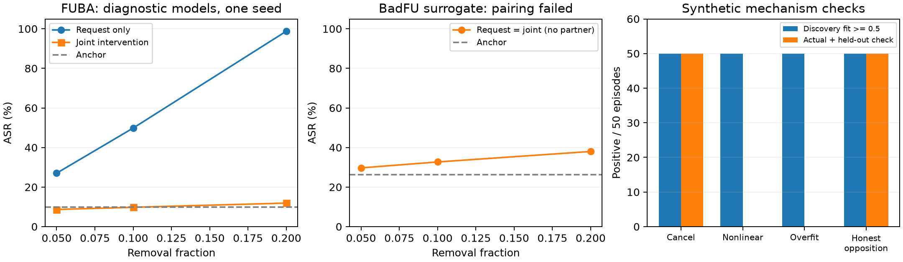

# 알고리즘·논문 개정 보고서

2026-10-13 공동삭제 개정 기록: [draft_v6.tex](draft_v6.tex). 현재 알고리즘 중심 개정은 [재설계 보고서](DEFENSE_LOGIC_REDESIGN.md)와 [v7](draft_v7.tex)를 따른다.
수학 명세와 증명: [PAIRED_AUDIT_MATH.md](PAIRED_AUDIT_MATH.md).
기존 전체 제어기: [STRUCTURAL_GUARD.md](STRUCTURAL_GUARD.md).

## 1. 결론과 논문의 중심 문장

**기존 CCD·DOSE·TRACE를 유지하고, TRACE의 상쇄 설명을 실제 공동 삭제와 별도 입력으로 확인하는 단계를 추가했다.**
새 단계는 기존 위험 경보를 취소하지 않으며, 자체적으로 추가 감사 우선순위를 만들 수 있다.
노벨티 후보는 ‘상쇄를 처음 발견했다’가 아니라 **선택된 상쇄 설명을 검증 가능한 개입 주장으로 바꾸는 절차**다.
신규 지표의 이름이나 기존 방법의 단순 연결을 노벨티로 내세우지 않는다.

현재 근거에 맞춘 핵심 주장:

> 잠복 백도어의 삭제 감사를 요청 조건부 모델 개입으로 정식화하고,
> 기존 위험 검사를 유지하면서 추정 상쇄 관계를 별도 입력과 실제 공동 삭제로 확인한다.
> 이 검증은 단순 출력 변화의 설명을 강화하지만 악의나 삭제 완료를 단독으로 증명하지 않는다.

**현재 원고는 연구 초안이다.** 동일 오탐률·다중 학습 시드·원래 BadFU의 묶음 삭제·실제 복구 실험 전에는
범용 성능 우위나 보편적인 공격 방어를 주장할 수 없다.

## 2. 없애거나 축소할 부분

아래 주장은 v6에서 제거/축소했다. v5는 과거 기록으로 남기고 폐기된 주장 목록을 상단에 표시했다.

| 기존 주장/구성 | 수정안 | 근거 |
|---|---|---|
| 정상 학습에는 상쇄가 발생하지 않는다 | 삭제. 정상 반대 기여 반례를 명제로 추가 | 같은 네 모델 출력을 내는 정상/공격 세계를 구분할 수 없음 |
| 공격 성립의 필요조건이 CCD 판정의 충분조건 | 삭제 | 공개 뷰 전파, 크기, 여유분, 잡음, 역할 분리 조건이 부족함 |
| CCD 조건들의 꼬리확률을 곱하면 오탐 보장 | 삭제 | 공통 표본·MAD·합계에서 만든 사건들은 의존함 |
| 다수 양의 기여 + 단일 음의 기여가 공통 구조 | FUBA 설정용 휴리스틱으로 한정 | BadFU 단일 운반자, 복수 억제자, 같은 클라이언트 묶음에는 부적합 |
| 기존 방어는 원리적으로 전부 실패 | 삭제 | MASA/UnlearnGuard의 목적과 전제를 정확히 비교해야 함 |
| MASA = 악성 언러닝 요청 탐지, 2024 | WACV 2025의 개별 언러닝 기반 악성 로컬 모델 탐지로 수정 | 원문 확인 |
| 후보 집합 = 공격자 정답 | 후보 설명으로 격하 | 새 FUBA 실험의 후보에 정상 13/15/17 등이 섞임 |
| 되감기 후 제외 학습이면 요청자 정보가 제거된다 | 독립 망각 검증 필요 | 되감은 체크포인트도 요청자 영향을 포함할 수 있음 |
| 모델 생성이 전혀 없다 | 후보 상태 생성/로딩 및 순전파 비용으로 수정 | 실제 구현이 개입 모델을 계산함 |
| 복원 = 백도어 제거 | 둘을 분리 | ASR이 삭제 전 수준으로 돌아와도 잠복 성분은 남을 수 있음 |
| 저장 U의 배율 조정 = 적응형 공격 방어 | 반합성 감도 분석으로 표기 | 공격자가 방어를 고려하여 다시 학습한 실험이 아님 |
| 실패한 투영 정화·요청자 재주입을 기본 처방으로 사용 | 기본 경로에서 제외 유지, 실패 분석으로만 보존 | 기존 R-011 실패 및 망각 위반 가능성 |

기존 코드/결과 파일을 지우지는 않았다. 기존 CCD 및 DOSE 기준선을 보존해야 새 단계의 기여를 비교할 수 있다.
기존 R-007의 FedEraser 성공 기록도 논문에서 누락하면 안 된다.
v5의 ‘공모 집합을 제외한 경우에만 성공’ 문장을 삭제했고, 같은 프로토콜의 재비교 전에는 우위를 선언하지 않는다.

## 3. 추가 구현

- `FUBA/paired_audit.py`: 네 모델 효과, 클래스 중심화 로그확률, TRACE 선택,
  50:50 입력 분할, 실제 공동 잔차, 비선형 오차, 정상 에피소드 순위 보정 함수.
- `FUBA/structural_guard.py`: 선택적 `confirmation` 콜백.
  `DOSE 위험 OR paired 위험 OR 보존 실패`로 보류한다. pairing 미확인이 기존 경보를 지울 수 없다.
- `FUBA/run_structural_guard.py`: `--paired_confirm` 옵션. 기본 기존 구성요소는 유지.
- `FUBA/experiment_paired.py`: 실제 저장 궤적·공격 없는 대조군·합성 기전 실험.
- `FUBA/evaluate_paired.py`: 후보 선택을 저장한 뒤 별도 입력에서 ACC/ASR 평가.
- `FUBA/summarize_paired.py`: 고정 결과의 소거표·그림·소스 해시.
- 동작 검사 37개 통과. 새 검사에는 정상 반대 기여, 선형 예측 실패, 선택 과적합,
  BadFU처럼 pairing이 안 되어도 기존 경보를 유지하는 조건이 포함된다.

유의확률 보정은 **함수 구현과 합성 검증까지**다. 실제 정상 에피소드 보정 자료가 없어
실제 결과에는 p값이나 5% 오탐 보장을 붙이지 않았다.
`held`는 삭제 완료가 아니며, 실제 체크포인트 CLI는 복구·독립 망각 증거가 없으므로 승인하지 않는다.

## 4. 이번에 실제 실행한 실험

### 자료와 통제

원본 체크포인트를 수정하지 않고 읽었다.
로컬 자료 루트는 `C:/Users/sijoo/AppData/Local/Temp/bfu/repo-rfu`다.
파일 경로·크기·수정 시각과 마지막 체크포인트 SHA-256은 각 JSON에 있다.
작업 코드의 사후 해시 스냅샷은 `summary.json`에 기록했다(새 Git 커밋이나 새 학습 시드가 아님).

| 실험 | 자료 | 요청자 | 조건 수 |
|---|---|---|---:|
| FUBA | loc_k20paper_s0, MNIST/LeNet, K20, 100라운드, IID 시드522 | 억제자4, 정상5/19 | 9 |
| BadFU 변형 | traj_full, CIFAR-10/ResNet-18, K6, 15라운드, 시드42 | camouflage5, 정상1/2 | 9 |
| 정상 대조군 | loc_clean_k8, MNIST/LeNet, K8, 8라운드 | 전체8명 | 24 |
| 합성 메커니즘 | 6종×50회 | 정상·상쇄·국소·비선형·과적합·정상 반대 기여 | 300 |
| 합성 정상 보정/시험 | 별도 생성 에피소드 | 보정199 + 시험200 | 399 |

실제 조건은 삭제 비율 0.05/0.1/0.2. 공개/요청 뷰 각각 256개 입력을 사용하고
각 뷰를 128개 선택/128개 확인으로 나눴다. 요청 뷰는 실제 클라이언트 분할의 균등 표본이다.
정상 에피소드 수는 **42가 아니라 세 궤적 중 정상 학습 1개**다.
한 궤적의 서로 다른 요청·비율은 상관된 측정이므로 다중 시드처럼 세지 않았다.

BadFU 6클라이언트 변형은 원래 논문의 같은 클라이언트 내 표본 삭제가 아니다.
또한 삭제 전 ASR 26.2%인 15라운드 모델이므로 충분히 잠복한 공격 재현의 강한 증거로 쓰지 않는다.
정상 대조군의 ACC도 87.1%이고 K/학습 길이가 FUBA와 달라 동일 설정 오탐률을 추정할 수 없다.

### 결과와 소거

| 대상 | 에너지 단독 경보 | 기존 DOSE 경보 | 새 공동 검증 경보 | OR 결합 경보 |
|---|---:|---:|---:|---:|
| FUBA 억제자 3조건 | 3 | 1 | 2 | 3 |
| FUBA 정상 6조건 | 0 | 0 | 0 | 0 |
| BadFU 변형 요청자 3조건 | 0 | 1 | 0 | 1 |
| BadFU 변형 정상 6조건 | 6 | 0 | 0 | 0 |
| 공격 없는 정상 24조건 | 3 | 0 | 0 | 0 |

에너지 단독은 같은 z/최소 에너지 문턱을 사용한다. 실제 정상 조건의 에너지 경보 9개가
공동 검증에서는 확인되지 않았다. **기존 DOSE보다 오탐이 줄었다는 결과는 아니다.**
DOSE 자체의 정상 경보도 0이었다. 새 검증의 관측된 이점은 FUBA 5%/10% 부분 삭제에서의 추가 신호다.
20% FUBA는 출력 붕괴로 paired가 판정 불가다. BadFU는 요청 뷰 DOSE만 20%에서 위험을 찾았다.
공개 뷰만 사용한 paired도 BadFU에서 실패했다.

별도 평가의 ASR은 비표적 입력만 분모로 사용했다. FUBA 899개, BadFU 1,000개다.

| FUBA 억제자 삭제 비율 | 요청만 삭제 ACC / ASR | 공동 삭제 ACC / ASR |
|---|---:|---:|
| 삭제 전 | 98.0 / 9.8 | — |
| 5% | 98.0 / 27.0 | 98.1 / 8.7 |
| 10% | 96.9 / 49.8 | 98.1 / 9.8 |
| 20% | 44.6 / 98.8 | 96.7 / 11.9 |

단위는 %. **전량 삭제나 방어 완료 결과가 아니다.** 공동 삭제 ASR은 기준 수준으로 돌아왔을 뿐이다.
10% 삭제에서 선택된 상대는 {0,3,17,13,15}; 정답 주입자는 {0,1,2,3}이다.
정상 후보가 섞여 자동 배제는 허용할 수 없다.
이미 저장되어 있던 정답 집합 제외 재학습 모델은 같은 평가에서 ACC98.7/ASR0.44였다.
이 값은 새 후보 집합에 대한 복구 성능으로 사용하지 않았다.

BadFU 변형의 요청자 20% 삭제는 ACC82.5/ASR38.0이었다(삭제 전83.8/26.2).
새 검증은 상대를 찾지 못했으므로 공동 모델이 요청 모델과 같았다.
GPU 계산 비결정성으로 BadFU 일부 정확도 재측정에는 0.1%p 차이가 있었으며 반올림으로 숨기지 않는다.

합성 실험에서는 선형 선택이 잘못 설명한 비선형 실패 50/50과 선택 과적합 50/50을
실제 개입·확인 입력으로 걸렀다. 반면 정상 반대 기여 50/50도 경보를 냈다.
이는 정상과 공격의 관측이 같으면 구별할 수 없다는 반례이지 실환경 탐지율 추정이 아니다.
별도 합성 보정199/시험200에서는 α=.05의 순위 검정이 정상4/200을 기각했다.



원자료: [결과 요약](../../FUBA/logs/paired_audit/summary.json),
[FUBA 감사](../../FUBA/logs/paired_audit/fuba_local.json),
[BadFU 감사](../../FUBA/logs/paired_audit/badfu_local.json),
[정상 감사](../../FUBA/logs/paired_audit/clean_local.json),
[FUBA 평가](../../FUBA/logs/paired_audit/fuba_evaluation.json),
[BadFU 평가](../../FUBA/logs/paired_audit/badfu_evaluation.json),
[합성 실험](../../FUBA/logs/paired_audit/synthetic.json).

## 5. 다음에 필요한 실험: 주장별 통과 기준

| 우선순위 | 실험 | 고정할 조건/기준 | 미실행 이유와 현재 주장 제한 |
|---|---|---|---|
| 1 | K20/100라운드의 공격 없는 IID·Dirichlet·owner, 독립 학습 시드 | 보정/시험 궤적 분리, 동일 FPR에서 DOSE/에너지/paired/OR 비교 | 해당 정상 궤적이 현재 로컬에 없음. 범용 FPR 주장 보류 |
| 1 | 원래 BadFU의 동일 클라이언트 camouflage 묶음 FU | 원문 수준 잠복·활성화 확인 후 실제 묶음 연산자 연결 | 현재 저장 기록은 6클라이언트 surrogate. BadFU 원설정 방어 주장 보류 |
| 1 | 기존 FUBA 6시드의 실제 paired 개입 | 고정된 문턱·뷰·후보 예산으로 동일 지표 | 현재 로컬은 1개 K20 원본 궤적, 6개는 CCD 캐시만 있음. 새 방법6시드 성능 주장 불가 |
| 2 | 선택된 후보로 전량 요청 복구 | 보존ACC, non-target ASR, 참조 재학습 거리/망각 증거, 정상 오배제 비용 | 현재 후보가 혼합됨. 진짜 역할로 후보를 바꿔 결과를 포장하지 않음 |
| 2 | FedEraser·재학습·MASA·UnlearnGuard 비교 | 동일 위협·데이터 접근·FU 연산자·계산 예산, 기존 성공 결과 포함 | 새 비용/다중시드 비교는 미실행. 기존 방법 대비 우위 주장 보류 |
| 2 | 후속 정상 학습 후 재활성화 | 복구 후 사전 고정 5/20/50라운드의 ASR·ACC | 현재는 순간 복원 평가만 수행 |
| 3 | 실제 적응형 재학습, 복수 억제자·다중 표적·강건 집계 | 평가 전에 문턱과 입력 고정; 공격자의 지식 범위 명시 | 합성/저장U rescale은 대체 증거가 아님 |
| 3 | 입력 분할·문턱·후보 예산·확률 클리핑 민감도 | 새로운 시험 궤적에서 효과/시간/실패율 보고 | 지금 관측한 실패를 보고 같은 시험 자료에 맞춘 튜닝을 하지 않음 |

이번에는 새 모델 학습 없이 실행 가능한 개입·평가·소거 실험을 수행했다.
위 표의 대규모 훈련이나 원래 BadFU 어댑터 작업을 완료했다고 표현하지 않는다.
논문 성능 주장을 강화하는 다음 최우선 작업은 **동일 설정 정상 에피소드 확보와 원래 BadFU 묶음 FU**다.

## 6. 재실행

저장소 루트에서 PyTorch/torchvision/NumPy/matplotlib가 설치된 Python으로 실행한다.
모든 출력은 지정한 로컬 경로에 저장하며 외부 전송·모델 배포는 없다.

```powershell
$py = 'C:\Users\sijoo\Documents\ChatGPT\badFU\envs\badfu-original\python.exe'
$artifacts = 'C:\Users\sijoo\AppData\Local\Temp\bfu\repo-rfu'
& $py -m unittest discover -s FUBA/tests -v
& $py FUBA/experiment_paired.py --case synthetic --out FUBA/logs/paired_audit/synthetic.json
& $py FUBA/experiment_paired.py --case fuba --artifact-root $artifacts --out FUBA/logs/paired_audit/fuba_local.json
& $py FUBA/experiment_paired.py --case badfu --artifact-root $artifacts --out FUBA/logs/paired_audit/badfu_local.json
& $py FUBA/experiment_paired.py --case clean --artifact-root $artifacts --out FUBA/logs/paired_audit/clean_local.json
& $py FUBA/evaluate_paired.py --audit FUBA/logs/paired_audit/fuba_local.json --out FUBA/logs/paired_audit/fuba_evaluation.json
& $py FUBA/evaluate_paired.py --audit FUBA/logs/paired_audit/badfu_local.json --out FUBA/logs/paired_audit/badfu_evaluation.json
& $py FUBA/summarize_paired.py
```

공통 CLI에서 실험 경로를 켜려면 기존 `audit` 명령에 `--paired_confirm --step 0.05`를 추가한다.
단계 수 증가에 따른 반복 검사와 계산 비용도 함께 평가해야 한다.
위 로컬 checkpoint/data는 Git 저장소에 포함되지 않으므로 재현 환경에서 별도로 확보해야 한다.
