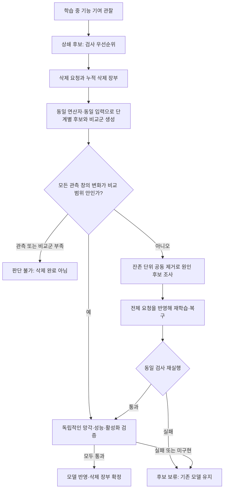

# 잠복형 공격의 공통 방어 과정: Structural Guard

2026-10-13. 범위: FUBA·BadFU처럼 학습 중에는 억제되고 삭제 뒤 활성화되는 공격.
상쇄 구조가 없는 일반적인 언러닝 공격은 이번 범위에서 제외한다.

이 문서는 새 **실험용 알고리즘과 실행 가능한 공통 인터페이스**를 정의한다.
기존 CCD의 R-013 성능을 새 알고리즘의 성능으로 옮겨 쓰지 않는다.
핵심 구현은 `FUBA/structural_guard.py`, 궤적 연결은 `FUBA/run_structural_guard.py`다.

**기존 방법을 기본으로 재사용한다.** 새 탐지기로 교체하는 것이 아니라 기존 계산을
공통 제어 계층으로 연결한다. `--components existing`, `--screen ccd`가 CLI 기본값이다.

| 단계 | 재사용하는 기존 구현 | 공통 계층에서 하는 일 |
|---|---|---|
| 학습 관찰 | CCD의 `judge`, `mad_z` | 결과를 삭제 검사 우선순위로 사용 |
| 삭제 검사 | DOSE의 `Engine.stat_of/check/threshold`, `median_probs` | 다중·누적 요청 비교군과 공개/삭제 입력별 검사 연결 |
| 귀속 | TRACE의 `box_nnls/resid2/forward_select` | 활성화에 반대되는 잔존 기여의 집합 추정 |
| 복구 | 기존 FedEraser·재학습을 연결할 callback | 전체 요청 전달·복구 후 재검사·실패 시 미반영 |
| 최종 확인 | 환경별 망각·성능 검사 callback | 세 독립 검사의 결과가 있어야 완료 처리 |

CCD 계산은 `ledger_rules.py`, TRACE 계산은 `trace_solver.py`로 **수식 변경 없이 분리**했다.
기존 스크립트도 같은 함수를 import하므로 코드가 두 벌로 갈라지지 않는다.
`existing_guard_components.py`가 DOSE·TRACE를 연결한다. FedEraser의 충실 구현은
`unlearn_method/federaser_faithful.py`에 있지만 학습 데이터 연결이 필요하므로 이번 CLI에서
자동 호출하지 않는다. 저장소에서 실패로 기록한 DEFUSE와 재억제 KD는 기본 복구로 사용하지 않는다.

## 1. 공격 이름 대신 무엇을 공통으로 볼 것인가

삭제 단위 집합을 V, 주입 성분이 있는 단위를 A, 억제 성분을 지우는 요청을 S라고 하자.
한 단위는 클라이언트 전체일 수도 있고, 같은 클라이언트 안의 서로 겹치지 않는 데이터 묶음일 수도 있다.
관측 입력 X에서 단위 v의 기능적 기여를 E_v(X)라고 하면, 국소 선형 근사에서

\[
\left\|\sum_{a\in A}E_a(X^*)+\sum_{s\in S}E_s(X^*)\right\|
\ll \left\|\sum_{s\in S}E_s(X^*)\right\|
\]

인 영역 X*가 있을 수 있다. 실제 판정은 이 근사의 정확성을 가정하지 않고
동일한 삭제 연산자 R로 만든 후보 모델의 출력 변화를 직접 검사한다.
공격자 명단·타깃 정답·트리거 정답은 판정 입력에 없다.

| 차이 | FUBA형 | BadFU형 | 공통 처리 |
|---|---|---|---|
| 관측 위치 | 공개 입력에도 영향이 나타날 수 있음 | 삭제 대상 입력에서만 보일 수 있음 | 공개/삭제 입력을 별도 관측 창으로 검사 |
| 주입자 수 | 여러 명 | 한 명도 가능 | 최소 주입자 수를 판정 조건으로 쓰지 않음 |
| 억제자 수 | 한 명 또는 여럿 | 위장 데이터 묶음 | 요청을 단위→삭제 비율 사전으로 표현 |
| 표적 | 한 클래스가 흔함 | 한 클래스가 흔함 | 전체 분포·입력별 변화·클래스 흐름을 함께 검사 |
| 요청 방식 | 클라이언트 이탈 | 클라이언트/데이터 삭제 | 동시·순차·분할 요청을 누적 비율로 추적 |
| 대응 | 되감기/재학습 | 잔존 주입 데이터까지 처리 필요 | 동일한 복구 계약과 독립 검증 사용 |

같은 클라이언트가 주입·억제를 모두 보유하면 클라이언트 전체 기여 U만으로 두 성분을
분리할 수 없다. 데이터 묶음별 기여 또는 해당 데이터 삭제를 구현하는 R이 필요하다.
현재 체크포인트 어댑터는 클라이언트 단위이며, 코어 인터페이스만 데이터 묶음까지 지원한다.

## 2. 하나의 상태 전이로 연결한 알고리즘



학습 중 후보가 없더라도 요청 검사는 **항상** 수행한다.

### A. 학습 중 관찰

기본 `--screen ccd`는 기존 장부 판정과 연속 경보 규칙을 그대로 재생한다.
주입자 2명 이상이라는 기존 조건이 맞지 않아 후보가 없어도 삭제 검사를 생략하지 않는다.
다음은 선택 가능한 **실험용** `--screen structural`의 넓은 후보 규칙이다.

각 참여자의 집계 가중 기여가 만드는 기능 변화 텐서를 누적한다. 입력×클래스 차원을
보존할 수 있으며 기존 장부의 클래스 평균 벡터도 읽는다. 각 좌표 d에서

\[
H_d=1-\frac{|\sum_v P_{v,d}|}{\sum_v |P_{v,d}|}
\]

를 계산한다. 큰 양·음 기여 집합이 함께 있고 H가 문턱을 넘는 동일 집합·좌표가 반복되면
검사 후보로 기록한다. 4개 이상 단위에서는 중앙값과 MAD로 큰 양·음 기여를 고른다.
단일 주입자도 허용하며 정상 class owner도 후보가 될 수 있다. **후보만으로 제외하지 않는다.**
부분 참여를 허용하되, 후보 중 누구의 새 기여도 없는 라운드에서는 연속 증거를 쌓지 않는다.
라운드 누락도 연속성을 끊는다. 고정 문턱은 오경보 확률 보장이 아니다.
기존 `ledger_defense.py`와 그 결과는 보존한다.

### B. 누적 요청의 단계별 검사

삭제 장부 a[v]는 최초 기준 모델을 기준으로 누적한다. 새 요청 Δa를 단계별로 반영해
R(θ_anchor, a+λΔa)를 생성한다. 정상으로 통과한 작은 요청 뒤에도 기준을 현재 모델로
바꾸지 않으므로 분할 요청의 누적 활성화를 숨기지 않는다.

비교군은 삭제 이력이 없는 다른 단위들에서 **전체 누적 요청과 같은 개수·비율**을 제거한다.
동일 입력·동일 연산자·동일 난수 규약을 사용해야 한다. 기본 비교군 구성은 개수와 비율을
맞춘다. 데이터 크기·참여 횟수·분포까지 자동으로 맞추지는 않으므로, 비균등한 환경에서는
호출자가 비교 가능한 단위 집합을 제공하거나 전용 어댑터로 매칭해야 한다.
같은 비율은 같은 영향량이나 교환 가능성을 보장하지 않는다.

각 관측 창에서 네 가지 통계를 비교한다.

아래 네 통계는 선택적 `--components distribution` 경로다. 기본 `existing` 경로는
DOSE의 `flow`(또는 `--stat mass/changed/shift`)와 기존 leave-one-out 비교를 재사용한다.
기존 스크립트처럼 공개/삭제 입력을 합치지 않고 각 창에서 건강한 비교군을 골라 별도로 검사한다.
기존 DOSE의 모든 기본값·원래 실험 성능을 그대로 재현한다는 뜻은 아니다.

1. 전체 예측 분포의 평균 Jensen–Shannon 변화.
2. 입력별 total variation이 큰 상위 10%의 평균. 국소 활성화가 평균에 묻히는 것을 완화한다.
3. 어느 클래스든 유입되는 최대 확률 질량.
4. 여러 출발 클래스에서 한 클래스로 바뀌는 흐름량×출발 다양성.

비교군 중앙값 대비 MAD 점수가 문턱을 넘고 절대 변화도 충분하면 보류한다.
MAD=0을 자동 통과시키지 않고 양의 바닥값을 사용한다. 공개 입력의 전체 변화 상한도 검사한다.
이는 유지 성능의 대리 검사이며 정확도 검증을 대신하지 않는다. 점수들은 다중 비교 보정된 p값이 아니다.

관측 창이 없거나 서로 다른 비교군이 3개 미만이면 `inconclusive`다.
현재 `public`, `request`가 기본 필수 창이다. 둘을 제공했다는 사실만으로 X*를 포괄했다고
볼 수 없으며, 모든 창을 통과해도 보편적인 안전 보장은 없다.

### C. 잔존 기여 귀속

기본 경로는 잔존 단위의 제거가 만든 출력 변화 벡터를 계산한 뒤 기존 TRACE의 상자 제약
최소제곱 전진 선택으로 활성화 벡터를 상쇄하는 집합과 가중치를 찾는다.
`distribution` 경로에서는 아래의 직접 모델 제거 탐욕 검사를 사용한다.

요청 기여를 다시 넣지 않고, 남은 단위들을 추가로 제거했을 때 입력별 변화가 얼마나
줄어드는지 탐욕적으로 조사한다. 여러 단위를 누적 선택할 수 있고 단일 주입자도 허용한다.
출력은 `suspects`이며 확정 악성 명단이 아니다. 독립적으로는 효과가 없고 공동 제거에서만
효과가 나는 고차 상호작용은 이 탐욕 탐색이 놓칠 수 있다.

정상 owner나 정직한 억제 효과를 가진 단위도 귀속될 수 있다. 따라서 이 결과만으로
참여자를 차단하지 않고 복구 후보와 독립 검증에 사용한다.

### D. 전체 삭제를 반영한 복구

`recover(cumulative_removals, suspects)`는 중단된 일부 비율이 아니라 **전체 삭제 요청**을
인자로 받는다. 적용 환경에 맞는 재학습/FedEraser 등으로 모델을 반환한다.
삭제 데이터를 가진 원 모델로 재증류해 잠복 상태만 복원하는 것을 복구로 간주하지 않는다.
되감기 체크포인트가 삭제 데이터나 주입 기여를 포함하지 않는지 입증할 수 없다면 처음부터
재학습하는 기준선이 필요하다. 체크포인트를 되감았다는 사실 자체가 망각 증거는 아니다.

코어는 복구를 호출하고 재검사하는 경로까지 구현한다. **현재 CLI 어댑터에는 실제 재학습
callback이 없다.** 해당 경우 `held`를 반환하며 삭제를 이행했다고 표시하지 않는다.

### E. 반영 전 검증과 이후 재검사

`verify(model, cumulative_removals, suspects)`는 별도 검증 데이터·삭제 계약에 따라
`Verification(forgetting, retention, independent_audit, evidence)`를 반환한다.
세 검사가 모두 통과하고 근거 문자열이 있어야 serving model과 삭제 장부를 함께 갱신한다.
검증 함수의 올바름은 통합 환경의 책임이며 코어가 Boolean 입력의 진실성을 증명하지는 않는다.

| 상태 | 의미 | 제공 모델/삭제 장부 변경 |
|---|---|---|
| `inconclusive` | 관측·비교 근거 부족 | 없음 |
| `held` | 활성화/붕괴/재검증 실패, 복구 필요 | 없음 |
| `audited_only` | 관측 검사는 통과했으나 독립 검증 미구현 | 없음 |
| `released` | 전체 요청의 모든 검사 통과 | 있음 |
| `recovered` | 전체 요청을 반영한 복구와 모든 검사 통과 | 있음 |

복구 후에는 이전 기여 근사로 모델을 다시 만들지 못하도록 새 backend를 요구한다.
새 기준은 검증된 복구 모델이며 이미 삭제한 단위는 재등록하지 않아야 한다.
`audit(model, removals)`는 이후 후보도 검사할 수 있지만, 추가 학습·재참여로 지연 활성화되는
경우에는 같은 학습 과정을 거친 비교군을 제공해야 한다. 자동 재참여 실험 루프는 아직 없다.

## 3. 실행

Python 3.10+와 NumPy로 정책·캐시 재생을 실행할 수 있다. 체크포인트 감사에는 기존
FUBA/BadFU PyTorch 환경이 필요하다. 저장소 루트에서:

```bash
python -m unittest discover -s FUBA/tests -v
python FUBA/run_structural_guard.py monitor --cache FUBA/logs/ledger/bd_iid_r100w5_k20paper_s0_push.npz --out FUBA/logs/structural_guard/iid_s0.json
```

`probes.npz`의 `public`, `request`는 라벨 없이 모델 전처리가 끝난 입력 배열이다.
FUBA MNIST는 N×1×28×28, CIFAR는 N×3×32×32다. BadFU의 정규화 규약도 지켜야 한다.
삭제 요청자가 임의로 바꾼 입력을 그대로 믿지 말고 학습 시점의 데이터 약정과 대응하는
입력인지 통합 계층에서 확인해야 한다. 이 CLI는 약정 검증을 구현하지 않는다.
입력 선택·변환을 기록하고 ASR용 트리거 정답을 방어 입력으로 섞지 않는다.

```bash
python FUBA/run_structural_guard.py audit --fmt fuba --name bd_iid_r100w5_k20paper_s0 --rounds 100 --K 20 --ckpt_dir FUBA/checkpoints --probes probes.npz --requesters 4 --out FUBA/logs/structural_guard/fuba_audit.json
python FUBA/run_structural_guard.py audit --fmt badfu --name badfu_full --rounds 15 --K 6 --traj_dir BadFU_src/BadFU-main/logs/traj_full --counts 10545 9647 9641 9649 9668 10545 --probes probes_badfu.npz --requesters 5 --out FUBA/logs/structural_guard/badfu_audit.json
```

두 명의 공동 요청은 `--requesters 4 5`처럼 준다. CLI는 한 요청의 감사용이며,
지속적인 분할 요청은 `StructuralGuard` 인스턴스의 `request({unit: 추가비율})`로 전달한다.
실제 데이터 크기가 동일할 때만 BadFU의 `--uniform_weights`를 사용한다.

현재 어댑터는 저장 기여의 선형 감산이다. 이를 정확한 언러닝이나 삭제 완료로 표현하지 않는다.
FUBA의 참여자 균등 FedAvg, BadFU의 주어진 표본 수 FedAvg 가중을 재사용한다.
Median/Krum/FLAME 같은 비선형 집계의 기여를 이 어댑터로 정확히 분해할 수는 없다.
신규 모델·연산자는 `Backend`의 `units`, `views`, `propose`, `predict`를 구현해 연결한다.
연산자의 난수·실제 집계 규칙·입력 좌표를 비교군에도 동일하게 적용해야 한다.

## 4. 이번 검증과 남은 실험

합성 인과 모델로 FUBA형 공개 누출, BadFU형 비공개 국소 활성화, 단일/다중 주입자,
다중 억제자, 같은 클라이언트의 데이터 묶음, 분할 요청, 다중 표적의 평균 상쇄,
관측 누락, 부분 참여, 복구 실패, 독립 검증 실패, 요청 범위 초과를 검사한다.
실제 파일 형식의 작은 fixture로 FUBA 결석 처리와 BadFU 표본 수 가중도 검사한다.
이 테스트는 실험 ASR이나 방어 보장을 뜻하지 않는다.

기존 FUBA MNIST 논문 설정 캐시 6개와 로컬 캐시 1개를 재생했다.

**기본 CCD 재사용 경로:** 논문 설정 6개의 첫 경보 라운드·좌표·참여자 집합이 기존 저장
결과와 모두 일치했다. IID 13/15/11, owner 16/15/11이며,
`FUBA/logs/structural_guard/existing_ccd_parity.json`에 기록했다.

**실험용 structural 경로:**
`FUBA/logs/structural_guard/existing_cache_replay.json`에 기록했다.
논문 설정 6개 모두 첫 후보 좌표는 8, 첫 후보 라운드는 IID 20/15/11,
owner 16/15/14였다. owner s2의 첫 후보에는 정상 단위 5가 추가로 포함됐다.
따라서 이 넓은 후보 규칙은 기존 CCD의 정밀도를 계승하지 않으며 자동 제외 근거로 쓸 수 없다.
`round`는 캐시 이벤트 번호이고 FUBA 원본 체크포인트 번호와 1 차이가 난다.

후속 작업에서 요청 조건부 공동삭제 검증을 추가했다. `--paired_confirm`은
기존 DOSE 경보를 유지하면서 추가 위험을 보류시키는 실험 옵션이다.
수학은 `PAIRED_AUDIT_MATH.md`, 42개 실제 감사와 699개 합성 에피소드,
별도 ACC/ASR 평가 및 한계는 `REVISION_REPORT.md`에 정리했다.
실제 학습 궤적은 FUBA·BadFU 변형·정상 각 1개이며 새 재학습 실험은 아니다.

아직 측정하지 않은 것: 새 요청 검사·복구의 실제 FUBA/BadFU 다중 시드 ASR/ACC,
공격 없는 non-IID 오탐률, 통계 문턱 보정, 데이터 묶음 FU의 실제 구현,
지연 재활성화, 실제 재학습의 망각 증거, secure aggregation 환경.

관측 X에서 정상 모델과 공격 모델이 같은 출력을 만들면 X만 보는 탐지기는 둘을 구별할 수 없다.
범용성의 주장은 **동일한 과정을 여러 잠복 구조에 적용할 수 있음**까지다.
모든 잠복 공격을 반드시 탐지한다는 정리는 아니다.
