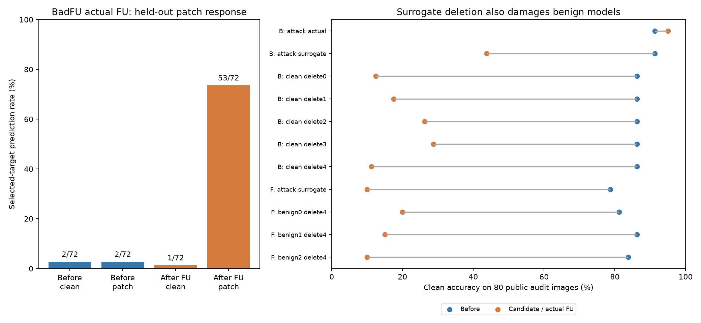
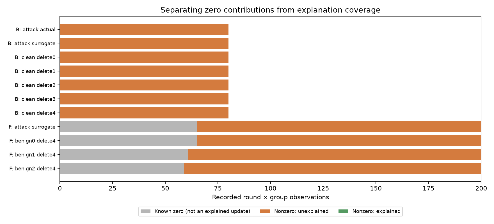

# 저장 모델의 로짓 이중 차분과 정상 설명 집합 비교

2026-10-17. 실행은 [RUN.md](../../../RUN.md). 정상 Non-IID와 공격을 완벽하게 구별한다는 주장은 하지 않는다.

**현재 연구의 위치:** 이 문서는 완료한 관측 방법 비교의 기록이다. 다음 목표는 [요청한 삭제 이후에 드러나는 잠복 백도어의 교정](../../../docs/current/RESEARCH_SUMMARY.md#현재-연구-범위와-다음-실험--2026-10-17)이다. 아래 이중차분 신호는 교정할 위험의 후보이며, FU의 망각 정확성이나 정화 성능의 증거는 아니다. BadFU·FUBA의 삭제 단위와 공격 기제는 별도로 검증한다.

## 본 실험 업로드 검토 — 2026-10-17

업로드 커밋 `845803e`의 [원본 ZIP](results/07ad0aefbb22ddc8/deletion_comparison.zip)에는 **11건 모두** 들어 있다. BadFU 40R 및 FUBA 100R, 정상 FUBA seed 42·43·44다. ZIP/파일 체크섬, 로짓 이중 차분, 정상 설명 LP/보류 결과, 이력 점수, AUC 표를 원본 관측에서 재계산해 일치했다. 원격 실행의 측정 코드 해시도 로컬 원본과 같다. 검산기에서 수정된 중심화 로짓의 수치 허용 오차는 GPU/NumPy float32 합산 차이에 관한 것으로, 점수나 탐지 임계값을 바꾼 것이 아니다.

### 1. 실제 BadFU FU에서 확인한 신호

| 측정 | 삭제 전 | 실제 FU 후 |
| --- | ---: | ---: |
| 깨끗한 평가 이미지 정확도 | 73/80 = 91.25% | 76/80 = 95.00% |
| 비표적 원본 이미지의 표적 0 응답 | 2/72 = 2.78% | 1/72 = 1.39% |
| 같은 이미지에 탐색 패치를 적용한 표적 0 응답 | 2/72 = 2.78% | 53/72 = 73.61% |

검색용 이미지에서 선택한 변형은 오른쪽 아래 4×4 패치, 출력은 클래스 0이었다. 실제 공격 트리거/표적을 검색 입력으로 주지 않았다. **별도 평가 이미지에서 이중 차분 D=6.0142, 정상 정확도 저하 없이 삭제 후 패치 반응 증가**가 관측됐다. 이는 이 방법에서 유지할 가치가 있는 관측이다. 다만 탐색한 패치에 대한 응답률이지 원래 공격 트리거의 ASR은 아니며, **정상 모델의 실제 FU 대조가 없어 정상 삭제와의 구분 성능은 아직 평가하지 못했다.** 실제 FU 후 모델로 탐색했으므로 실행 전 탐지의 증거도 아니다.

### 2. 이력 차감 근사의 AUC=1.0을 탐지 성공으로 부르면 안 되는 이유

| 조건 | 공격 D | 정상 D | 깨끗한 정확도 변화 |
| --- | ---: | ---: | --- |
| BadFU 이력 차감 근사 | 7.1545 | 3.1047~5.9658 | 공격 91.25→43.75%, 정상 86.25→11.25~28.75% |
| FUBA 이력 차감 근사 | 710.8484 | 7.4380~37.5655 | 공격 78.75→10%, 정상 81.25~86.25→10~20% |

각 공격 실행 하나의 점수가 정상 대조들보다 높아 소표본 순위 AUC는 1.0이다. 그러나 **정상 모델까지 망가지는 차감 근사**에서 얻은 구분이다. FUBA 공격 후보는 변형을 넣기 전부터 비표적 평가 이미지 72/72를 검색 표적 1로 분류하고, 변형 후에도 72/72다. 큰 로짓 이중 차분은 새로운 표적 전환 없이도 나타났다. 이 사례에서 D=710.85를 잠복 백도어가 활성화됐다는 직접 증거로 쓰지 않는다. 원본 학습 궤적이 틀렸다는 결론이 아니라, 이번 **누적 업데이트 차감이 실제 FU를 대신하기 어렵다**는 결과다.

### 3. 정상 설명 집합은 현재 설정에서 작동하지 않았다

**사례별로 집계한 0이 아닌 이력 기여 관측 1,110개 모두 정상 설명 집합이 비었다.** 같은 궤적을 다른 삭제/후보에 재사용한 관측을 포함하며 독립 업데이트 1,110개라는 뜻은 아니다. 따라서 11건 모두 정상 보정 이력 점수와 결합 점수가 보류됐다. 이는 공격 탐지 실패/성공으로 숫자를 낼 단계 이전의 표현 가정 실패다.

기존 출력의 FUBA coverage 29.5~32.5%는 삭제 대상 비참여로 기여가 0인 항목을 포함한다. 총 1,360개 라운드×집합 관측 중 알려진 0은 250개, 실제 설명된 비영 기여는 0개다. **32.5%를 정상 업데이트의 설명 성공률로 읽으면 안 된다.** [검토 표](checks/reviews/deletion_comparison_20261017/report.md)는 두 수치를 분리한다.

각 사례·삭제/잔류 집합의 첫·마지막 비영 방향 44개에서 계수 제한을 없애도 깨끗한 관측의 최소 오차는 허용 범위보다 컸고, 제한을 둔 경우와 사실상 같았다. 정상 BadFU의 클래스별 공개 기울기 공간에 대한 최소제곱 잔차 RMS 비율의 사례별 중앙값은 **78.55~85.42%**, 정상 FUBA는 **63.56~66.59%**였다. 따라서 확인한 표본에서는 단순히 계수 제한 B=2가 작은 문제가 아니다. **최종 모델의 공개 클래스 평균 기울기 10개가 실제 정상 기여 방향을 충분히 표현하지 못했다.** 이것을 공격 신호로 사용하면 정상도 함께 오탐한다. ε를 공격 결과에 맞춰 크게 잡는 방식으로 성공을 만들지 않는다.

### 다음 검증의 우선순위

1. BadFU의 신호를 확인하려면 **정상 실행의 실제 FU 대조**를 먼저 추가한다. 기존 FL을 다시 학습할 필요성과 FU만 수행할 수 있는지를 분리한다.
2. FUBA는 누적 차감 후보의 큰 점수를 주 결과에서 제외하고 **같은 요청을 수행한 실제 FU 모델**로 다시 평가한다.
3. 이력 방법은 먼저 정상 실행에서 참조 공간의 설명 가능성을 검증해야 한다. 기존 집합의 실패를 확인한 상태에서 이력 추가 이득이나 새로운 탐지 보장을 주장하지 않는다.

추가 학습·FU·추론 없이 업로드된 관측만으로 검토했다. 상세 수치와 재계산 근거는 [audit.json](checks/reviews/deletion_comparison_20261017/audit.json)에 있다. 기존 원본 결과는 수정하지 않았다.

## 비교할 두 방법

1. **로짓 이중 차분:** 삭제 전후 모델의 변형 민감도가 얼마나 달라지는가?
2. **정상 설명 집합을 이용한 이력 방법:** 같은 변형·출력 좌표에서, 정상 클래스 학습으로 설명 가능한 부분을 제외해도 삭제 대상의 억제와 잔류 기여의 강화가 함께 남는가?

동일한 검색 이미지, 후보 모델, 탐색 예산으로 변형과 출력 클래스를 한 번 선택한다. 모든 비교군은 그 좌표를 고정해 별도 평가 이미지에서 측정한다. 공격 표적, 공격 생성기, 실제 트리거, 공격자 ID는 탐색·정상 설명 계산에 넣지 않는다. **삭제 요청 ID는 입력**이며 정상/공격 역할 표시는 결과 비교에만 쓴다.

## 관측과 수식

모델 출력은 확률이 아닌 로짓 벡터다. 고정 선형 대비를 $q_k(z)=z_k-C^{-1}\sum_jz_j$로 정한다. 이는 표적-나머지 평균 로짓 차이를 일정 비율로 줄인 것이다. 기존 logsumexp 마진을 그대로 재사용하지 않는다.

\[
I(x,\delta)=\{f_{post}(T_\delta x)-f_{pre}(T_\delta x)\}
             -\{f_{post}(x)-f_{pre}(x)\},\quad
D=\mathbb E_{x:y\ne k}q_k(I(x,\delta)).
\]

입력과 무관한 클래스별 로짓 편향은 정확히 소거된다. **정상적인 특징·분류기 가중치 변화는 남을 수 있다.** 따라서 D>0은 공격 판정이 아니다.

기본 탐색 공간은 작은 전역 가산 변형(8/255)과 4개 모서리의 4×4 덮어쓰기 패치다. 모든 표적·위치에 동일한 반복 수를 사용한다. 큰 명암 패치와 작은 변형을 한 종류의 제약으로만 검사하지 않기 위한 선택이다. 실제 트리거 복원을 보장하지 않으며 중간 위치·큰 패치·입력별 변형 등은 놓칠 수 있다. 계획의 probe_mode를 additive/patch로 나눈 확인도 가능하다.

공개 라벨 자료를 **참조/검색/평가** 세 묶음으로 나눈다. 참조 자료에서 최종 삭제 전 모델의 클래스별 손실 기울기를 만든다.

\[
g_c=-\nabla_\theta L_c(\theta_{pre})/
          \|\nabla_\theta L_c(\theta_{pre})\|_2,\quad G=[g_1,\ldots,g_C].
\]

전체 중심화된 평가 로짓에 대한 Jacobian을 J, 변형-원본의 고정 표적 대비 평균에 대한 Jacobian을 P로 둔다. forward AD의 JVP를 사용한다. **최종 모델 한 곳에서 모든 과거 방향을 비교**하며 과거 모델의 정확한 인과 영향이나 실제 FU의 미분이라고 부르지 않는다. BN 통계는 최종 모델 값으로 고정한다.

기록된 집계 가중치 a를 포함한 과거 삭제/잔류 집합의 방향은

\[
v_{D,t}=\sum_{i\in D\cap S_t}a_{i,t}(w_{i,t}-w_t),\quad
v_{R,t}=\sum_{i\in R\cap S_t}a_{i,t}(w_{i,t}-w_t).
\]

각 방향을 단위 L2 크기로 정규화한 u에 대해 다음 **정상 설명 후보 집합**을 구성한다.

\[
\mathcal B(u)=\{\beta:\|JG\beta-Ju\|_\infty\le\epsilon_u,\quad|\beta_c|\le B\}.
\]

기본 B=2, εu=10^-5+0.5·RMS(Ju), 관측 오차 여유 ν=10^-5이다. 사전에 고정한 실험 설정이며 검증된 정상 분포 경계가 아니다. 정상 기여가 이 집합에 속한다는 가정 자체를 정상 대조의 **설명 가능 비율**로 점검한다. 클래스 평균 기울기 10개로 모든 정상 업데이트를 표현할 수 있다는 전제를 사실로 취급하지 않는다.

\[
[\ell(u),r(u)]=[\min_{\beta\in\mathcal B(u)}(Pu-PG\beta)-\nu,\quad
                  \max_{\beta\in\mathcal B(u)}(Pu-PG\beta)+\nu].
\]

LP로 극값을 구하고 실제 방향 크기를 다시 곱한다. **집합이 비면 판단 보류**다. 필요한 최소 깨끗한 출력 오차도 별도로 저장하지만 그 값을 사용해 검사 도중 허용 오차를 늘리지 않는다. 하나의 회귀계수만 고르고 잔차를 공격으로 해석하지 않는다.

시간축은 길이가 비슷한 3개 연속 구간으로 고정한다. 각 구간에서 잔류 잔차의 하한과 삭제 잔차의 음의 상한이 모두 양수인지 측정한다.

\[
H=T[\min_b\min\{\overline\ell_{R,b},-\overline r_{D,b}\}]_+.
\]

T는 기록 라운드 수다. 어느 라운드/집합에서든 정상 설명이 없으면 H 전체를 보류한다. 기록상 비참여자의 집계 기여만 0이다. **시간 구간은 사후 분석 구간이며 미래 라운드를 예측한 검증이 아니다.** 출력 대비는 비표적 클래스 전체 평균 하나이므로 특정 원본 클래스에만 작용하는 공격이 희석될 수 있다.

## 이력의 추가 가치를 확인하는 비교군

| 저장 점수 | 목적 |
| --- | --- |
| logit_dd | 두 끝점의 이중 차분 D |
| endpoint_normal_set | 끝점 변화에도 같은 정상 설명 집합 적용: 정상 보정 효과와 이력 효과 분리 |
| history_raw | 정상 설명 제거 없이 이력의 반대 방향 관계만 측정 |
| history_normal_set_single_block | 정상 설명 제거 후 전체 시간을 한 구간으로 합침 |
| history_normal_set | 정상 설명 제거 + 3개 시간 구간의 지속성 H |
| logit_plus_history | 두 증거를 동시에 요구하는 고정 비교 규칙 min([D]+, H) |

마지막 규칙은 실험 비교용 교집합 점수다. 최적 결합기나 탐지 보장이 아니며 재현율이 떨어질 수 있다. **동일하게 점수를 낼 수 있던 요청만 사용한 AUC**와 전체 요청 대비 보류 건수를 함께 보고한다. 이미지 수를 독립 실험 수로 세지 않는다. 같은 모델의 여러 삭제 요청도 독립이 아니다. 충분한 정상 보정 시드가 없으므로 FPR 5% 보장·유의성·최종 공격 판정을 출력하지 않는다.

여기서 '이력 미사용 비교군'은 **점수 계산 단계에서 추가 이력을 쓰지 않는다**는 뜻이다. 이력 차감 근사 후보 자체를 만들 때는 두 방법 모두 저장 이력을 사용한다. 실제 두 모델만으로 수행한 검사와 혼동하지 않는다.

## 저장 모델에서 가능한 범위

- **BadFU:** full6의 client 5 삭제. fu_remove5의 실제 저장 모델이 있으면 별도 실제-FU 검사도 수행한다. clean5의 0~4 삭제는 정상 대조지만 클라이언트 수/자료 구성이 다르므로 **완전히 일치한 정상 대조가 아니다**. cover5→fu_remove1은 공격 모델에서 정상 클라이언트를 지운 것이므로 공격 없는 정상 대조로 분류하지 않는다.
- **FUBA:** fl의 client 4 삭제와 warmup≥전체 라운드인 정상 실행의 같은 ID 삭제를 비교한다. 실제 FU 모델이 없으면 final−Σ weighted updates 후보를 사용한다. 이것은 **이력 차감 근사**이며 FedEraser 재현이 아니다.
- FUBA 실제 FU 모델이 생기면 계획의 actual_state에 경로/체크섬/원본 manifest 체크섬/삭제 ID를 지정해 같은 코드로 검사한다. 요청 일치는 외부 제공자의 확인이며 자동 인증하지 않는다. 실제-FU AUC에는 실제-FU 정상 대조도 있어야 한다.
- 이 구현은 둘 다 **클라이언트 전체 삭제**다. BadFU 원논문의 클라이언트 내부 위장 샘플만 지우는 실험으로 해석하지 않는다.

실제 사후 모델을 쓴 결과는 **FU 실행 후 배포 전 검사**다. 이력 차감 후보를 쓴 결과는 **FU 실행 전 근사 진단**이다. 두 종류의 점수/성능은 섞지 않는다. 진짜 공격 트리거를 평가하지 않으므로 탐색 변형의 표적 응답률을 ASR로 표시하지 않는다.

## 현재 확인과 다음 판단

저장된 2라운드 FUBA MNIST/CIFAR 모델과 BadFU clean5/full6/실제 fu_remove5의 5건에서 실행·관측 내보내기·모델 없는 점수 재계산을 확인했다. 축소 실행에서는 FUBA 이력 점수가 0이고 BadFU는 정상 설명 집합이 비어 보류됐다. 성능 증거가 아니라 **파이프라인 연결과 가정의 초기 점검**이다.

본 궤적에서도 정상 업데이트의 설명 가능 비율이 낮으면 공격 점수나 임계값을 먼저 조정하지 않고 정상 참조 방향과 선형화 조건부터 검토한다. 같은 평가 요청에서 이력이 이중 차분보다 개선되지 않으면 추가 이득을 주장하지 않는다. 검증 목표는 “정상 변화 자동 제거”가 아니라 **어떤 정상 변화까지 설명하고 어떤 요청에서 추가 위험 증거가 남는가**다.
